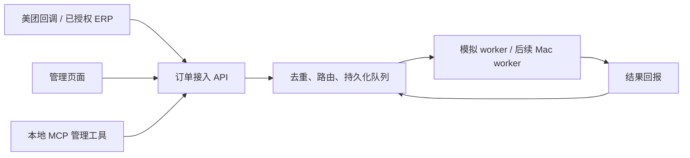

# 美团订单通知桥

首版提供订单接入、通知处理、持久化队列、管理页面、模拟发送端、MCP 和操作 Skill。

**本版不操作真实微信。** 模拟结果标记为 `simulated`；美团真实回调需要配置账号协议、权限与公网地址后联调。完整交付边界见 [SCOPE.md](SCOPE.md)。

## 先启动本地演示

需要 Python 3.11+；推荐使用 [uv](https://docs.astral.sh/uv/)。项目指定 Python 3.12。

```bash
cd /path/to/meituan-wechat-bridge
uv sync --extra mcp --extra dev
uv run order-bridge demo
```

打开 <http://127.0.0.1:8787>，点击「添加模拟订单」。页面自动刷新，可以查看通知预览、模拟处理结果和门店路由。点击一条任务的「模拟订单取消」，可查看后续取消通知。

`demo` 自带模拟 worker，无需美团凭证、微信登录或 OpenAI API Key。演示只能绑定本机回环地址；真实美团回调在演示环境中关闭。它与正式服务使用独立数据目录。

也可以逐步检查：

```bash
uv run order-bridge demo --no-worker
# 另一终端：提交模拟订单并运行一次模拟 worker
uv run order-bridge submit examples/order.confirmed.json
uv run order-bridge worker --sender mock --once
uv run order-bridge status
```

仅预览，不入队：

```bash
uv run order-bridge preview examples/order.confirmed.json
```

## 架构和自动触发



自动处理由**订单回调及运行中的 worker**驱动，无需逐单调用 AI。Skill 提供处理规则，MCP 提供 Agent 管理接口；它们不会自行启动服务或监听订单。

当前 MCP 使用 **stdio**，适合本地 Codex 等 MCP 客户端；不是可直接添加到 ChatGPT 网页的远程插件，也未实现 MCP Events。若之后需要让 ChatGPT 主动分析每笔订单，需要另外实现事件订阅桥；单纯订单转发不依赖这一步。

## 数据与配置

默认数据目录：

- macOS / Linux：`~/.local/state/meituan-wechat-bridge/`
- 设置 `XDG_STATE_HOME` 时：其下的 `meituan-wechat-bridge/`
- Windows：`%LOCALAPPDATA%\meituan-wechat-bridge\`
- 演示数据：上述目录下的 `demo/`
- 可用 `BRIDGE_DATA_DIR` 指定其他运行目录。

运行数据和密钥应放在研究 Vault 之外。数据库只保存规范化的订单通知字段，不保存原始回调、顾客姓名、电话或地址。**订单备注仍可能含有用户自行填写的信息**，请按你的运营需求设置访问权限及数据保留方式。

把 `examples/config.json` 复制到 Vault 外，例如 `~/.config/meituan-wechat-bridge/config.json`，修改真实门店编码和目标群名。配置文件不包含密钥。

```json
{
  "routes": {
    "your-store-code": {"group_name": "备餐工作群"}
  },
  "meituan_app_id": "your-app-id",
  "callback_base_url": "https://orders.example.com",
  "meituan_decode_passes": 2,
  "meituan_max_age_seconds": 86400,
  "lease_seconds": 180,
  "max_attempts": 5
}
```

配置中的 `routes` 在首次出现该门店时写入数据库；之后在管理页面或 API 中修改。重启不会覆盖已保存的路由。路由修改仅影响未来新订单；已有订单及其后续取消通知沿用首次入队时的目标群。

环境变量：

| 变量 | 用途 |
| --- | --- |
| `BRIDGE_CONFIG` | 无密钥 JSON 配置文件的绝对路径 |
| `BRIDGE_DATA_DIR` | 数据库目录，建议位于 Vault 外 |
| `BRIDGE_API_TOKEN` | 管理 API 和 worker 的 Bearer 令牌；`serve` 必填 |
| `MEITUAN_CONSUMER_SECRET` | 品牌商回调验签密钥 |
| `BRIDGE_URL` | CLI / MCP 访问的服务地址，默认 `http://127.0.0.1:8787` |

密钥通过系统密钥管理工具或进程环境注入；不要粘贴到聊天、配置样例或仓库文件中。`doctor` 只输出是否配置，不显示密钥。

```bash
# 先在当前进程环境配置令牌和所需密钥；以下命令没有密钥字面量
export BRIDGE_CONFIG="$HOME/.config/meituan-wechat-bridge/config.json"
uv run order-bridge doctor
uv run order-bridge serve
# 另一终端，继承相同 BRIDGE_API_TOKEN
uv run order-bridge worker --sender mock
```

正式模式的管理页面要求输入 `BRIDGE_API_TOKEN`，只在当前页面内存中保留。服务端和 worker 分开部署时，外部网络连接必须使用 HTTPS。公网 HTTPS、反向代理、平台回调地址注册需要在部署环境配置。

## 美团接入支持范围

### 已实现：品牌商 app_id / sig

配置以下回调地址：

| 场景 | 路径 |
| --- | --- |
| 商家已确认订单 | `/webhooks/meituan/confirmed` |
| 订单已取消 | `/webhooks/meituan/cancelled` |

支持 GET、POST form-urlencoded，query 与 form 合并，form 中同名字段优先。POST 默认执行两次解码，按全部参数验签，不把签名参数表写死。`meituan_decode_passes: 1` 可用于确实只编码一次的集成，应通过平台联调确认，不能靠关闭验签解决编码差异。

按官方规则计算小写 MD5：`请求URL + ? + 字母序参数串（排除 sig）+ consumer_secret`。公开 URL 使用配置中的 `callback_base_url` 加回调路径，不信任请求的 Host 或转发头来决定验签地址。

`callback_base_url` 必须与你在平台配置的公开服务根地址一致。如果反向代理去掉了 `/bridge` 前缀，公开根地址应包含这个前缀，应用内部仍使用上述路径。

已验签、解析并持久化后返回 `{"data":"ok"}`；空心跳不创建订单。微信或模拟发送耗时不阻塞平台回调。校验失败、字段错误、未知门店不会返回成功，也不会入队。防重放窗口默认 24 小时，未来时间容差 5 分钟；需根据所选回调的实际重试规则调整。

映射字段：`order_id`、`app_poi_code`、`wm_poi_name`、`day_seq`、`detail[].food_name/quantity/spec/food_property`、`caution`、`delivery_time`、`total`。金额按元转成整数分；平台返回的时间值原样保留，不猜测时区或承诺送达时间。通知金额不能代替结算对账数据。

### 待确认：服务商 developerId / sign

你暂时不确定账号协议。本版不把服务商协议套进品牌商 MD5 验签，遇到该格式明确拒绝。上线前请从控制台确认参数组，并提供该接口的文档或**脱敏样本**以完成正确适配；无需提供密钥。

如果已有 ERP 提供订单数据，可先使用带 Bearer 认证的统一入口 `POST /api/orders`。输入格式见 `examples/order.confirmed.json` 和 `examples/order.cancelled.json`。

平台一个门店的主接单应用绑定、非接单应用权限与订阅规则不同。本项目不调用接单、取消或绑定接口，不更改现有绑定；仅获取订单接口权限不代表已订阅所有回调。

## 队列与恢复

```text
pending → leased → sending → simulated / sent
                       ├── retry → leased （有限退避）
                       └── uncertain （人工核对）
```

- 去重键：`门店编码 + 订单号 + 事件状态`。相同回调重放不重复创建任务。
- 相同订单号出现在不同门店，分别处理。
- 取消早于确认到达时，后到的确认通知不会再发送；取消会停止未开始发送的确认任务。
- 未开始发送的领取租约到期后可重新领取；已开始发送的任务失联后转为 `uncertain`，不盲目重发。
- 只有明确未提交发送的失败才能报告 `retry`，超过次数上限转为 `dead`。
- `sent` 表示发送端报告提交成功，不能证明群成员已阅读。模拟 worker 不能报告 `sent`。
- 每笔订单有不确定结果时，该订单的后续通知暂停，直到结果被核对。
- 通过页面或 MCP 重试不确定任务时，需先检查目标端确实未收到；也可将其标为已提交或停止。

首版不提供跨平台“严格只发一次”的保证：将来 Mac UI 点击发送后进程可能立即中断，服务无法断定微信是否已接收，所以保留待核对状态。

## Mac 微信发送端接口

首版不安装微信控制工具，也不触发 macOS 辅助功能权限。后续 Mac worker 只需实现 [发送端协议](docs/worker-protocol.md)：领取任务、开始发送、提交结果。

原型 `order-bridge worker --sender mock` 已通过这个 HTTP 协议运行，可直接作为真实发送端的参考。Mac 端应串行操作微信、验证目标群并处理同名群，绝不能仅凭搜索结果第一项发送。

## MCP 与 Skill

```bash
uv sync --extra mcp
uv run order-bridge mcp
```

MCP 进程需要继承 `BRIDGE_URL` 和正式服务的 `BRIDGE_API_TOKEN`；后者不要写进 Vault 中的配置。stdio 配置结构见 `examples/mcp-config.json`，需要替换本机解释器路径。

Codex 本地配置示例（配置放在用户自己的 Codex 配置中，不改动本 Vault 配置）：

```toml
[mcp_servers.order-bridge]
command = "/absolute/path/to/meituan-wechat-bridge/.venv/bin/order-bridge"
args = ["mcp"]
env_vars = ["BRIDGE_API_TOKEN", "BRIDGE_URL"]
```

提供的工具：`bridge_status`、`notifications_list`、`notification_get`、`notification_preview`、`routes_list`、`route_set`、`notification_retry`、`notification_resolve`。后两者会修改队列；将来有真实 worker 时，重新入队可能触发发送。

Vault 内 Skill 位于 `../.agents/skills/meituan-wechat-bridge/SKILL.md`。可用 `$meituan-wechat-bridge` 请求检查状态、预览通知或处理失败任务。

## 容器运行

先在进程环境设置 `BRIDGE_API_TOKEN`。可用 `BRIDGE_CONFIG_FILE` 指向 Vault 外的无密钥配置文件。

```bash
docker compose up --build -d server
# 需要模拟消费时显式启动 mock profile
docker compose --profile mock up --build -d
```

默认只将服务映射到本机 `127.0.0.1:8787`。数据库位于命名卷，容器重建不会清空。模拟 worker 与 server 共享容器网络命名空间，通过回环地址连接；真实外网部署使用 HTTPS 入口。

## 开发验证

```bash
uv sync --extra mcp --extra dev
uv run pytest
uv run ruff check src tests scripts
uv run ruff format --check src tests scripts
# 启动隔离的真实 HTTP 服务，并通过 stdio 连接 MCP 完成自测
uv run --extra mcp python scripts/smoke.py
```

页面回归检查（先启动 `demo`，只会添加虚构订单）：

```bash
uv sync --extra ui
uv run playwright install chromium
uv run python scripts/check_ui.py
```

该检查验证连续添加订单、路由保存、消息预览、模拟取消和手机宽度下的页面，并把截图保存在 Vault 外的用户状态目录。

完整 HTTP 接口见服务启动后的 `/docs`；关键接口和使用方法见 [API.md](docs/API.md)。

## Sources

- [美团：签名规则](https://developer.waimai.meituan.com/home/guide/42)
- [美团：协议约定与推送成功判据](https://developer.waimai.meituan.com/home/guide/41)
- [美团：接单与非接单](https://developer.waimai.meituan.com/home/guide/46)
- [MCP Python SDK](https://github.com/modelcontextprotocol/python-sdk)
- [OpenAI：MCP Events](https://developers.openai.com/plugins/build/mcp-events)
