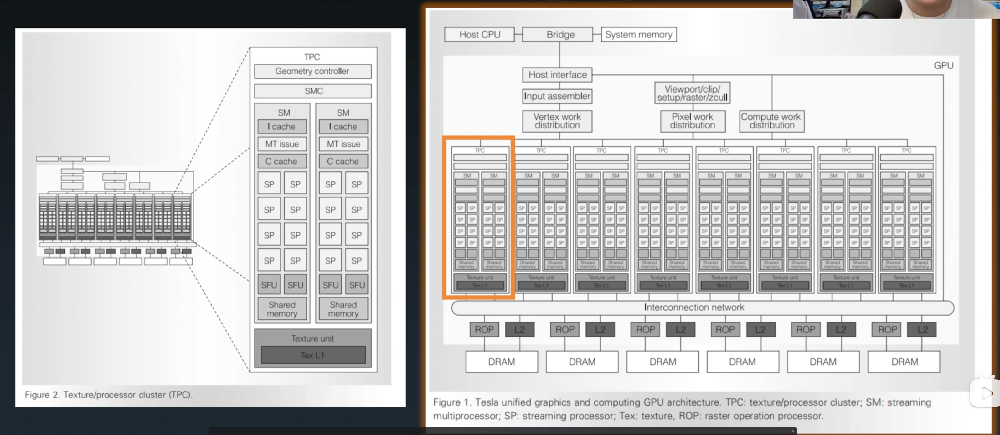
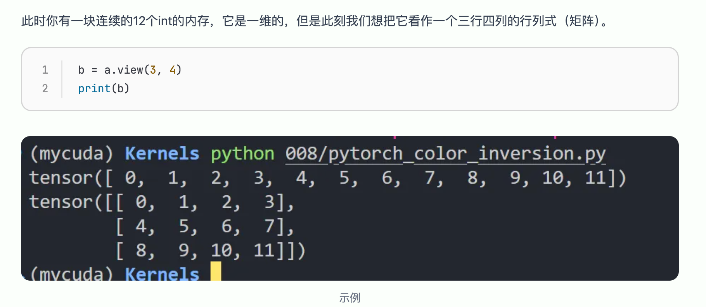

# Operators



## Element wise

局部变量，寄存器中进行计算，减少内存访问。

​

接口层：服务上层，屏蔽底层细节

分发层：一次发多少指令

网格优化层

内核实现层

​

尽量内存对齐

​

模版编程。

​

## Matrix addition

​

```
输入：
A = [[1.0, 2.0],
     [3.0, 4.0]]
B = [[5.0, 6.0],
     [7.0, 8.0]]

输出：
C = [[6.0, 8.0],
     [10.0, 12.0]]
```

triton

​

​

view只要数据在内存中不连续，例如经过转置、切片等操作，就会失败。需要使用contiguous来让数据重新连续化。

如果代码是你自己写的，知道内存是否连续，在乎性能，就用view；否则就用reshape。



### reduce 算法

共享内存和访存冲突

thread-warp，block

​

warp GPU 硬件决定的

​

​

​

# 未解问题

​

> 因为 warp 即使在等待内存、barrier 或计算依赖，通常仍然是 active/resident warp。Stall 会降低 warp 的 eligible rate 和 issue rate，但不一定降低 achieved occupancy。\
> 理论 occupancy 高而实际 occupancy 低，更可能由以下情况造成：\
> grid 太小，没有足够的 block 分配到全部 SM；\
> 最后一轮 wave 不完整；\
> block 执行时间不均衡，出现长尾；\
> 部分 block 或线程提前退出；\
> kernel 很短，稳定运行阶段占比很小；\
> 不同执行阶段需要的 active warp 数不同。

warp 分为几个状态？

***

​

​
