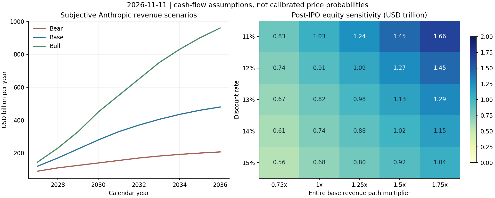

---
tags:
  - 理财
  - Anthropic
  - 估值
  - AI商业化
created: 2026-11-11
---

# Anthropic独立估值与AI付费市场

研究日期：**2026-11-11，北京时间**。A指Anthropic，O指OpenAI。承接 [[notes/理财/海外简报/2026-11-10-1631|11月10日简报]]；本轮聚焦公司价值，更新后的正式IPO文件取代上一轮“传阅定价撤回”的信息状态。未覆盖旧笔记，未访问账户或交易。

## 结论与估值口径

**我的基准估值约为8,200亿美元，主要判断区间为7,000亿—1万亿美元，统一为假设IPO及同步配售完成后的、计入现有稀释权益的整体股权价值。**这一区间来自对收入、资本回报和折现率的主观假设，不是统计置信区间，也不是机构共识。

同一基准模型的经营业务价值约6,200亿美元；加上发行前的简化金融资产调整，发行前股权价值约7,450亿美元。发行后约8,200亿美元包含新增资本，不能把融资到账机械地称为原股东投资收益。

**1.3万亿—1.4万亿美元可以由更强的持续增长或更低的资本成本支持，但我目前将其视为需要更多事实兑现的进取定价。**若模型能力与应用优势持续，2万亿美元以上也存在于乐观情景；若付费转弱而算力义务持续，价值可能远低于主要区间。没有给这三个情景附上未经校准的概率。

## 先核实收入和发行价

### Anthropic的1,000亿美元不是本轮已核实的当前收入年化值

11-10第二次修订招股书明确：截至10-31，Run-Rate Revenue约 **810亿美元**，较9月底增加100亿美元。公司定义为过去28天按量付费乘13，加测量时点月度订阅费乘12，**不是已经实现的全年收入，也不是全部由不可撤销合同锁定的SaaS ARR**。此前媒体所说年末达到或超过1,000亿美元属于预期。[SEC S-1/A No.2](https://www.sec.gov/Archives/edgar/data/2130357/000162828026072484/anthropicpbc-sx1ax2.htm)、[Reuters关于年末预期的历史报道](https://www.investing.com/news/stock-market-news/openais-annualized-revenue-20-billion-less-than-previously-signaled-ft-reports-4939854)

公司实际确认收入为2023年0.41亿美元、2024年3.86亿美元、2025年45.85亿美元、2026年前九个月332.42亿美元；Q3约169.6亿美元，环比约47%。这些数字与810亿美元短期年化口径不能混作同一条年度收入序列。[招股书，印刷页26及季度经营讨论](https://www.sec.gov/Archives/edgar/data/2130357/000162828026072484/anthropicpbc-sx1ax2.htm)

### 新的正式区间是70—78美元，估值必须计入稀释

11-10文件拟发行8.25亿股，其中公司新股约8.014亿股，其余为老股出售；同时配售260亿美元。指示区间 **70—78美元**，仍为待完成发行，不能当最终成交价。[SEC封面与发行条款](https://www.sec.gov/Archives/edgar/data/2130357/000162828026072484/anthropicpbc-sx1ax2.htm)

用中点74美元、文件的固定股本假设计算：

- 发行后基本股数约130.87亿股，对应约 **9,684亿美元**。
- 根据印刷页24将A/N类、库存股法期权、RSU及有关待转换权益等加总，有经济权益的稀释股数约180.13亿股，对应约 **1.333万亿美元**。
- 两种口径计算的是同一家公司。把基本市值约1万亿与完全稀释约1.4万亿并列后挑较便宜的数字，会误判投资价格。

完整表还涉及公益发行、捐赠匹配与待转换票据。这里计入文件已列的权益，**不把尚未授予的整个未来激励储备都当成已发行股份**。实际发行价格变化会改变配售股数和库存股法结果，不能把74美元股数机械套到所有未来价格。[原始股本表，印刷页24](https://www.sec.gov/Archives/edgar/data/2130357/000162828026072484/anthropicpbc-sx1ax2.htm)、[Reuters 11-10对两种估值口径的说明](https://uk.marketscreener.com/news/anthropic-eyes-1-4-trillion-ipo-valuation-in-test-of-wall-street-s-ai-fervor-ce785edadd8bf32d)

## 历年付费走向：增长真实，单价与口径也在变

### 行业支出扩张

| 测量时点／版本 | 企业生成式AI规模估计 | 阅读限制 |
| --- | ---: | --- |
| 2023，按2025报告回溯口径 | 17亿美元 | 排除部分推理支出 |
| 2024，同一回溯口径 | 115亿美元 | 同上 |
| 2025，2025报告 | 370亿美元 | 报告定义下的市场估计，非企业财务普查 |
| 2025，2026报告重分类后的部署口径 | 330亿美元 | 数据标注等由部署移到开发，不能与370亿无说明混用 |
| 截至2026年9月，2026报告部署口径 | **1,768亿美元** | 年化收入规模估计，不能写为全年已经花掉的金额 |

来源：[Menlo 2025报告及方法](https://menlovc.com/perspective/2025-the-state-of-generative-AI-in-the-enterprise/)、[Menlo 2026报告及方法](https://menlovc.com/perspective/2026-the-state-of-enterprise-ai/)。2026报告由近400名美国企业决策者调查、公开披露及市场模型构成，Menlo也是Anthropic投资方。应使用其趋势和可审查的方法，不将它当无利益关系的全球完整账本。

历史方向是从少量席位、试验预算，转向编码、企业助手及长任务代理的持续使用。收入越来越依赖每家公司执行的工作量，而非只靠新增付费人数。这支持市场继续扩大，但并不保证模型供应商拿走全部新增价值。

### 不支持“A强就必然O弱”的简单零和假设

Menlo的企业API付费份额估计中，2025到2026年，**A由40%升至55%，O也由27%升至31%**，Google由21%降至9%。这是同一个样本口径下两者同时获得份额的反例；企业API份额也不等于两家全部业务或消费者份额。[Menlo 2026](https://menlovc.com/perspective/2026-the-state-of-enterprise-ai/)

令市场总付费为M、A份额为s，A收入为R：

\[
R_A=M\,s_A,\qquad
1+g_{R_A}=(1+g_M)\frac{s_{A,t+1}}{s_{A,t}}
\]

例如市场增长50%，A份额从60%降至50%，A收入仍增长25%。因此模型能力或份额的相对胜负，不等同于收入绝对下降；公司估值还会共同受折现率、融资和行业利润预期影响。本轮没有可用的可比每日公开股价序列来证明A和O存在稳定负相关关系。

### 付费增速有反证，护城河也需检验

Ramp交易样本中，8—9月token支出近乎停滞，尽管token量仍增加；其10月发布的另一项研究显示，9月月度切换模型供应商的企业占比、三个月平均值达到8%。这支持降价、优化路由和客户切换可以削弱收入黏性。[Ramp付费研究](https://ramp.com/data/ai-index-oct-2026)、[Ramp模型切换研究](https://ramp.com/data/businesses-are-changing-ai-model-providers-more-often)

Ramp样本不是全市场，且10月初支出已有回升。它与A全球收入年化上升并不必然冲突，不能据此直接宣布行业增长结束；反过来，A的一个强劲月份也不能抹去客户切换与降价的风险。

## A和O合计能说明什么

软银11月最新投资者材料第40页列示OpenAI的收入年化：2023年底20亿美元、2024年底60亿美元、2025年底200亿美元、2026年9月约500亿美元。Reuters此前也报道9月近500亿美元，并说明先前近700亿美元口径存在比较调整。[软银原始材料，第40页](https://group.softbank/media/Project/sbg/sbg/pdf/ir/presentations/2026/earnings-presentation_q2fy2026_01_en.pdf)、[Reuters核对](https://www.investing.com/news/stock-market-news/openais-annualized-revenue-20-billion-less-than-previously-signaled-ft-reports-4939854)

A的10月810亿加O的9月约500亿，得到 **约1,310亿美元的粗略年化规模**。日期不完全相同、收入确认及云渠道口径存在差异，不能把该和当作精确的全行业付费市场或可比份额。Anthropic按总额确认部分云渠道销售是其会计政策；估值需要在成本中考虑渠道分成，不能直接认定这部分收入虚假，也不能忽略两家的可比性问题。

这项合计有助于量级核查和追踪增长，**只展示当前已触达的规模，不证明市场上限**。上限取决于新增付费工作流、客户支付意愿、提价／降价、开放模型、自建模型和应用层分配。芯片销售、云收入、应用收费与上游API销售存在上下游关系，不可直接相加当最终客户预算。

为了估值，另设可归属于模型实验室及其自营应用的2030年收入池，包含企业与消费者，排除芯片及不能归属于它们的其他应用收费：

| 主观2030情景 | 实验室及自营应用收入池 | A在该收入池中的份额 | A收入 |
| --- | ---: | ---: | ---: |
| 偏弱 | 5,000亿美元 | 28% | 1,400亿美元 |
| 基准 | 8,000亿美元 | 35% | 2,800亿美元 |
| 强势 | 1.2万亿美元 | 37.5% | 4,500亿美元 |

**这是有明确边界的假设，不是Menlo预测，也不是算出了行业的确定上限。**这些份额不能直接套用企业API的55%。当前可比较全球收入池并未被精确测量；选择区间只是让未来增长要求可以审核。基准2030年A收入已是当前810亿美元年化的约3.46倍，约四年增长所需复合率约36%，并非“低增长”情景。

## Meta比较：护城河重要，但收入和现金回报要分开

用户所说Meta“2”的合理收入量级解释是年收入约2,000亿美元，而非年利润或ARR合同额。最新财报显示Q3营收646.01亿美元，前三季1,817.12亿美元，Q4指引730亿—760亿美元，据此推得2026年收入 **约2,547亿—2,577亿美元**；后者仍含未来季度指引，不是全年实际值。[Meta Q3原始财报](https://investor.atmeta.com/investor-news/press-release-details/2026/Meta-Reports-Third-Quarter-2026-Results/default.aspx)

Meta的社交网络、用户关系、广告主系统与分发入口，可以让其在某一代模型不领先时仍依靠存量业务变现。A的优势更多来自研究、模型效果、企业信任、应用及工作流嵌入，需持续投入才能保住；多模型部署及路由工具也会降低部分迁移成本。因此我认为 **A有正在形成的竞争优势，但持续性与定价权尚未达到Meta式社交网络的可见程度**，不能用“完全没有护城河”概括。

护城河也不能取代资本回报检查：Meta Q3经营现金流327.9亿美元，但资本支出及融资租赁本金支出349.1亿美元，当季自由现金流为 **−21.2亿美元**。A在2026年前九个月经营现金流约65.69亿美元、GAAP经营亏损12.6亿美元；其巨额净亏损含融资工具重估，不能照搬为等额现金消耗。两家公司都需要检查AI投入后的持续现金流，而非“收入达到Meta几成，就应该有Meta几成市值”。[Meta财报](https://investor.atmeta.com/investor-news/press-release-details/2026/Meta-Reports-Third-Quarter-2026-Results/default.aspx)、[A招股书经营与现金流，印刷页26、176](https://www.sec.gov/Archives/edgar/data/2130357/000162828026072484/anthropicpbc-sx1ax2.htm)

## DCF：我的估值如何得到

以美元十亿为计算单位，预测2027—2036年，使用年期近似：2027年现金流为t=1，2036年为t=10。精确至数周的折现误差远小于收入、成本与现金桥接的不确定性，未据此伪造更精确的估值。

\[
EV=\sum_{t=1}^{10}\frac{R_t m_t}{(1+r)^t}
+\frac{R_{10}m_{10}(1+g)}{(r-g)(1+r)^{10}}
\]

\[
V_{\rm equity}\approx EV+\text{简化金融资产净调整}
\]

m是税后、无杠杆、扣除推理、持续训练研发、正常人才成本、渠道、资本支出／租赁与营运资金后的经济自由现金流率，**不是毛利率或调整后经营利润率**。现有已授予权益计入稀释股本；未来持续授予／替代现金薪酬的经济成本包含在利润率假设中，不再另加一个随意的稀释罚项。

| 情景 | 2027收入 | 2030收入 | 2036收入 | 2036自由现金流率 | 折现率／永续增长 | 经营价值EV | 发行后股权价值约 |
| --- | ---: | ---: | ---: | ---: | --- | ---: | ---: |
| 偏弱 | 900亿 | 1,400亿 | 2,070亿 | 12% | 15%／2.5% | 592亿 | **2,592亿美元** |
| 基准 | 1,200亿 | 2,800亿 | 4,800亿 | 25% | 13%／3% | 6,200亿 | **8,200亿美元** |
| 强势 | 1,450亿 | 4,500亿 | 9,600亿 | 30% | 11%／3.5% | 2.102万亿 | **2.302万亿美元** |

基准自由现金流率逐年为−5%、2%、8%、14%、18%、21%、23%、24%、25%、25%；收入分别为1,200、1,700、2,250、2,800、3,300、3,700、4,050、4,350、4,600、4,800亿美元。完整逐年路径和其他情景见模型配置。

基准不仅假设规模扩大，还假设增长期现金投入最终产生25%的可持续自由现金流率；这本身已经给了竞争优势相当价值。11-10公布的CPI总体环比0.4%、核心0.3%，也没有提供可以忽略利率风险的理由。13%折现率是本轮主观要求收益率，并非从一条CPI机械计算出的WACC。[BLS已公布数据](https://www.bls.gov/news.release/archives/cpi_11102026.htm)

### 现金与计算义务的处理

发行前披露的现金及短期投资约1,318.45亿美元，74美元发行及配售完成、相关预扣税支出后的备考值约2,126.84亿美元。本模型分别采用 **1,250亿、2,000亿美元** 的简化净调整，保留对其他债权、经营现金需求、交易后变化和口径误差的余量；不是逐项审计后的精确净债务桥接。净调整上下变化200亿美元时，股权价值同额变化。[备考资产负债表，印刷页27](https://www.sec.gov/Archives/edgar/data/2130357/000162828026072484/anthropicpbc-sx1ax2.htm)

待转换票据已按权益进入相应稀释假设，不能再将其账面重估负债全额扣一次。其他融资债权仍需精确交易文件核对，本轮桥接的近似限制必须保留。

新文件的采购和租赁等承诺约9,009亿美元，其中约4,516亿美元预计在2030年底前发生。它们是未来现金回报的重要约束；模型成本路径必须吸收相关支出，不能将其视为免费产能。也**不能在已经扣除相关现金成本的DCF之后，再把9,009亿美元未折现面额全额当作当日债务扣掉**。如果存在闲置赔付、收入不足或额外融资，需另做更差情景，当前偏弱情景不是损失底线。[招股书，印刷页143及风险因素](https://www.sec.gov/Archives/edgar/data/2130357/000162828026072484/anthropicpbc-sx1ax2.htm)

### 为什么主要判断在7,000亿—1万亿美元

保持基准收入与现金流率，折现率12%／13%／14%时，发行后估值约9,147亿／8,200亿／7,436亿美元。再考虑现金桥接和小幅收入路径误差，7,000亿—1万亿美元是本轮更便于决策的粗略区间，不是把偏弱与强势结果硬截断成概率区间。

基准经营价值约59%来自2036年后的终值，偏弱和强势分别约85%、67%。因此对长远利润率和折现率的分歧会显著改变结果，不能给出“实际必然就值8,200亿”的精度承诺。模型未增加单独的AGI／机器人期权溢价，也未用当下IPO价格校准基准参数。

[PDF图](assets/Anthropic估值-2026-11-11/valuation.pdf)。右图保持基准利润率与现金调整，横轴将整条收入路径按比例缩放，纵轴改变折现率，均为主观敏感性。

## 反向检查1.33万亿美元需要什么

按74美元稀释估值约1.333万亿美元，约为810亿美元收入年化的16.5倍。扣除本模型2,000亿美元金融资产调整后，经营价值要求约1.133万亿美元。

若保留13%折现率、3%永续增长和基准现金流率，只按比例提高整条收入路径，需要提高约 **83%**：对应2030年A收入约 **5,116亿美元**；若A占实验室及自营应用市场35%，该2030收入池需约 **1.46万亿美元**。这是“其他参数固定”的反推，**不是1.33万亿估值唯一可能的实现路径**；更高现金流率、更早现金回报或更低资本成本也能支持。

如果用户说的1,000亿美元年化后来正式兑现，并且有证据支持将整条收入路径由810亿基准同比例上移、利润率不受损，基准发行后股权价值会从约8,200亿升至 **约9,655亿美元**。这说明强劲收入应提高估值，但仅跨过1,000亿门槛，并不足以自动证明1.3万亿—1.4万亿便宜。也不能只凭一个季节性旺月，就把十年全部收入同步上修。

## 怎样修订判断

- **上调：**收入年化持续跨过1,000亿美元并转为多个季度实际收入；大客户之外的付费扩散；渠道及人才成本后现金流率改善；客户在模型能力优势暂时缩小时仍继续续费及扩张。
- **下调：**token用量上升但付费停滞延续；增量收入靠显著降价；多模型切换带来流失；长期算力义务先发生而利用率不足；新增融资或公益／激励发行进一步摊薄普通股。
- 900%的净收入留存反映早期扩张，不能当未来每年9倍增长；供应商的同步投资增强融资能力，但不等于独立证明全部发行估值合理。

当前更适合把A作为需要验证现金回报的成长企业定价：强劲业务允许较高价值，现有证据仍不足以忽略发行估值与合理回报之间的距离。

## Sources

实际读取的Vault相对路径：

- `AGENTS.md`
- `notes/理财/海外简报/2026-11-10-1631.md`（检索相关段落，衔接上一轮信息状态）。
- `notes/理财/assets/Anthropic估值-2026-11-11/`：冻结招股书、软银材料、Ramp原文、提取文本、来源清单、股本页面核对图、模型参数与计算结果。

主要外部来源：

1. [SEC 11-10 S-1/A No.2](https://www.sec.gov/Archives/edgar/data/2130357/000162828026072484/anthropicpbc-sx1ax2.htm)：读取定义、收入、发行、稀释、现金流、成本、资本及风险。另从[E*TRADE承销材料入口](https://cdn2.etrade.net/1/20261009.0/aempros/content/dam/etrade/new-issues-center/en_US/document/pdf/initial/2026/November/ant-ipo-ered.pdf)保存430页同版PDF，核对印刷页24股本表。SEC submissions JSON核对最新公开申报日期为11-10。
2. [发行人IPO factsheet](https://ipo.anthropic.com/documents/us/factsheet.pdf)：交叉核对季度增长和成本效率；该材料为发行人营销披露，非独立估值意见。
3. [Reuters 11-10发行报道](https://uk.marketscreener.com/news/anthropic-eyes-1-4-trillion-ipo-valuation-in-test-of-wall-street-s-ai-fervor-ce785edadd8bf32d)：读取正文，区分基本市值与稀释估值、发行区间与最终定价。
4. [Menlo 2025](https://menlovc.com/perspective/2025-the-state-of-generative-AI-in-the-enterprise/)、[Menlo 2026](https://menlovc.com/perspective/2026-the-state-of-enterprise-ai/)：读取研究、方法、历史重分类及利益关系，未将不同版本拼成严格可比年序列。
5. [Ramp 10月研究](https://ramp.com/data/ai-index-oct-2026)、[10-06模型切换研究](https://ramp.com/data/businesses-are-changing-ai-model-providers-more-often)：读取交易样本及范围，未外推为全部全球企业。
6. [软银2026财年Q2材料](https://group.softbank/media/Project/sbg/sbg/pdf/ir/presentations/2026/earnings-presentation_q2fy2026_01_en.pdf)：本轮下载、提取并目视核对第40页OpenAI年化收入图。软银有投资利益；另与[Reuters 10月口径核对](https://www.investing.com/news/stock-market-news/openais-annualized-revenue-20-billion-less-than-previously-signaled-ft-reports-4939854)交叉验证。
7. [Meta Q3财报](https://investor.atmeta.com/investor-news/press-release-details/2026/Meta-Reports-Third-Quarter-2026-Results/default.aspx)：读取营收、指引、现金流及资本支出。
8. [BLS 11-10 CPI](https://www.bls.gov/news.release/archives/cpi_11102026.htm)：本次已经公布的环比数据，取代上一轮发布前预期。

估值场景、市场规模假设、合理区间及反向计算均为本轮研究；未将新闻、发行人目标或投资者看法冒称经过验证的内在价值。
