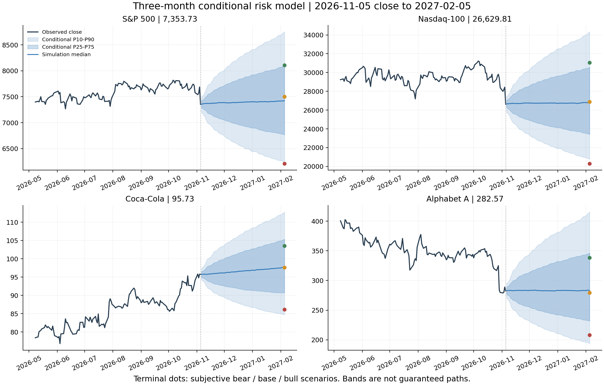

---
aliases:
  - 美股三个月走势模型
tags:
  - 理财
  - 美股
  - 量化研究
  - 预测
created: 2026-11-06
---

# 标普、纳指、可口可乐、谷歌：三个月走势模型

研究日期：**2026-11-06，北京时间上午，非农发布前**。行情统一截止 **美国 11-05 常规交易收盘**，即北京时间 11-06 05:00；没有使用 11-06 美国尚未发生的收盘或就业结果。预测终点为 **2027-02-05 收盘**，按当前交易日历约 **62 个交易日**。全部涨跌和价格均为美元名义、**不含分红的价格回报**，个人税费和人民币汇率另算。

标普指 **S&P 500**；主预测中的纳指为 **Nasdaq-100**，对应此前关注的 QQQM；同时列 Nasdaq Composite（纳斯达克综合指数）供新闻口径核对。谷歌使用 **Alphabet A，GOOGL**，可口可乐使用 **KO**，不与独立上市的装瓶公司 COKE 混淆。

## 当前判断

**标普：宽幅震荡、略有修复倾向；可口可乐：相对防御、温和偏强，但近期上涨已多；谷歌：修复受自由现金流和资本开支制约，基准偏弱；纳指100：反弹空间与再跌风险都大，趋势尚未修复。**

这组判断结合财报和政策事件，不是已验证的高胜率交易信号。价格模型的更可靠用途是衡量风险范围，不能因为一个基准点就集中下注。

| 标的 | 当前价格／点位 | 偏悲观情景 | 基准情景 | 偏乐观情景 |
| --- | ---: | ---: | ---: | ---: |
| 标普500 | 7,353.73 | 约 **6,210，−15.5%** | 约 **7,500，+2.0%** | 约 **8,110，+10.2%** |
| 可口可乐 KO | $95.73 | 约 **$86，−10.0%** | 约 **$98，+2.0%** | 约 **$104，+8.2%** |
| 谷歌 GOOGL | $282.57 | 约 **$208，−26.4%** | 约 **$279，−1.1%** | 约 **$339，+19.8%** |
| 纳指100 | 26,629.81 | 约 **20,310，−23.7%** | 约 **26,880，+0.9%** | 约 **31,050，+16.6%** |

**这是本轮自行设置、明确列出盈利和估值假设的三个月情景，不是机构目标价，也不是模型算出的三种发生概率。**行情本身已反映部分公开利空，不能再机械把每条新闻的影响叠加减一次。

## 最新行情：11月4日上涨之后，11月5日显著逆转

同一行情供应商日线计算，最近一个月统一为 **21 个交易日**：

| 标的 | 11-05 收盘 | 当日涨跌 | 近21日涨跌 | 距近252日收盘高点 |
| --- | ---: | ---: | ---: | ---: |
| 标普500 | 7,353.73 | **−4.36%** | −5.74% | −5.95% |
| 纳指100 | 26,629.81 | **−6.36%** | −14.54% | −14.71% |
| 纳斯达克综合 | 24,315.00 | **−5.52%** | −11.71% | −11.90% |
| KO | $95.73 | **−0.07%** | **+11.55%** | −0.10% |
| GOOGL | $282.57 | **−2.20%** | **−19.38%** | **−29.82%** |

VIX 同日约 **28.18**，10 年期美国国债收益率代理 ^TNX 收盘约 **4.837%**，均来自同批冻结日线。VIX 衡量标普未来约30天的期权隐含波动，不给涨跌方向，也不是未来三个月实现波动的保证值。

Reuters 的 11-05 收盘报道将卖压与芯片公司业绩、AI 支出回报担忧，以及选举后对数据中心监管的重估联系起来；媒体归因不能证明选举单独造成全部跌幅。本次完整报道网页抓取受限，使用有日期的检索摘要，与日线涨跌交叉核对。[Reuters 跨资产报道](https://live.euronext.com/en/financial-news/deep-chip-selloff-drags-global-stocks-lower-ai-spending-concerns)、[Reuters 科技股分析](https://www.marketscreener.com/news/tech-stock-rout-accelerates-retreat-from-the-ai-trade-ce785fddd988fe25)。

行情源为 Yahoo chart API，精确参数和原始文件哈希见模型目录的 `manifest.json`。GOOGL 在少数网站出现小幅报价差异，本报告统一采用 $282.57，不混合盘后或不同供应商价格。单日表现不替代长期风险分析。

## 模型一：过去价格决定条件风险范围

### 数据与公式

下载自2000年起的公开日线，GOOGL 自其2004年上市开始。联合分析采用共同有效交易日；没有补齐股票缺失价格。使用供应商已按拆股调整的普通收盘价，不使用含分红复权价预测股价。

日对数收益 \(r_{i,t}=\ln(P_{i,t}/P_{i,t-1})\)。先估计过去252日的市场敏感度：

\[
r_{i,t}=\alpha_i+\beta_i r_{m,t}+\epsilon_{i,t}
\]

本模型不外推历史 \(\alpha\)；只用 \(\beta\) 和残差估计风险。每个资产的近期波动底值取过去21／63／252日样本波动的最大值，残差波动也取这三个窗口的最大值。

\[
\sigma_m=\max\left(\sigma_{m,\mathrm{real}},\frac{\mathrm{VIX}}{100\sqrt{252}}\right)
\]

\[
\sigma_i=\max\left(\sigma_{i,\mathrm{real}},\sqrt{\beta_i^2\sigma_m^2+\sigma_{\epsilon_i}^2}\right)
\]

**把30天 VIX 延用为未来62日的市场风险底值，是保守的状态假设，不是取得了三个月期权隐含波动。**当前风险水平在模拟中保持不变，没有模拟波动均值回复、期权偏斜或后续新闻跳跃。

对方向只使用很弱的历史趋势：

\[
\widehat\mu_i=0.25\,\overline r_{i,252},\qquad
\ln(P_{i,T}/P_{i,0})=H\widehat\mu_i+\sigma_i\sum_{h=1}^{H}z_{i,h},\quad H=62
\]

趋势系数0.25在检验前固定，不搜索最优参数。\(z\) 来自过去最多1260日、去均值并按样本标准差归一化的收益，按**5日循环区块**配对重采样，保留区块内的共同变化；20,000条路径，固定随机种子20261106。不声称这种重采样可以复制新的监管或财报事件。

### 当前条件模拟结果

| 标的 | 模拟采用的年化波动 | 模拟中位数 | P10—P90 期末风险带 |
| --- | ---: | ---: | ---: |
| 标普500 | 28.2% | 约7,425 | **6,224—8,752** |
| KO | 22.8% | 约$97.64 | **$84.72—$112.81** |
| GOOGL | 61.5% | 约$283.06 | **$193.55—$415.72** |
| 纳指100 | 41.9% | 约26,787 | **20,793—34,329** |

P10—P90 只代表条件模拟样本中间80%，**不能直接解释为真实未来有80%概率落在里面**，也不是整个三个月不会越过的上下界。逐日图中的带状区域是各日边际分位数，不是一条最可能的涨跌路径。模拟上涨频率约为标普53%、KO57%、GOOGL50%、纳指51%，这里只作为模型内部结果，不当成经过校准的买入胜率。

谷歌区间很宽，因为近期财报跳跌、市场波动和历史残差共同抬高风险估计。这种宽度是在承认不确定性，不表示已能精准判断其回到400美元。

### 历史验证：不要把趋势模型包装成择时优势

回看 **2006-08-21 起至2026-11-05**，共82段**目标窗口互不重叠**、每段62日的历史预测；每个预测点只用当时及此前的价格、VIX和参数。最少504日训练历史，逐步扩展；采样池最多1260日。最新一段实际结果截止本次收盘，不使用未结束窗口。

| 标的 | 趋势点预测平均绝对误差 | “价格不变”平均绝对误差 | 方向命中率 | “始终预测上涨”命中率 | 名义80%风险带实际覆盖率 |
| --- | ---: | ---: | ---: | ---: | ---: |
| 标普500 | 5.26个百分点 | 5.53个百分点 | 68.3% | **73.2%** | 90.2% |
| KO | 5.28个百分点 | **5.25个百分点** | 45.1% | **61.0%** | 93.9% |
| GOOGL | 11.91个百分点 | **11.61个百分点** | 47.6% | **61.0%** | 84.1% |
| 纳指100 | 7.20个百分点 | 7.51个百分点 | 67.1% | **76.8%** | 95.1% |

平均绝对误差按每段实际简单价格回报减去点预测后取绝对值，再对窗口平均；不是交易收益。趋势对指数点误差有小幅改善，对两只个股没有改善，所有方向命中率都低于上涨基准。**因此本轮没有证据证明模型拥有可交易的三个月方向优势。**风险带实际覆盖高于名义水平，尤其指数偏宽；不将其描述为精准概率模型。

这仍是事后进行的时间序列检验，不是当年真实部署记录，资产选择和供应商历史修订的局限仍在；82段目标不重叠，但训练窗口共享、经济周期相关，不能视为82次完全独立试验。新闻情景没有做历史验证。

另检查1日／10日区块、去掉 VIX 风险底值和将波动乘1.5等敏感性。主结果在区块长度变化下没有改变高不确定性结论；去掉 VIX 后标普带明显收窄，说明当前区间依赖波动假设。压力波动乘1.5时，P10损失可达到标普约22%、纳指约31%、谷歌约44%，并不构成最深损失边界。

## 模型二：消息面通过盈利预期和估值传导

用下面的恒等分解组织三个月情景：

\[
\frac{P_T}{P_0}=(1+\Delta E_{\rm forward})(1+\Delta M)
\]

\(E_{\rm forward}\) 是市场对未来盈利能力的预期，\(M\) 是给予这种盈利的估值倍数。对谷歌使用持续经营盈利的概念，避免投资账面重估污染。**这里没有估计四个资产当前的精确合理PE或DCF价值；下表百分比是本轮主观敏感性假设，不能与公司报告的季度同比增速混用。**

| 标的 | 偏悲观：未来盈利预期／估值变化 | 基准 | 偏乐观 |
| --- | --- | --- | --- |
| 标普500 | −4%／−12% | +2%／0% | +4%／+6% |
| KO | 0%／−10% | +2%／0% | +3%／+5% |
| GOOGL | −8%／−20% | +3%／−4% | +7%／+12% |
| 纳指100 | −7%／−18% | +3%／−2% | +6%／+10% |

这给出开头的价格表。没有给三种情景人为添加看似精确的概率，也没有将统计模拟与新闻价格简单平均成所谓精确目标价。

### 标普500：需要确认此次下跌是否主要是估值冲击

上行条件是就业和消费维持增长、通胀逐步缓和、信用和融资没有出现更深压力；大型企业盈利能消化部分高利率影响。下行条件是AI企业盈利预期一起下修，或者能源和工资通胀迫使政策继续收紧。

10-28 的美联储声明维持政策区间 **3.75%—4.00%**，强调通胀仍高，且两名反对票主张加息。不能把本次抛售自动等同于“马上降息托底”。[Fed 正式声明](https://www.federalreserve.gov/newsevents/pressreleases/monetary20261028a.htm)

技术状态上，标普当前仅比200日均线约7,323高 **0.4%**，低于50日均线约7,687。若后续重新站稳7,690附近，说明短期修复更有依据；若持续跌破200日均线且盈利修订／信用同步恶化，应向悲观情景移动。均线是观察规则，不是已验证的支撑或买卖信号。

### 可口可乐：经营增长支持防御，但近期涨幅已反映部分偏好

10-27 官方结果：单位箱销量增长5%、有机收入增长7%、可比EPS增长11%；全年可比EPS增长指引提高至至少11%。这支持其经营稳定性。[KO 正式财报](https://investors.coca-colacompany.com/news-events/press-releases/detail/1176/coca-cola-reports-third-quarter-2026-results-and-raises-full-year-guidance)

但 KO 近21日已上涨约11.5%，高于200日均线约15.9%。科技股下跌时的避险偏好，可能已经提高其价格；如果市场恢复追逐风险，防御资金流也可能反转。**相对抗跌不等于当前价格便宜，也不等于能够替代人民币存款。**本次没有足够数据证明95.73美元具有明确估值安全边际。

### 谷歌：增长与现金消耗并存，复苏需要更多证据

10-28 的 Q3 原始财报显示总收入同比增长25%、Cloud收入增长103%；同时当季经营现金流约 **422.90亿美元**，资本开支约 **513.55亿美元**，自由现金流约 **−90.65亿美元**，连续第二季为负。投资估值变动还影响了净利润，所以不能只用GAAP EPS判断主营业务变差或变好。[Alphabet Q3 原始PDF，第1、2、8页](https://s206.q4cdn.com/479360582/files/doc_news/2026/Oct/28/attachments/2026q3-alphabet-earnings-release.pdf)

GOOGL 比近252日收盘高点低约29.8%，并不能单独证明便宜。基准情景允许经营预期改善，但仍用估值折价反映现金回报不明。上调条件是资本投入转成可持续收入和现金流、2027支出沟通更清晰；下调条件是投入继续上调而经营现金流跟不上、搜索商业化或监管压力恶化。

价格低于50日均线约334和200日均线约340，说明趋势仍弱。从约283回到334—340已需很大涨幅，不能轻易把一次反弹当作趋势恢复。相反，基本面若改善，当前较高波动也意味着更大的向上弹性。

### 纳指100：反弹弹性高，对共同风险也更敏感

本次估计的年化波动约42%，高于标普约28%；其过去252日对标普的 beta 约1.45，这些均是样本和模型状态，不是永久属性。持有标普再加纳指100仍会重复承担同一批大公司的盈利、AI融资和估值风险。

纳指低于200日均线约27,977、50日均线约29,686。先观察28,000附近能否重新站稳，再看更长期修复。乐观情景依赖AI现金回报和金融条件共同改善；悲观情景是两者同时恶化。近期急跌后可能出现反弹，但本模型不能可靠预测哪一天触底。

## 未来三个月必须更新的消息节点

| 时间（美国事件日期；括号内为北京时间） | 事件 | 应怎样改变判断 |
| --- | --- | --- |
| **11-06 08:30 ET（今晚21:30）** | 10月就业报告 | 尚未发布。就业过强且工资热可能强化收紧预期；就业过弱也可能压盈利，不能把所有坏数据当利好。 |
| **11-10 08:30 ET（21:30）** | 10月CPI | 看核心和连续趋势。实际数据与市场预期的差异，比数字单独高低更有解释力；本轮未锁定一致的最新市场共识。 |
| 11月以后，日期待最终文件确认 | Anthropic IPO／OpenAI融资与上市披露 | 本轮检索可核对到的11-02 S-1/A仍未给价格区间；不把媒体计划当保证。正式定价、顺延和融资条件可能影响AI估值。 |
| 12-08—09 | FOMC，附预测 | 观察政策区间、通胀判断和金融条件，避免只看“加／不加”。 |
| 12-11 | 当前临时拨款到期 | 若此前通过新法，须更新。财政谈判可能影响风险偏好与收益率；不等于确定停摆。 |
| 12-04、2027-01-08、02-05 | 就业报告 | 检查增长、工资与修订，02-05也落在目标期末。 |
| 12-10、2027-01-13 | CPI | 检查通胀是否让政策路径改变。 |
| 2027-01-26—27 | FOMC | 目标期内第二次议息；官方日历仍有确认和调整机制。 |
| 2027年1—2月财报期 | Q4业绩和2027指引 | 逐项核实实际公告日期；本次没有确认KO、GOOGL下次财报是否都在02-05之前。 |

[BLS就业日历](https://www.bls.gov/schedule/news_release/empsit.htm)、[BLS CPI日历](https://www.bls.gov/schedule/news_release/cpi.htm)、[Fed日历](https://www.federalreserve.gov/monetarypolicy/fomccalendars.htm)、[当前拨款法律文本](https://www.govinfo.gov/content/pkg/PLAW-119publ103/html/PLAW-119publ103.htm)。

## 对现有资金安排的意义

你已明确国内人民币只存款、有稳定收入、每月净新增约2万—3万元。新闻和这次模型没有给出推翻人民币储备＋海外股票框架的充分证据。当前更值得控制的是重复科技暴露、个股集中和一次投入的金额，而不是押一个精确的三个月点位。

在股票预算内部，标普仍适合作为核心候选；KO可以继续研究防御性，但不能为追求抗跌而忽略近期涨幅；GOOGL和纳指的预算应能承受更大的短期波动。未确认实际持仓和资金用途，故本次不生成具体下单数量或个人交易订单。

人民币回报还要乘以同期USD/CNY变化。即使达到美元价格情景，人民币收益也可能更低；本报告没有预测未来三个月汇率，因此不能把美元目标直接当人民币支出预算。

## 图与复现

黑线是历史收盘，蓝带是条件模拟各日分位数；终点红／橙／绿点分别是主观偏悲观／基准／偏乐观情景。中位数很平，反映统计模型方向信息弱；带宽反映波动假设。[PDF图](../assets/三个月走势模型-2026-11-06/forecast.pdf)

模型、冻结数据、回测和完整结果位于 `notes/理财/assets/三个月走势模型-2026-11-06/`，运行方式见 `README.md`。保留原始下载哈希；做了价格正值、重复日期、极端变化、分位数与价格回报换算、现金流减法和交易日数量检查。实现正确不代表方向判断正确。

## Sources

本轮实际读取的 Vault 相对路径：

- `AGENTS.md`
- `notes/理财/海外财经跟踪规则.md`
- 本轮新建的 `notes/理财/assets/三个月走势模型-2026-11-06/` 数据、代码和结果。

主要外部资料及核验范围：

1. [Yahoo chart API示例](https://query1.finance.yahoo.com/v8/finance/chart/KO?period1=946684800&period2=1793923200&interval=1d&events=div%2Csplits)：股票、指数、VIX及收益率代理的同批日线；清单记录全部参数和哈希。它是行情供应商，数据可修订，非交易所保证成交价。
2. [KO 10-27财报](https://investors.coca-colacompany.com/news-events/press-releases/detail/1176/coca-cola-reports-third-quarter-2026-results-and-raises-full-year-guidance)：原文读取增长、指引与风险；不与装瓶公司披露混用。
3. [Alphabet 10-28财报发布页](https://abc.xyz/investor/news/news-details/2026/Alphabet-Announces-Third-Quarter-2026-Results-2026-FCcqxfIfmh/default.aspx)及其[原始PDF](https://s206.q4cdn.com/479360582/files/doc_news/2026/Oct/28/attachments/2026q3-alphabet-earnings-release.pdf)：读取财务、分部和现金流，另以PDF页面核对表格。原始PDF存入模型 `raw/`。
4. [Reuters 11-05跨资产报道](https://live.euronext.com/en/financial-news/deep-chip-selloff-drags-global-stocks-lower-ai-spending-concerns)、[科技股报道](https://www.marketscreener.com/news/tech-stock-rout-accelerates-retreat-from-the-ai-trade-ce785fddd988fe25)：本轮主要取得检索摘要，完整抓取失败，不声称还原所有新闻细节或证明单一原因。
5. [Fed 10-28声明](https://www.federalreserve.gov/newsevents/pressreleases/monetary20261028a.htm)、[会议日历](https://www.federalreserve.gov/monetarypolicy/fomccalendars.htm)。
6. [BLS就业](https://www.bls.gov/schedule/news_release/empsit.htm)、[CPI日程](https://www.bls.gov/schedule/news_release/cpi.htm)：确认未来发布日期，未把未公布数据当作已知。
7. [NYSE交易日历](https://www.nyse.com/trade/hours-calendars)：确认窗口内四个休市日，半日交易仍算一个交易日。
8. [Anthropic 11-02 S-1/A](https://www.sec.gov/Archives/edgar/data/2130357/000162828026068676/anthropicpbc-sx1ax1.htm)：本轮检索核对封面空白定价；未把未检索到更新等同于确定不上市。

上述价格区间、情景、公式、历史检验和方向判断为本轮研究产物，不是媒体或机构向用户推荐的目标价。

## 2026-11-16更新：谷歌行情与估值复核

### 行情核对

| 标的及口径 | 可核实值 | 解释 |
| --- | ---: | --- |
| GOOGL，11月13日常规收盘 | 295.77美元 | 11月14日北京时间对应最近完整美股交易日 |
| GOOG，同日常规收盘 | 292.52美元 | A类较C类贵约1.11% |
| GOOGL，同日19:59 ET盘后 | 294.05美元 | 不与常规收盘混用 |
| GOOG，同日19:59 ET盘后 | 290.78美元 | 不与常规收盘混用 |
| Anthropic拟IPO价格区间 | 70—78美元 | 尚非确定的公开市场成交价 |
| KraneShares私募市场指标 | 约1.54万亿美元隐含估值 | 周报11月13日发布、表格快照11月12日；非可保证成交的Nasdaq股价 |

**纠错：之前会话将GOOGL 298.70美元和GOOG 295.35美元归为11月13日收盘，实际对应11月12日。**最新常规收盘应使用上表13日数据。[GOOGL历史行情](https://stockanalysis.com/stocks/googl/history/)、[GOOG历史行情](https://stockanalysis.com/stocks/goog/history/)、[Yahoo GOOGL历史行情交叉核对](https://finance.yahoo.com/quote/GOOGL/history/)

Anthropic仍在发行流程中，Fidelity当前页面预计11月18日晚定价。私募指标、发行价区间、私人股份成交及拟上市普通股，可能有不同权利、股本、费用和流动性；未核对前，不将1.54万亿机械除以本研究股数换成另一条“实际可成交价”。[Fidelity本次发行页面](https://www.fidelity.com/learning-center/trading-investing/how-to-buy-anthropic-stock)、[KraneShares 11月13日私募周报](https://kraneshares.com/weekly-private-markets-wrap-anthropic-sets-an-ipo-price-range-as-ai-valuations-diverge/)
### 谷歌：增长判断有依据，精确择时缺少证明

Q3原始财报显示，营收同比增长25%、营业利润增长30%、Cloud收入增长103%。这支持把谷歌视为仍在扩张的业务，而非仅凭AI竞争就判断其衰退。同时当季经营现金流422.90亿美元、资本开支513.55亿美元、自由现金流−90.65亿美元，表明投入尚未完全转成当期可分配现金。[Alphabet原始财报，第1、2、8页](https://s206.q4cdn.com/479360582/files/doc_news/2026/Oct/28/attachments/2026q3-alphabet-earnings-release.pdf)

会话中6—12个月的275—285美元首笔买入价，相对最新收盘折价约3.6%—7.0%；330—350美元减仓区相对最新收盘高约11.6%—18.3%。这些是执行价带，不是已验证的合理价值下限或上涨上限。更早11月6日的三个月模型也明确没有估计精确合理PE/DCF，不能把不同期限和口径混成一项已验证的估值结论。

自11月5日282.57美元到13日295.77美元，股价已涨约4.7%，最近短线表现比此前偏弱叙事更强。但原三个月观察期尚未结束，少数交易日不能给出完整绩效结论。既往笔记的历史检验不等于证明上述具体买卖价带存在交易优势。

本轮判断：没有足够证据宣称295—300美元明显高估，也没有完成足以证明它明显低估的独立估值。对愿意长期承担风险的人，小额首笔加后续分批，比“没有跌到275就永不买”更符合参与增长的目标；这改变的是执行方式，并不证明现价便宜。对谷歌业务来源的认识相对更可靠，对其具体短线买卖点仍应保持低信心。
### 如何评估正确与否

| 判断层次 | 当前证据与信心 |
| --- | --- |
| 谷歌经营仍在增长、业务较分散 | 财报支持；相对更有把握，但不代表股票必涨 |
| Anthropic付费增长及商业机会 | 招股书支持历史增长，未来持续性与现金回报更不确定 |
| 两家公司精确内在价值 | 对远期参数敏感，不能包装成确定数值 |
| 谷歌具体买卖价、Anthropic首日最高价 | 没有证明预测优势，信心低 |

事前固定持有期限、成本、仓位、估值前提和失效条件；事后同时比较价格回报、相同资金期限下的基准回报、资金占用、最大回撤及错过行情的成本。避免只用某个最高价挑错，也避免用“安全”解释所有踏空。

本次保留谷歌相对更适合长期分析、Anthropic估值不确定性更高的判断，撤回具体整数卖价具有普遍适用性的表达。对用户担心估值较高的情况，不以怕错过行情为由扩大仓位；谷歌可小额分批参与，Anthropic可等最终定价和更多公开业绩后再决定，不能把首日涨幅当成收益保证。
