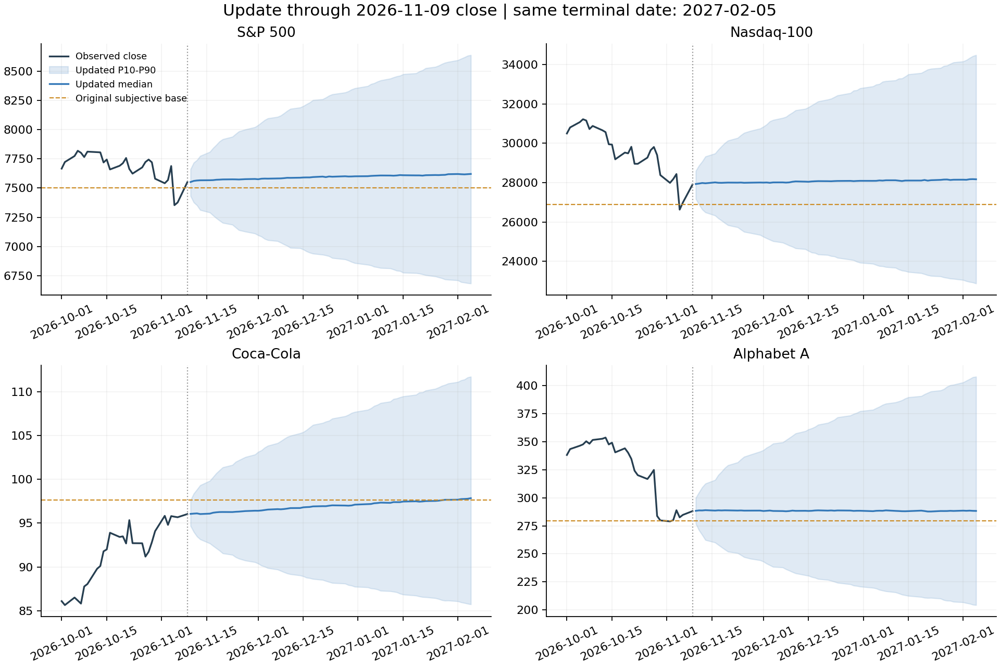

---
tags:
  - 理财
  - 海外简报
  - 美股
  - 量化研究
created: 2026-11-10
as_of: "2026-11-10 16:31 Asia/Shanghai"
---

# 海外财经与投资执行更新｜2026-11-10

信息检索截止北京时间 **2026-11-10 16:31**；美股行情统一截止 **美国11-09常规收盘**。今晚21:30的美国10月CPI尚未公布。承接 [[notes/理财/每日笔记/海外简报/2026-11-04-1802|上一份新闻简报]] 和 [[notes/理财/每日笔记/标普纳指可口可乐谷歌三个月预测-2026-11-06|11月6日三个月模型]]。

**当前仍倾向保留人民币储备，以标普500 ETF承接长期新增股票预算。已有长期仓位不因这轮波动全部清仓；新资金在今晚CPI之后再评估首笔，随后分批投入。纳指100、谷歌和可口可乐暂不作为本轮集中加仓方向。**这项配置判断依靠资金用途、分散和承受能力，价格模型没有证明三个月择时优势。

## 五项值得更新的信息

### 1. 指数已经反弹，利率风险仍在

以11月6日报告采用的11月5日收盘为固定比较基准，此后只有11月6日、9日两个交易日：

| 标的 | 11-09收盘 | 11-09单日 | 较11-05累计 | 近21交易日 |
| --- | ---: | ---: | ---: | ---: |
| 标普500 | 7,549.94 | +2.35% | **+2.67%** | −3.35% |
| 纳指100 | 27,907.63 | +3.40% | **+4.80%** | −9.63% |
| 纳斯达克综合 | 25,253.14 | +2.74% | +3.86% | −7.72% |
| 可口可乐 KO | $96.03 | +0.38% | +0.31% | +9.06% |
| 谷歌 GOOGL | $288.15 | +1.18% | +1.97% | −18.06% |

VIX从11-05的 **28.18降至19.92**，恐慌定价明显回落；10年美债收益率代理 ^TNX 则由 **4.837%升至4.864%**。风险偏好修复与利率压力可以同时存在。NVDA在11-09逆市下跌约4.27%，也说明不能把指数反弹理解为所有AI公司的风险同时消失。

最新50日均线约为标普7,676、纳指100为29,602，两者仍在其下；纳指100也略低于200日均线约27,995。价格已有修复，尚不足以单凭两天走势确认趋势反转。均线仅作观察，不是经过验证的支撑位或自动交易规则。

上述数字统一取冻结的Yahoo日线，价格回报不含分红、税费和汇率；^TNX为收益率代理，不能当作可成交债券报价。原始文件、参数和哈希见本轮模型清单。

### 2. 就业仍有韧性，不能直接假设美联储即将转向宽松

11-06发布的10月非农新增 **16.5万人**，失业率 **4.1%**，平均时薪环比 **+0.4%**、同比 **+3.1%**。[BLS正式报告](https://www.bls.gov/news.release/archives/empsit_11062026.htm)

本轮推理：就业支持消费和企业收入，但工资月度增幅使通胀回落仍需证据。增长尚可与估值受到高利率约束，并不矛盾。10-28美联储维持政策利率 **3.75%—4.00%**；未来是否加息仍待数据和正式决议。[Fed声明](https://www.federalreserve.gov/newsevents/pressreleases/monetary20261028a.htm)

### 3. 今晚CPI是最近的决策节点，注意同比口径缺失

10月CPI定于 **11-10 08:30 ET，即北京时间今晚21:30** 发布。[BLS日历](https://www.bls.gov/schedule/news_release/cpi.htm)

Reuters今日调查预期为：总体CPI环比 **+0.3%**，核心 **+0.2%**。这是一组注明来源和日期的共识快照，不是实际结果，也不代表所有机构一致。Reuters同时提醒，由于2025年10月停摆造成基期缺失，本次不会发布通常的同比读数；流传的总体同比约3.9%、核心约2.7%属于经济学家的估算，不可写为BLS已公布数据。[Reuters预告](https://finance.yahoo.com/economy/policy/articles/us-consumer-prices-expected-risen-050314167.html)、[BLS缺失数据说明](https://www.bls.gov/cpi/additional-resources/2025-federal-government-shutdown-impact-cpi.htm)

本轮的条件观察：核心环比若接近0.2%且细项缓和，修复的宏观依据增加；若为0.3%或更高，且美债收益率同步上行，应更谨慎安排新增风险。一次月度数据不足以确认通胀趋势，市场反应还取决于预期、修订和分项，以上阈值也不是经过回测的交易系统。

### 4. 大摩公开观点偏向逐步增加风险，仍保留再探低点的可能

Mike Wilson在 **11-09** 的公开播客判断，调整可能接近尾声，但可能再次测试低点；其偏好是利用随后几周的弱势增加优质周期股及AI应用受益企业，并提醒更鹰派的Fed可能使筑底延续至12月。[Morgan Stanley原始文字稿](https://www.morganstanley.com/insights/podcasts/thoughts-on-the-market/market-bottom-final-retest-mike-wilson)

Reuters同日综述称，大摩和UBS认为市场对AI及数据中心极端监管风险的定价偏重。[Reuters机构综述](https://www.aol.com/articles/wall-st-brokerages-ai-selloff-143701000.html)

这些是有条件的机构预测。本轮能核验的是公开文字稿和媒体综述，没有使用无法验证的闭门会转述。对个人执行更有用的含义是：观察政策实际落地、订单和盈利，而不是把中期选举结果直接换算成必涨或必跌。美国中期选举已经发生，接下来的风险在监管、财政、融资和利率如何传导。

### 5. Anthropic撤回传阅定价，OpenAI上市时间也不能写成确定事件

Reuters于美国11-09晚报道，Anthropic向银行发送后又撤回IPO相关信息，先前传阅的70—80美元区间随后被指不准确。**撤回传阅信息不等于撤回SEC注册，也不足以认定IPO取消或延期；该价格不能当最终报价。**[Reuters完整稿检索入口](https://www.marketscreener.com/news/anthropic-s-nearly-70-billion-ipo-plan-briefly-circulated-to-banks-then-retracted-ce785edad988fe23)、[Reuters简讯转载](https://bluewaterhealthyliving.com/news/business-and-economy/exclusive-anthropic-sends-out-then-retracts-details-of-ipo-filing-emails-show/)

OpenAI方面，Reuters在9月已报道Altman排除2026年上市；这并不确认2027年的具体日期。本轮没有核实到取代该表态的正式上市时间，因此不再把“O和A都在未来几个月完成上市”设为基准情景。[Reuters 9月报道](https://ca.marketscreener.com/news/openai-s-altman-won-t-do-ipo-this-year-calls-ai-extinction-risk-unacceptable-ce785bdcd98bf026)

本轮推理：融资完成有利于支付算力开支，但高估值、融资规模和新增股份供给也会检验投资者需求，影响现有AI公司的相对估值。对谷歌还应分别看其云业务、与模型公司的关系和自身资本回报；单一IPO消息不足以替代整个公司估值。

## 数学更新：保留原预测终点，更新风险

### 价格风险模型

只追加11-06、11-09收盘，保留原冻结历史和全部模型参数；终点仍为 **2027-02-05**，剩余 **60个交易日**。沿用过去252日beta、21／63／252日波动最大值、VIX风险底值及5日配对区块重采样，20,000条路径、同一固定种子。

| 标的 | 当前模型年化波动 | 2月5日P10—P90期末风险带 | 相对最新价的风险带 |
| --- | ---: | ---: | ---: |
| 标普500 | 21.6% | **6,684—8,638** | −11.5%—+14.4% |
| 纳指100 | 34.5% | **22,874—34,488** | −18.0%—+23.6% |
| KO | 21.6% | **$85.73—$111.71** | −10.7%—+16.3% |
| GOOGL | 56.8% | **$204.28—$408.16** | −29.1%—+41.6% |

VIX回落使部分风险估计下降，但标普模型波动仍约21.6%，高于VIX19.92%，因为近期实际波动底值仍在起作用。谷歌的公司特有波动也未消失。模型将当前风险状态延伸到期末，没有预测后续新闻、波动突变和通胀结果。

**P10—P90仅是条件模拟样本中间80%的期末区间，不能宣称真实未来有80%概率落在其中，也不是持有期间最大回撤边界。**原模型82段历史检验未证明方向择时优势；本次没有因仅增加两个收盘就重新调参或挑选更有利的回测。

### 盈利与估值情景

原报告用 \(P_T/P_0=(1+\Delta E)(1+\Delta M)\) 明示假设。此次没有核验到足以量化修改原盈利与估值假设的新证据，因此**保留原绝对情景价格**，避免因价格反弹自动抬高目标：

| 标的 | 原2月5日主观基准价格 | 从11-09价格到原基准的回报 |
| --- | ---: | ---: |
| 标普500 | 7,500.80 | **−0.7%** |
| 纳指100 | 26,880.13 | **−3.7%** |
| KO | $97.64 | **+1.7%** |
| GOOGL | $279.41 | **−3.0%** |

这些基准是可审查的假设，不是合理价值结论、机构目标或卖出信号。现在部分价格已高于原基准，意味着沿用原假设时，反弹消耗了上行空间；也可能说明原假设需要随后被事实修订。观察期才过去两天，不能把这次反弹宣称为三个月预测已经验证成功。

蓝带是每日边际分位数，蓝线为条件中位数；橙色虚线为11月6日原主观基准。[PDF图](../../assets/形势与模型更新-2026-11-10/update.pdf)

## 对你的资金安排

沿用已确认约束：稳定收入，每月净新增2万—3万元；国内人民币只存银行，不买国内股票。**40%人民币存款／60%海外股票**仍是储备充分时的配置起点，尚非已确认的实际持仓，也不是模型优化出的唯一比例。先保证约12个月必要开支及未来三至五年确定净支出的人民币储备；绝对金额不够时，存款比例应更高。

| 资金或标的 | 当前执行判断 | 主要依据 |
| --- | --- | --- |
| 已有、用途长期的标普核心仓 | 继续持有；按实际总资产比例检查是否过量 | 两天反弹或下跌不足以验证全清再买的优势 |
| 新增长期股票预算 | **优先标普500 ETF，例如SPYM** | 分散个股决策风险；仍需承担美国大盘及科技集中风险 |
| 纳指100／QQQM | 暂不主动提高科技倾斜 | 与标普重复持仓，模型波动仍显著更大 |
| GOOGL | 观察，不作为新增主仓 | 11月6日已核对的资本开支与现金流疑虑，尚未被新财报消除 |
| KO | 观察，不追近期防御性上涨 | 近21日已涨约9%，抗跌不能替代估值安全边际 |
| 三个月内要使用的资金 | 人民币银行存款 | 资金用途无法承受上述股票风险带 |

[SPYM发行人资料](https://www.ssga.com/us/en/individual/etfs/state-street-spdr-portfolio-sp-500-etf-spym)确认其跟踪标普500；本次未重新进行跨注册地、税费及个人账户适用性的完整产品比较。

若人民币储备达标、现有仓位接近40/60，每月2万—3万元结余可参考：存款 **8,000—12,000元**，海外股票预算 **12,000—18,000元**。今晚CPI公布前先保留新资金；其后若长期配置条件未变，第一笔可为当月股票预算的约三分之一，即 **4,000—6,000元**，余下两笔在随后4—8周分配。若现有股票已经超配，新增资金应先补存款。分批是控制一次投入的风险，未证明比立即全额投资收益更高。

人民币升值也要按乘法处理。令 \(S\) 为USD/CNY、\(R_\$\) 为美元股票回报：

\[
R_{\mathrm{人民币}}=(1+R_\$)\frac{S_T}{S_0}-1
\]

例如股票美元上涨10%、美元对人民币贬值5%，人民币回报为 **4.5%**。这是敏感性计算，本轮没有预测未来汇率。若美元股票跌45%、美元对人民币另贬10%，海外部分人民币损失约50.5%；60%股票权重使家庭金融资产损失约 **30.3%**，暂忽略存款利息、成本和再平衡。它不是最坏情形上限。若这一级别的家庭资产损失也无法接受，应降低股票目标，而非只凭“股票账户可承受40%—50%”推到高仓位。

## 随后观察节点

| 北京时间／美国日期 | 事件 | 需要核实的内容 |
| --- | --- | --- |
| **11-10 21:30，北京时间** | 美国10月CPI | 核心环比、分项和债市反应；勿把估算同比当官方结果 |
| 未来一周，具体时间待确认 | Anthropic正式文件、路演及定价 | 更新的实际条款；媒体预计的路演和定价时间仍非保证 |
| **11-18 06:00，北京时间** | NVDA Q3财报电话会，对应美国11-17 17:00 ET | 需求、交付、客户融资和现金回报；不能提前引用业绩 |
| 12-08—09，美国日期 | FOMC及经济预测 | 政策利率与通胀路径；不是预设降息 |
| 2027-01-26—27，美国日期 | FOMC | 仍处在本轮预测窗口内 |
| 2027年1—2月 | 公司业绩和2027支出指引 | 以各家公司确认的日程为准；检验AI投入是否转成现金流 |

[NVDA官方电话会公告](https://nvidianews.nvidia.com/news/nvidia-sets-conference-call-for-third-quarter-financial-results-6928873)、[Fed会议日历](https://www.federalreserve.gov/monetarypolicy/fomccalendars.htm)。

## Sources

本轮实际读取的Vault相对路径：

- `AGENTS.md`
- `notes/理财/海外财经跟踪规则.md`
- `notes/理财/每日笔记/海外简报/2026-11-04-1802.md`
- `notes/理财/每日笔记/仅存款与海外股票的配置修订-2026-11-03.md`
- `notes/理财/每日笔记/标普纳指可口可乐谷歌三个月预测-2026-11-06.md`
- `notes/理财/assets/三个月走势模型-2026-11-06/model.py`、`model_config.json`，及程序读取的冻结日线、原预测和情景结果。
- 本轮新建并读取的 `notes/理财/assets/形势与模型更新-2026-11-10/`，含原始行情、脚本、清单、结果和图。

外部来源的证据范围：

1. Yahoo chart API：股票、指数、VIX、^TNX均截止11-09收盘；完整URL参数、原始JSON和SHA256见本轮`manifest.json`。供应商可修订历史；本次保留旧数据，仅追加新日期，另保存重叠日期差异。
2. BLS 11-06就业报告、CPI日历与缺失数据说明，Fed 10-28声明及会议日历：读取官方页面。同比缺失的本次发布安排另据Reuters 11-10预告，未把尚未公布的CPI写为已知。
3. Morgan Stanley 11-09播客：官方网页由HTTP直接取得全文文字稿；Reuters 11-09机构综述可读正文。均属公开信息。
4. Reuters 11-10 CPI预告、11-09晚Anthropic完整报道：本轮检索正文片段可读，完整网页抓取受限；Anthropic“发送后撤回”的事实另与可读的Reuters简讯交叉核对。不宣称已读正式更新后的IPO申报文件。
5. Reuters 9月OpenAI报道：读取MarketScreener转载；历史表态不构成2027上市日期保证。
6. NVDA官方公告确认电话会时间；SPYM官方检索资料确认跟踪指数。上述链接均列于相关段落。

模型风险带、原情景比较、股汇敏感性与个人资金安排为本轮研究计算和判断，不是媒体或机构给出的确定收益承诺。
