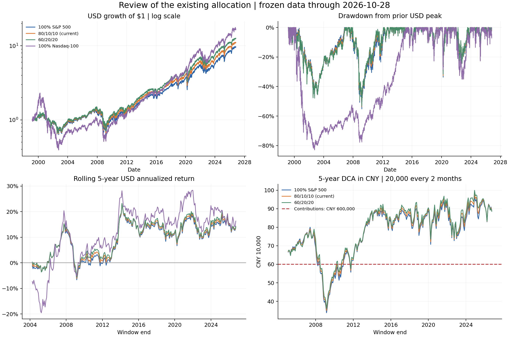

---
tags:
  - 理财
  - 资产配置
  - 美股
  - 风险预算
created: 2026-11-16
updated: 2026-11-16
---

# 资产配置、美股建仓与执行计划

本篇合并美股建仓、个人股票配置、数学复核、人民币仓位分层和“只存款加海外股票”的后续修订。不同日期的比例和前提不强行抹平，当前采用版本放在前面，历史方案放在后面。

## 当前采用版本

- 国内人民币只做存款和流动性储备，海外股票承担长期增长。
- 人民币存款优先覆盖约12个月必要生活费和未来3—5年确定支出。
- 海外股票采取宽基为核心、个股和成长股小比例的结构。
- 新增资金优先补足存款安全垫和偏低资产，再按目标比例投入。
- 股票账户的可承受回撤不能直接等同于家庭总资产可承受回撤。

## 决策顺序

1. 先确认存款安全垫和未来刚性支出。
2. 再确定海外股票总比例。
3. 股票内部先建立宽基底仓，再安排GOOGL、QQQM、BRK.B等个股或成长暴露。
4. 以分批投入和再平衡替代单次择时。
5. 用回撤、汇率和资金期限复核仓位，而不是只看短期涨跌。

## 历史研究材料

## 合并材料：美股建仓分析-2026-10-27

原始文件：notes/理财/每日笔记/资产配置、美股建仓与执行计划-2026-11-16.md

研究日期：2026-10-27。用户确认：计划向嘉信首笔入金 **HKD5,000，之后每两个月约 RMB20,000，长期持有**；当前只需要未来五年的预测与投资安排，不据此假定第五年必须清仓。当前持仓、应急资金和最大可承受回撤尚未确认；下文的股票方案以前述资金五年内不用、无杠杆、能够承受明显回撤为前提。金额指这笔计划投资资金，不代表家庭全部资产配置。

行情统一采用 **2026-10-26 美国正常交易时段收盘价**；不混用盘前、盘后及检索日的未收盘报价。网页报价存在延迟，下单时须用账户内价格重新计算。汇率仅按 **USD1＝HKD7.8 作预算假设**，不是实时报价：5,000 港币约为 641 美元，实际可用金额须扣除换汇、汇出和中间行费用。

### 建仓结论

当前股票目标为 **80% 标普 500 ETF、10% QQQM、10% BRK.B**。标普部分选 SPYM 或 VOO 中的一只；BRK.B 为研究通过后的目标，不是必须立即买满的订单。初始不单独重仓谷歌、微软或英伟达。完整执行规则见 [[notes/理财/每日笔记/资产配置、美股建仓与执行计划-2026-11-16|个人股票配置与执行计划]]。

- **能使用相应碎股：**按目标预算逐步配置；BRK.B 尚未完成独立估值，待研究额度可暂留现金。
- **只能买整股：**优先 SPYM；按本次收盘价，6 股约 540.36 美元，余款留待下一次补仓。不要为了凑两只 ETF 而买出过高的 QQQM 权重。
- **执行节奏：**本周财报与议息结束后，分两次完成，间隔约两至四周。分批的用途是降低首次买入的时点压力，不保证比一次投入收益更高。

这个方案仍以美国大盘股票为主，既有美国市场风险，也有美元兑日常开支货币的汇率风险，并不是全球分散组合。

### 后续每两个月入金的执行安排

在应急资金另有准备、股票回撤时不需要被迫卖出的前提下，股票目标采用 **80% 标普 500 ETF＋10% QQQM＋10% BRK.B**。每次计划投入人民币 20,000 元等值资金时，目标分别为人民币 16,000 元、2,000 元和 2,000 元等值美元；金额以实际到账、扣除费用后的预算同比例调整。BRK.B 在研究通过后逐步配置，首笔可先建立标普底仓，不强求立即凑齐三种资产。

- 标普部分优先 SPYM；若已经持有 VOO，可继续积累，不必为微小费率差卖出更换。两者选一只。
- 首笔可在本周议息和科技财报后分两次完成；后续每两个月到账后按比例投入，无须每次重新等待所谓最低点。
- 每半年检查一次。任一部分偏离目标超过 5 个百分点时，优先用后续入金补比例不足的一边。
- 谷歌列为优先跟踪的个股候选，首次建仓先通过现有组合间接参与。若后续完成独立分析并决定配置，可从 QQQM 预算中划出最多 5% 的股票资金，研究后的目标对应 80% 标普、5% QQQM、10% BRK.B、5% 谷歌；不额外提高股票总预算，也不预设能提高收益。
- 本报告的 80/10/10 是股票目标方案。如果不能承受明显回撤，应先降低总资金投入股票的比例，将必要储备放在与未来开支币种匹配的现金、短存等资产中，再分配剩余股票预算。伯克希尔自身的现金不能代替个人储备。
- 若确认第五年必须支付某笔费用，应在计划用款前约一至两年逐步准备相应金额的现金或短存；避免把固定用款日绑定在股票卖出价上。

五年收益测算中的 5% 年化仅为预算情景，不是组合能够稳定实现的回报。持续追加金额和长期配置规则，比为某次财报临时提高仓位更适合作为执行依据。

### 本地资料能提供什么

已阅读 [[notes/理财/INDEX|理财索引]]、[[notes/理财/财经媒体-关注渠道索引|财经媒体关注清单]]、[[notes/理财/财经研究与交易人物-内容渠道索引|财经研究与交易人物]]及[[notes/理财/每日笔记/香港银行开户与账户验收清单-2026-11-16|香港银行开户与账户验收清单]]。

前两类资料主要提供新闻、研究与人物的查阅入口，没有形成针对 QQQM、标普或谷歌的当期估值结论，也没有记录个人资产负债和风险预算。开户清单提供银行、券商入金的背景。本次投资判断另外核对基金发行商、公司财报、美联储资料和注明时间的行情，不能把关注名单本身当作买入依据。

### 当前走势：标普相对稳定，科技股内部出现分化

下表涨跌由同一来源的收盘价计算，公式为「10 月 26 日收盘价 ÷ 对照日收盘价 − 1」。这是价格变化，不是承诺收益，也不是完整的含息回报。

| 标的 | 10 月 26 日收盘价（美元） | 当日涨跌 | 相对 9 月 30 日 | 相对 10 月 6 日 |
| --- | ---: | ---: | ---: | ---: |
| VOO，标普 500 ETF | 703.41 | +0.69% | +0.36% | −1.79% |
| QQQM，纳斯达克 100 ETF | 293.26 | +1.10% | −3.74% | −6.23% |
| Alphabet A 类股 GOOGL | 316.80 | −1.06% | −7.93% | −8.88% |

数据：[VOO 历史价格](https://stockanalysis.com/etf/voo/history/)、[QQQM 历史价格](https://stockanalysis.com/etf/qqqm/history/)、[GOOGL 历史价格](https://stockanalysis.com/stocks/googl/history/)。

**我的解读：**截至该时点，10 月的表现更像科技相关资产调整、标普整体相对稳定；10 月 26 日 QQQM 反弹时，谷歌仍然下跌。一次反弹不足以确认科技股调整已经结束，也不能仅凭谷歌跌得更多就判断它更值得买。

短期有两个已核实的事件：

1. 美联储 **10 月 27—28 日**开会。9 月 16 日的实际动作是加息 25 个基点，把联邦基金利率目标区间提高到 **3.75%—4.00%**，并明确通胀仍偏高。因此不能把「持续降息一定推高科技估值」作为此次建仓前提。[9 月声明](https://www.federalreserve.gov/newsevents/pressreleases/monetary20260916a.htm)、[会议日历](https://www.federalreserve.gov/monetarypolicy/fomccalendars.htm)。
2. Alphabet 和微软计划 **10 月 28 日**发布财报。谷歌本次尚未公布的第三季度结果，不能提前当作已经兑现的增长。[Alphabet 财报日期公告](https://www.publicnow.com/view/44136C85C4D5D099F2F1F5740EF199299B51D499)、[微软投资者 FAQ](https://www.microsoft.com/en-us/investor/faq)。

我的执行判断是等本周上述信息落地后再开始主要买入。这样会放弃可能出现的财报前上涨，也不能消除之后的风险；对于约 640 美元的首次投入，没有必要靠押中一晚的涨跌建立收益来源。

### QQQM 与标普 500：先决定风险暴露，再选代码

| 产品 | 暴露与作用 | 年费率 | 本次收盘价 | 对这笔资金的适用性 |
| --- | --- | ---: | ---: | --- |
| SPYM | 标普 500，作为美国大盘底仓 | 0.02% | $90.06 | 整股价格适合小额起步 |
| VOO | 标普 500，与 SPYM 的主要市场暴露相近 | 0.03% | $703.41 | 碎股可用时可选；整股超过本次预算 |
| QQQM | 纳斯达克 100，增加大型成长公司权重 | 0.15% | $293.26 | 适合少量配置；整股会占预算约 46% |

资料：[SPYM 发行商页面](https://www.ssga.com/us/en/intermediary/etfs/state-street-spdr-portfolio-sp-500-etf-spym)、[Vanguard 产品列表](https://investor.vanguard.com/investment-products/list/etfs)、[VOO 行情](https://stockanalysis.com/etf/voo/)、[Invesco QQQM 页面](https://www.invesco.com/us/en/financial-products/etfs/invesco-nasdaq-100-etf.html)、[QQQM 行情](https://stockanalysis.com/etf/qqqm/)。

**标普优先的原因：**行业覆盖更广，能同时参与科技公司增长和其他大盘行业表现。标普仍然有很强的巨头权重，并不是避险资产。SPYM 发行商列示的 10 月 23 日 FY1 预期市盈率约 **20.21 倍**；我的判断是它适合长期分批积累，但不能据此称为明显低估。该口径与其他网站的 forward P/E 未必相同，不直接混合排序。[发行商估值口径](https://www.ssga.com/us/en/intermediary/etfs/state-street-spdr-portfolio-sp-500-etf-spym)。

**QQQM 的作用是主动增加成长股权重。**它不是对标普的独立避险配置。两者都持有谷歌、微软、英伟达等巨头；再买这些个股，会继续增加同一批公司的暴露。此次不建议把 QQQM 配到一半以上，也不因为它近期跌得更多就提高目标仓位。

SPYM 每股约 90 美元、VOO 每股约 703 美元，主要影响整股购买的便利性，不能说明 SPYM 所持公司的估值更便宜。标普部分选一只即可，无须把小额资金同时分到多只跟踪相同指数的产品。

### 谷歌及其他科技股：值得研究，起步资金无需逐一买入

以下价格与网站列示的 forward P/E 均取自 10 月 26 日行情页面。forward P/E 依赖分析师盈利预测和供应商口径，不等于公司保证的盈利，跨公司比较只作辅助。

| 公司 | 股价 | 网站 forward P/E | 已核对的经营事实 | 本次建仓意见 |
| --- | ---: | ---: | --- | --- |
| Alphabet / GOOGL | $316.80 | 23.68 倍 | Q2 营收同比 +24%，云收入 +82%；现金投入也大幅增加 | 优先研究，等 10 月 28 日财报；本次通过 ETF 持有即可 |
| Microsoft / MSFT | $532.60 | 26.95 倍 | FY26 Q4 营收 +18%，Azure 与其他云服务收入 +43% | 企业软件与云业务值得长期跟踪；价格已反映增长，先等本周财报 |
| Amazon / AMZN | $249.09 | 26.81 倍 | Q2 营收 +20%，AWS 收入 +37% | 关注云业务利润和资本支出后的现金回报，暂不单独建仓 |
| NVIDIA / NVDA | $216.00 | 17.86 倍 | FY27 Q2 营收 +106%，数据中心收入 +117% | 高增长背后仍有客户投资周期和竞争风险；不因预期市盈率较低就重仓 |
| Meta / META | $630.56 | 19.17 倍 | 已公布 Q3 营收 +26%，有 $9.89bn 法律相关费用；2026 资本开支指引 $135—145bn | 广告表现强，但需评估费用与现金投入；一整股几乎占满预算 |
| Apple / AAPL | $343.91 | 37.51 倍 | FY26 Q3 营收 +16%，EPS 含关税退款带来的有利影响 | 当前预期估值在这组公司中较高；本次不优先额外配置 |

行情：[GOOGL](https://stockanalysis.com/stocks/googl/)、[MSFT](https://stockanalysis.com/stocks/msft/)、[AMZN](https://stockanalysis.com/stocks/amzn/)、[NVDA](https://stockanalysis.com/stocks/nvda/)、[META](https://stockanalysis.com/stocks/meta/)、[AAPL](https://stockanalysis.com/stocks/aapl/)。

经营数据：[Alphabet Q2 财报](https://s206.q4cdn.com/479360582/files/doc_financials/2026/q2/2026q2-alphabet-earnings-release.pdf)、[微软 FY26 Q4](https://www.microsoft.com/en-us/investor/earnings/fy-2026-q4/press-release-webcast)、[Amazon Q2](https://ir.aboutamazon.com/news-release/news-release-details/2026/Amazon-com-Announces-Second-Quarter-Results/default.aspx)、[NVIDIA FY27 Q2](https://investor.nvidia.com/news/press-release-details/2026/NVIDIA-Announces-Financial-Results-for-Second-Quarter-Fiscal-2027/)、[Meta Q3](https://investor.atmeta.com/investor-news/press-release-details/2026/Meta-Reports-Third-Quarter-2026-Results/default.aspx)、[Apple FY26 Q3](https://www.apple.com/newsroom/2026/07/apple-reports-third-quarter-results/)。

#### 谷歌最需要辨别的两点

第一，**约 15.9 倍的滚动市盈率不能直接当作主营业务便宜的证据**。Q2 财报显示，权益证券收益约 $99.0bn，对当季 EPS 的贡献为 $6.26，而报告 EPS 为 $9.11。大额投资估值收益抬高了利润，不能把该季度利润简单年化，也不能把全部利润都理解为搜索和云业务产生的可持续收益。[行情估值](https://stockanalysis.com/stocks/googl/)、[财报第 9 页](https://s206.q4cdn.com/479360582/files/doc_financials/2026/q2/2026q2-alphabet-earnings-release.pdf)。

第二，**云增长很快，但自由现金流承受投入压力**。Q2 经营现金流约 $39.07bn，购置物业及设备约 $44.92bn，按公司定义的单季自由现金流约 **−$5.86bn**；截至该季的过去十二个月自由现金流仍为正，不能把单季负值解读成整个公司没有现金创造能力。[财报现金流调节表](https://s206.q4cdn.com/479360582/files/doc_financials/2026/q2/2026q2-alphabet-earnings-release.pdf)。

我的判断：谷歌值得继续研究，买入理由应建立在搜索变现能力、云利润增长和未来资本回报上。10 月 28 日重点看搜索增长、云增长与利润率、资本开支、现金流，以及投资收益与经营利润的区分。本次一股 GOOGL 就约占原始预算的 **49%**，风险过于集中。若未来坚持拿小额资金学习个股，可从原有 ETF 预算中划出不超过 5% 的股票投资额，而不是追加一整股谷歌；这仍须账户支持碎股。

### 具体怎么买

#### 先核实账户支持的交易方式

嘉信当前官网已写明：支持大多数美国上市股票和 ETF 的碎股，最低可从 1 美元开始，旧 Stock Slices 名称也已调整。不能再笼统沿用「嘉信只能买标普成分股碎股、ETF 不能买碎股」的历史说法。[嘉信碎股说明](https://www.schwab.com/fractional-shares-stock-slices)。

香港嘉信现行账户文件也含碎股交易条款，但文件保留标的和交易条件限制。本人账户能否对 SPYM、VOO、QQQM 按金额下单，仍以实际交易页面为准。按金额的碎股订单须采用市价单，且限正常交易时段；不能把整股限价单操作直接套用到按金额订单。[香港嘉信账户文件，碎股条款](https://disclosures.schwab.com/SchwabDashboard/62626/BDL97675CSHK.pdf)。

#### 方案 A：可买相应碎股，逐步接近 80/10/10

先从实际到账美元中扣除费用并留少量余额，余下作为投资额。例如最终决定投入 **600 美元**：

| 配置 | 总目标 | 第一次 | 两至四周后的第二次 |
| --- | ---: | ---: | ---: |
| SPYM 或 VOO，二选一 | $480 | $240 | $240 |
| QQQM | $60 | $30 | $30 |
| BRK.B，研究通过后的目标 | $60 | $30 | $30 |
| 合计 | $600 | $300 | $300 |

第一次可安排在 **10 月 30 日或资金到账后的首个合适交易日**，届时复核本周财报与政策结果；第二次不以必须跌到某个价位为前提。若市场上涨，仍按原预算执行；若下跌，先区分正常波动与个人资金需求变化，不临时借钱补仓。上述金额随净到账资金同比例调整。

表格表示目标预算。BRK.B 尚未形成独立估值结论时，相应额度暂留现金；首笔资金优先完成标普底仓，不为凑齐表格而提前买入。

#### 方案 B：只能买整股，先建标普底仓

以本次收盘价举例：

- 第一批 **3 股 SPYM，约 $270.18**。
- 两至四周后再买 **3 股 SPYM**；最终成本以实际成交价为准，按当前价合计约 **$540.36**。
- 余款与未来追加资金合并，再按研究进展和目标仓位补入 QQQM、BRK.B。此时暂时持有标普和现金，不强求立即凑出 80/10/10。

不要为了立即买到 QQQM 而采用「1 股 QQQM＋3 股 SPYM」：按当前价，两只 ETF 中 QQQM 的占比超过一半，与本次以标普为主的目标不符。整股可在正常交易时段采用限价单；历史收盘价只用于预算，不是保证能成交的买入价。

### 哪些事情比挑一晚的买点更重要

**控制入金成本。**假设一次固定费用为 HKD100，它就占本金 2%；这是费用敏感性示例，不是对银行实际收费的断言。相比之下，5,000 港币资金全年按 0.15% 计算的基金费约 7.5 港币，按 0.02% 则约 1 港币。先看实际换汇价差、汇款和中间行收费，再决定未来追加频率。嘉信确认部分中间行可能收费；不要默认港币可直接按美元电汇路径汇入。[嘉信入金说明](https://www.schwab.com.hk/fund-your-account)。

**让持有期限与回撤承受力一致。**以股票目标 80/10/10 为例，纯作压力情景：若标普跌 35%、QQQM 跌 50%、BRK.B 跌 35%，股票部分约跌 36.5%，5,000 港币等值投资会变为约 3,175 港币，尚未考虑汇率。这不是预测，也不是最大亏损上限。如果这样的波动会迫使卖出，就应减少投入股票的金额，把短期必用的钱留在股票之外。

**追加和复核规则保持简单。**每次追加优先补目标比例不足的一边；每半年查看一次比例和资金用途。谷歌等个股的跟踪重点是经营与现金回报，不用每天根据价格涨跌重写长期计划。小额起步阶段，稳定追加、减少费用和避免集中持仓，比同时持有六家科技公司更有实际意义。

### Sources

本次实际读取的 Vault 相对路径：

- `notes/理财/INDEX.md`
- `notes/理财/财经媒体-关注渠道索引.md`
- `notes/理财/财经研究与交易人物-内容渠道索引.md`
- `notes/理财/每日笔记/香港银行开户与账户验收清单-2026-11-16.md`

外部资料的直接链接列于对应数据和判断附近。优先依据基金发行商、美联储、公司财报和嘉信文件；行情与跨公司 forward P/E 使用注明时点的 Stock Analysis 页面。收益率、预算金额与压力情景为本次计算，配置比例和执行节奏为分析建议，不属于数据源原话。Alphabet 第三季度及微软下一季度结果在本次研究时尚未发布，应在公布后更新相关判断。

## 合并材料：个人股票配置与执行计划-2026-10-27

原始文件：notes/理财/每日笔记/资产配置、美股建仓与执行计划-2026-11-16.md

更新日期：**2026-10-27**。本页汇总当前配置建议，市场数据和人物来源分别保留在关联研究中。

### 资金背景与前提

- 首笔计划入金嘉信 **HKD5,000**。
- 此后计划每两个月投入约 **RMB20,000**，只对未来五年做规划；不据此认定第五年必须清仓。
- 股票预算先扣除生活应急金和五年内确定要用的钱。当前已有持仓、应急资金和最大回撤承受力仍未完整确认。
- 下表比例针对可投入股票的资金，不是家庭全部存款。金额随实际到账美元、换汇和汇款费用调整，保持无杠杆。

### 当前股票目标配置

| 标的 | 目标比例 | 每两个月 RMB20,000 全部作为股票预算时 | 作用 |
| --- | ---: | ---: | --- |
| **SPYM 或 VOO，二选一** | **80%** | **RMB16,000 等值美元** | 宽基底仓，参与美国大盘企业增长 |
| **QQQM** | **10%** | **RMB2,000 等值美元** | 适度增加大型成长股权重 |
| **BRK.B** | **10%** | **RMB2,000 等值美元** | 小比例参与伯克希尔的经营企业与资本配置 |

这些比例是结合个人资金计划做的建议，不是投资大师共同给出的配方，也不代表当前价格已经被证实低估。BRK.B 的 10% 是研究通过后的目标：当前尚未完成其独立估值，不因本人或其他投资者的评论立即买满。待研究的额度可暂留现金，和生活应急金分别管理。

标普基金与 QQQM 已提供谷歌、微软、英伟达等公司的暴露；标普和伯克希尔之间也存在持仓重合。多个代码仍可能受到共同风险影响，整个目标组合依然偏向美国股票。

### 建仓与持续入金

1. **首笔先建标普底仓。**约 5,000 港币的起步资金不必立即凑齐三种资产，避免整股价格迫使单只股票占比过高。
2. **资金到账后按计划投入。**按实际可用美元预算分配，历史收盘价用于研究，不作为保证成交的限价。首笔可分两次完成，后续不因短期涨跌临时翻倍投入。
3. **逐步接近目标比例。**已有 QQQM 较多时，优先用新增资金补标普或研究通过后的 BRK.B，不为切换比例频繁买卖。
4. **每半年检查一次。**任一部分偏离目标超过 5 个百分点，先用后续入金补不足的一边。公司研究随财报和关键事实更新。
5. **谷歌等个股先跟踪。**日后完成独立分析，可从 QQQM 的预算中划出最多 5% 的股票资金建立学习仓；这个上限是风险纪律，不是额外必须配置的仓位。

若本人嘉信账户支持相应碎股，可按金额配置；否则等待后续资金积累后再安排整股，不为凑齐产品而明显偏离仓位目标。账户具体权限与下单条件以实际交易页面为准。

### 从投资理念迁移的执行原则

| 原则 | 当前如何执行 | 关联资料 |
| --- | --- | --- |
| 低费用与能力边界 | 80% 宽基承担主要配置，记录全部费用 | 博格、巴菲特 |
| 理解生意与资本回报 | 个股先分析客户、现金流、资本投入、经营者和估值 | 段永平、芒格、李录 |
| 下行分析与仓位预算 | 写失败情景和反证，评估单一判断错误的账户影响 | 苏世民、马克斯、德鲁肯米勒 |
| 资金期限与风险暴露 | 必用资金单独安排，检查共同依赖的行业、利率和币种 | 斯文森、达利欧 |

这些是对已收集理念的个人应用，不表示相关人物推荐 SPYM、QQQM、BRK.B 的上述组合。

### 回撤、五年期限与收益口径

如果股票账户暂时下跌 30% 就会影响生活或迫使卖出，应先降低投入股票的总金额。BRK.B 仍是股票，集团自身的现金不能代替个人可直接使用的储备。

若第五年有明确支付日期，提前约一至两年逐步准备与用款币种匹配的现金或短存。若五年只是复盘节点，则按资金用途、经营事实和风险预算决定是否继续持有。

此前年化 5% 只用于预算情景，不是固定回报。五年后实际结果可能亏损；换汇、税费和市场涨跌顺序都会影响结果，不能拿情景测算值直接承诺未来支出。

### 关联研究

- [[notes/理财/每日笔记/资产配置、美股建仓与执行计划-2026-11-16|美股建仓分析]]：行情、ETF、科技公司与嘉信交易条件。
- [[notes/理财/每日笔记/伯克希尔-巴菲特-段永平投资思路与配置-2026-10-27|伯克希尔、巴菲特与段永平]]：公司研究、投资原则和目标比例的依据。
- [[notes/理财/投资大师理念库|投资大师理念库]]：15 位代表人物的来源、条件与局限。
- [[notes/理财/苏世民-投资理念与个人投资启示|苏世民专题]]：风险审查与反对意见。
- [[notes/理财/投资决策记录模板|投资决策记录模板]]：每次个股决策与复盘的记录工具。

### Sources

本次实际读取的 Vault 相对路径：`notes/理财/每日笔记/资产配置、美股建仓与执行计划-2026-11-16.md`、`notes/理财/每日笔记/伯克希尔-巴菲特-段永平投资思路与配置-2026-10-27.md`、`notes/理财/投资大师理念库.md`、`notes/理财/INDEX.md`。

本页同步会话中已确认的资金计划和最新配置建议，沿用关联研究中已注明时点的来源，不新增行情或收益预测。用户授权更新文档并推送，不代表已经执行任何证券交易。

## 合并材料：现有投资建议的数学复核-2026-10-29

原始文件：notes/理财/每日笔记/资产配置、美股建仓与执行计划-2026-11-16.md

研究日期：**2026-10-29，北京时间**。美股日线截止 **2026-10-28 收盘**；官方历史汇率截止 **2026-10-23**；五年滚动计算只用截至 **2026-09** 的完整月份。本次是对既有建议的独立研究，供下一步修订计划使用。

### 问题与判断

既有股票目标是 **80% 标普、10% QQQM、10% BRK.B**，首笔 HKD5,000，之后每两个月约 RMB20,000，长期持有、先规划五年。本轮用户确认：**可以承受 40%—50% 的阶段性亏损，且不影响生活**。当前实际持仓、家庭资产负债、储备规模仍未知，计划入金不能当成已实际投资。

**结论：标普作为核心、两个小比例补充的结构可以保留为股票方案候选；历史数据支持有限改善，不支持把 80/10/10 称为最优比例。真正需要调整的是人民币口径的总风险预算。**这个股票组合历史上仍跌过约 54%，并未把风险降到 40%—50% 以内；人民币升值还可能放大本币亏损。如果 50% 已接近承受上限，以这笔投资预算 **80% 股票＋20% 人民币现金或短存**作为起始参考，比直接把全部预算投股票更符合所给范围。该参考仍须与已有储备合并计算。

BRK.B 的独立估值仍未完成，本次回测没有填补这项缺口，其 10% 股票目标应保留“研究通过后”的条件。报告没有据此触发买卖或修改原执行计划。

### 方法：比较既有方案，不用历史赢家反推权重

使用 Yahoo Finance 日频复权收盘，近似计入分红再投资；**基金自身费用已反映在基金价格中，个人税、换汇价差、汇款费和交易成本未计入**。实际税后结果取决于身份、账户及费用，不能直接套用表中回报。

| 样本 | 使用资产 | 用途 |
| --- | --- | --- |
| 1999-03-10—2026-10-28 | SPY、QQQ、BRK.B | 覆盖互联网泡沫、金融危机及疫情等阶段；前两者是指数暴露代理 |
| 2020-10-13—2026-10-28 | VOO、QQQM、BRK.B | 用实际可选产品交叉检查；起点晚于 2020 年春季暴跌 |
| 2000-01—2026-09 完整月份 | SPY、QQQ、BRK.B＋美联储 H.10 USD/CNY | 按人民币现金流重建五年定投 |

不把 QQQ 的历史冒充 QQQM 的实盘历史。SPY 与 SPYM/VOO 的费用、跟踪差不同，QQQ 与 QQQM 也有费用和结构差异，长期代理回测不是实际产品的精确复制。SPYM 官网说明它在 2020 年前曾跟踪其他基准，因此没有把它成立以来的全部收益直接当作标普收益。[SPYM 发行商及基准变更说明](https://www.ssga.com/us/en/intermediary/etfs/state-street-spdr-portfolio-sp-500-etf-spym)、[QQQ 发行商](https://www.invesco.com/qqq-etf/en/about.html)。

多资产组合按目标权重建立，此后持仓随价格漂移，**每年 6 月、12 月最后一个交易日收盘后再平衡**。这是可复现的统一比较规则；原计划是半年检查、偏离 5 个百分点后优先用新增资金调整，两者并不完全相同。另比较不再平衡与每月再平衡，检查结论是否依赖这一选择。

核心数学量：

\[
\mathrm{CAGR}=\left(\frac{V_T}{V_0}\right)^{1/T}-1,\qquad
\sigma_{\rm annual}=\sqrt{252}\,\mathrm{std}(r_{p,d})
\]

\[
\mathrm{MDD}=\min_t\left(\frac{V_t}{\max_{s\leq t}V_s}-1\right),\qquad
\sigma_p^2=w^\top\Sigma w
\]

\(V_t\) 是不含外部入金的组合净值，\(T\) 按实际日数换算年数；\(\Sigma\) 为日收益样本协方差乘 252。波动率是历史样本统计量，不是未来亏损上限。定投账户的本金增加不能算作收益，也不能直接拿账户余额计算上述净值回撤。

### 结果一：改善收益，但没有显著改变危机中的亏损级别

**长样本：1999-03-10—2026-10-28，美元名义回报。**比例顺序均为标普／纳指／伯克希尔。

| 股票组合 | 历史年化收益 | 年化波动 | 最大回撤 |
| --- | ---: | ---: | ---: |
| 100% 标普 | 8.56% | 19.18% | −55.19% |
| **80/10/10，既有方案** | **9.10%** | **18.89%** | **−53.66%** |
| 90/10/0 | 8.88% | 19.57% | −54.78% |
| 90/0/10 | 8.75% | 18.52% | −54.06% |
| 60/20/20 | 9.61% | 18.85% | −53.09% |
| 100% 纳指 100 | 10.77% | 26.87% | −82.96% |
| 100% BRK.B | 9.07% | 21.84% | −53.86% |

既有方案相对纯标普的历史年化增加 **0.54 个百分点**，最大回撤改善 **1.53 个百分点**。它的最深回撤发生于 **2007-10-12—2009-03-09**；跌 53.66% 后，需要上涨约 **115.8%** 才能回到原高点。

60/20/20 在这份样本中确实更好，不能反过来宣称它必然增加了历史波动；但仅凭这一结果，不足以提高未来主动仓位。伯克希尔是事后选定的存续公司，未来经营和资本配置不会复制过去，20% 单公司仓位的理由还需要独立建立。

分阶段看，80/10/10 的美元年化为：**2000—2009 年 −0.55%、2010—2019 年 13.98%、2020 年初至本次截止 15.77%**。同一组合可经历十年低回报，也可经历强增长阶段，不能把全样本的 9.10% 当作未来每年兑现的利率。

实际产品短样本中，80/10/10 年化 **15.95%**、最大回撤 **−24.37%**；纯 VOO 年化 **15.61%**、最大回撤 **−24.52%**。**短样本缺失早期危机，不能用其约 24% 的回撤预算未来风险。**

### 结果二：QQQM 增加成长暴露，伯克希尔提供部分分散

实际产品共同样本中，日收益相关系数：

| 组合关系 | 相关系数 |
| --- | ---: |
| VOO 与 QQQM | **0.938** |
| VOO 与 BRK.B | 0.583 |
| QQQM 与 BRK.B | 0.386 |

QQQM 与标普高度同向，不能把它当作独立的防守资产。伯克希尔相关性较低，但在长期样本中自身最大回撤也超过 50%。

固定目标权重下，第 \(i\) 项的样本方差贡献份额为：

\[
\mathrm{RC}_i=\frac{w_i(\Sigma w)_i}{w^\top\Sigma w}
\]

实际产品共同样本下，80/10/10 的三项方差贡献约为 **80.55%／12.80%／6.65%**。这是在固定目标权重和历史协方差下的估算，不是对漂移持仓逐日风险的精确分解，也不能衡量所有尾部风险。

为检查收益差异的不确定性，对两个组合的**配对月度对数收益**做循环移动区块重采样，每种区块长度重复 6,000 次，保留区块内的共同变化；使用截至 2026-09 的完整月份。12 个月区块下，80/10/10 相对纯标普的年化收益差 95% 百分位区间：

- 长期代理样本：约 **+0.05 至 +1.01 个百分点**；6／24 个月区块下区间也为正。
- 实际产品短样本：约 **−0.80 至 +1.23 个百分点**；6／24 个月区块下也包含零。

长样本内的改善相对稳定，但重采样条件于既有资产选择和历史路径，不能计入公司存续选择、未来制度变化等不确定性，**不能解释为未来跑赢的概率或有效的择优证明**。本次没有通过最大化历史收益来选择新权重。

既有方案不再平衡／半年再平衡／每月再平衡的长期年化分别约 **8.89%／9.10%／9.07%**，最大回撤都约 **53.7%**。这一比较支持低频检查的可执行性，未证明交易越频繁越好。

### 结果三：五年持续投入，也存在本金亏损

以用户计划建立 **261 个相互重叠的五年窗口**：每两个月期末投入 RMB20,000，30 次合计 **60 万元**，不计首笔 HKD5,000。每笔按当期汇率换美元，新增资金按目标权重购买，半年再平衡，期末按汇率折回人民币。

| 股票方案 | 期末低于本金的历史窗口 | 最差期末市值 | 历史中位数 | 最好期末市值 |
| --- | ---: | ---: | ---: | ---: |
| 100% 标普 | 33/261，12.64% | 33.80 万 | 81.17 万 | 96.92 万 |
| **80/10/10** | **28/261，10.73%** | **34.96 万** | **82.32 万** | **98.43 万** |
| 60/20/20 | 26/261，9.96% | 36.14 万 | 83.23 万 | 99.96 万 |

**这些是相关性很高的历史窗口，不能把 10.73% 当作未来亏损概率，历史最好和最差也不是未来边界。**大量近年强势窗口会提高历史中位数，不能把 82 万写成未来的基准预算。

80/10/10 最差窗口的观察起点为 **2004-02 月末**，按规则首次投入在 **2004-04 月末**，结束于 **2009-02 月末**，60 万变成约 **34.96 万**。相对累计本金少约 **41.73%**；这是终值对本金的损失，不是净值最大回撤。按等间隔现金流求得的年化资金加权收益约 **−22.12%**，也不等于直接把本金损失除以五。

一次投入并持有五年的美元滚动结果也存在亏损：既有方案最差五年年化约 **−6.11%**。因此“五年只是复盘节点”与“五年必须用钱”需要不同的风险安排。

人民币定投计算的逐期形式为：

\[
U_{i,k}^{-}=U_{i,k-1}^{+}(1+r_{i,k}),\quad
U_{i,k}^{+}=U_{i,k}^{-}+w_i\frac{C_k}{S_k},\quad
V_T^{\rm CNY}=S_T\sum_i U_{i,T}
\]

\(U\) 为各项美元市值；\(C_k\) 为当期人民币投入；\(S_k\) 为每美元对应的人民币。再平衡时，将美元总市值重新按 \(w\) 分配。汇率取美联储 H.10 纽约午间参考价，与美股收盘不同步，也不是个人银行成交价；节假日使用此前最近观察日的参考价。这是事后重建现金流，未把 H.10 的每周发布日期还原为实时交易信号。[官方历史数据](https://www.federalreserve.gov/releases/h10/hist/dat00_ch.htm)、[H.10 口径说明](https://fred.stlouisfed.org/series/DEXCHUS)。

### 当前价格与未来回报：做敏感性分析

10 月 28 日美联储决定维持联邦基金利率目标 **3.75%—4.00%**，不能把持续降息作为收益测算的已知前提。[美联储声明](https://www.federalreserve.gov/newsevents/pressreleases/monetary20261028a.htm)。

SPYM 发行商列示的 **2026-10-27 FY1 预期市盈率为 20.44 倍**，指数股息率约 **1.10%**。预期盈利本身可修订，不能仅凭这个市盈率认定低估。[发行商当期估值](https://www.ssga.com/us/en/intermediary/etfs/state-street-spdr-portfolio-sp-500-etf-spym)。

简化价格分解：若前瞻 EPS 在五年内以 \(g\) 增长，期末采用一致的前瞻市盈率口径，则

\[
r_{\rm price}=(1+g)\left(\frac{\mathrm{PE}_5}{20.44}\right)^{1/5}-1
\]

下面将价格年化加约 1.10% 股息率，作为**粗略名义总回报敏感性**，没有完整模拟分红路径、税费、回购及指数成分变更；不是估值模型给出的回报预测，也不代表整个 80/10/10 组合的预测。

| 假设 EPS 年增长 | 期末 PE 降至 16 倍 | 期末 PE 保持 20.44 倍 | 期末 PE 升至 24 倍 |
| --- | ---: | ---: | ---: |
| 4% | 约 0.13%/年 | 约 5.10%/年 | 约 8.49%/年 |
| 8% | 约 3.94%/年 | 约 9.10%/年 | 约 12.62%/年 |
| 12% | 约 7.75%/年 | 约 13.10%/年 | 约 16.75%/年 |

即使盈利增长 8%，估值从 20.44 压缩到 16 倍，粗略总回报仍可能只在约 4%/年；不能把盈利增长或近年股价涨幅直接外推为投资收益。

进一步沿用 30 次定投，假设美元总回报平滑实现、汇率从 **6.67 线性变化**到表列终点：

| 假设美元年化总回报 | 汇率终点 5.50 | 汇率终点 6.00 | 汇率终点 6.67 | 汇率终点 7.30 |
| --- | ---: | ---: | ---: | ---: |
| −10% | 43.16 万 | 44.89 万 | 47.05 万 | 48.94 万 |
| 0% | 54.58 万 | 56.98 万 | 60.00 万 | 62.65 万 |
| 5% | 61.32 万 | **64.13 万** | **67.68 万** | 70.80 万 |
| 8% | 65.73 万 | 68.82 万 | 72.71 万 | 76.15 万 |
| 12% | 72.08 万 | 75.56 万 | 79.96 万 | 83.85 万 |

**这些是无概率含义的情景，不是预测区间。**同为美元年化 5%、汇率最终 6.00，若升值主要发生在前一年、五年内线性发生、最后一年，终值分别约 **67.02 万／64.13 万／61.57 万**，因为新增资金换汇的时点不同。实际股票回报的先后顺序同样影响定投终值，不能只看长期平均回报。

### 把 40%—50% 承受力转换成仓位预算

取一个**人为设定、接近但略深于既有组合历史美元回撤**的联合压力情景：股票美元市值跌 **55%**，同时 USD/CNY 从 6.67 变为 6.00。两项相乘后：

\[
L_{\rm stock,CNY}=1-(1-55\%)\frac{6.00}{6.67}
\approx59.52\%
\]

假设其余部分持人民币现金，瞬间名义价值不变，压力期间没有再平衡或额外入金；冲击前股票权重为 \(q\)，则组合损失约为 \(q\times59.52\%\)。

| 冲击前股票比例 | 人民币现金比例 | 该情景下总损失 |
| --- | ---: | ---: |
| 100% | 0% | −59.52% |
| 90% | 10% | −53.57% |
| **80%** | **20%** | **−47.62%** |
| 70% | 30% | −41.66% |

\[
q\leq\frac{\text{可接受损失}}{\text{股票人民币压力损失}}
\]

用 50%／45%／40% 作为这个情景下的损失预算，股票比例分别约不超过 **84.0%／75.6%／67.2%**。这是压力情景预算，**无法保证真实回撤受限于给定数字**；更深下跌、汇率变化或风险资产重新加仓都会改变结果。现金还面临通胀侵蚀，此处只是为明确瞬时压力计算假设。

### 本轮建议如何落地

1. **股票内部暂不提高主动仓位。**保留标普核心；QQQM 的 10% 是成长倾向，不是避险安排。BRK.B 仍须通过独立经营和估值审查，待研究额度可留现金。100% 标普仍是可比较的简化方案，回测没有证明必须凑齐三个标的。
2. **若 50% 接近实际承受上限，先参考 80% 股票＋20% 人民币现金或短存。**股票内部采用既有目标时，总预算对应 **64% 标普、8% QQQM、8% BRK.B、20% 人民币储备**。已有可用于该风险预算的储备应合并计算；家庭应急资金和确定要用的钱仍先独立保障，不用本报告代替资产负债核对。
3. **每两个月 2 万元的参考分配：**12,800 元等值标普、1,600 元等值 QQQM、1,600 元等值研究通过后的 BRK.B、4,000 元人民币储备。BRK.B 未通过前，其 1,600 元也暂留现金。按实际净到账金额执行，不为整股凑单偏离预算；这只是新预算的研究建议。
4. **低频复核，新增资金优先补不足。**半年检查和目标偏离纪律仍可沿用。本次没有证明等待某次财报或宏观事件能提高收益，也没有建立短期择时模型。
5. **五年支出不依赖股票终值。**若后来确定第五年有刚性支出，应按金额和日期逐步落实人民币资金，不能把 67.68 万或历史中位数写成保证可用的预算。

### 图表与复现

左上：美元净值，纵轴对数；右上：美元净值回撤；左下：一次投入持有五年的美元年化；右下：每两个月 2 万元、五年共 60 万元的人民币期末市值。图中不同起点窗口相互重叠，不能视为独立样本。可另取 [PDF](../assets/投资量化复核-2026-10-29/investment_review.pdf)。

复现文件位于 `notes/理财/assets/投资量化复核-2026-10-29/`：

- `download_data.py`：冻结数据与哈希清单。已有原始快照保持不变。
- `analyze.py`：组合净值、协方差、区块重采样、现金流、情景和图表；只读取本地数据，不访问交易接口。
- `manifest.json`：来源、观察日期、行数、原始文件 SHA-256。
- `results/historical_metrics.csv`、`results/rolling_5y_DCA_CNY.csv`、`results/forward_DCA_scenarios.csv`：主要完整计算结果。
- `README.md`：运行方式、数据质量和模型边界。

已核对单资产净值与复权价格比值相等、零收益零汇率变化时终值等于 60 万、5% 平滑收益递推与逐笔求和相等、资金加权年化反解一致，并用独立的持有单位数公式复核第一段标普定投。检查通过仅说明实现与所述规则一致，不验证未来收益。

### Sources

本次实际读取的 Vault 相对路径：

- `AGENTS.md`
- `notes/理财/每日笔记/资产配置、美股建仓与执行计划-2026-11-16.md`
- `notes/理财/每日笔记/资产配置、美股建仓与执行计划-2026-11-16.md`
- `notes/理财/每日笔记/人民币汇率破6的可能性与境内投资启示-2026-10-28.md`
- `notes/理财/INDEX.md`
- `notes/理财/assets/投资量化复核-2026-10-29/` 下本次下载的数据与生成的计算结果。

既有方案见 [[notes/理财/每日笔记/资产配置、美股建仓与执行计划-2026-11-16|个人股票配置与执行计划]]，汇率背景见 [[notes/理财/每日笔记/人民币汇率破6的可能性与境内投资启示-2026-10-28|人民币汇率研究]]。本轮风险偏好来自当前会话的明确回答，不从历史文件推测。

外部原始资料：

- [SPYM 发行商：费用、持仓、估值、基准变更](https://www.ssga.com/us/en/intermediary/etfs/state-street-spdr-portfolio-sp-500-etf-spym)。
- [SPY 发行商：标普跟踪目标及基金信息](https://www.ssga.com/us/en/intermediary/etfs/state-street-spdr-sp-500-etf-trust-spy)。
- [Invesco：QQQ 跟踪纳斯达克 100](https://www.invesco.com/qqq-etf/en/about.html)。
- [美联储 2026-10-28 决议](https://www.federalreserve.gov/newsevents/pressreleases/monetary20261028a.htm)。
- [美联储 H.10 人民币历史数据](https://www.federalreserve.gov/releases/h10/hist/dat00_ch.htm)、[FRED DEXCHUS 口径说明](https://fred.stlouisfed.org/series/DEXCHUS)。
- [Yahoo 日线数据接口示例：SPY](https://query1.finance.yahoo.com/v8/finance/chart/SPY?period1=915148800&period2=1793232000&interval=1d&events=div%2Csplits)，其余证券同结构，精确参数与快照哈希见清单。它是行情供应商来源，并非基金发行商的审计数据。

数据质量处理：未使用 Yahoo `CNY=X` 序列；其中 2011-07-18／19 出现约 −8.87%／+10.33% 的相邻异常跳动，而美联储原始记录分别为 6.4688／6.4631。人民币测算统一使用官方 H.10，并保留实际发布时间边界。没有把异步参考汇率伪称可成交汇率，也没有用未来数据补齐最后一周。

## 合并材料：人民币与股票仓位分层建议-2026-11-03

原始文件：notes/理财/每日笔记/资产配置、美股建仓与执行计划-2026-11-16.md

研究日期：**2026-11-03，北京时间**。本轮用户补充“2w 到 3w 每月的增速”，暂解释为**每月净新增可投资资金 RMB20,000—30,000**，替代此前每两个月约 RMB20,000 的新增节奏。当前总本金、已有仓位、月必要支出、负债和刚性大额支出仍未知。用户此前确认可以承受股票账户阶段性亏损 40%—50%，不能自动解释为家庭全部金融资产均可承受这一跌幅。

### 建议：人民币约 60%，海外约 40%；股票约 65%

适用假设：主要在中国生活，收入和生活支出以人民币为主，股票资金可以持有七至十年或更长，未确认未来必须支付的大额外币支出。国籍本身不能决定比例；资金用途、已有资产和承受力更重要。

分母为**全部可配置金融资产**，包括现金、存款、债券和基金等，以人民币统一折算；不包含自住房、汽车和受限养老金。存在高成本负债或保证金杠杆时须先处理现金流，不能把借入资金当作可投资本金。

| 配置 | 起始比例 | 每月新增 2 万元 | 每月新增 3 万元 | 用途 |
| --- | ---: | ---: | ---: | --- |
| 人民币现金、存款、匹配期限的高质量债务资产 | 35% | 7,000 元 | 10,500 元 | 生活储备、确定支出和降低账户波动 |
| 中国股票宽基 | 25% | 5,000 元 | 7,500 元 | 分散配置国内企业；不集中押注一个行业 |
| 美国股票，宽基为主 | 30% | 6,000 元 | 9,000 元 | 参与海外企业增长；成长和个股仓位从此项内部划出 |
| 非美、非中国股票宽基 | 10% | 2,000 元 | 3,000 元 | 降低对单一美国市场和估值的依赖 |
| 合计 | 100% | 20,000 元 | 30,000 元 | 股票合计 65%，人民币低波动部分 35% |

这是**判断性的起始配置**，没有通过预期收益／协方差优化证明 25% 中国股票或 65% 总股票是最优。按资产所在地和底层业务粗分，国内人民币资产约 60%，海外资产约 40%；它不是精确的外汇风险分解。中国股票同样受到出口、进口、外币负债和海外收入影响。海外股票也可能包含人民币业务。

人民币与股票是两个维度，不能互斥相加。人民币计价的未对冲海外 QDII 应计入海外风险；港股的交易币种与企业经营暴露须分别判断。美元计价的非美股票 ETF 也不代表其全部经济敞口都是美元。上述国内 25% 以境内中国股票宽基为基准，不把所有港股自动算作人民币资产。

### 人民币升值信号如何改变配置

本次核验 MUFG **2026-11-02** 月报：USD/CNY 的 2026-10-30 参考收盘为 **6.6531**，预测 2027Q1／Q2／Q3 分别为 **6.60／6.55／6.50**。同页列示 2027Q3 市场共识为 6.60。MUFG 认为贸易顺差和结汇支持人民币，但美国收益率、潜在加息和能源价格会限制升值；不是单边走势保证。[MUFG 11 月原文](https://www.mufgresearch.com/fx/monthly-foreign-exchange-outlook-november-2026/)

ING 的预测表截至 **10-15** 更新，2027Q2／Q3／Q4 为 **6.60／6.60／6.55**；其 10-12 专题也强调双向风险。资料日期与预测终点不同，不混成所谓统一市场目标。[ING 预测表](https://think.ing.com/forecasts/)、[ING 双向风险分析](https://think.ing.com/articles/asia-fx-talking-october-2026/)

对持有期间未对冲的美元资产：

\[
1+R_{\rm CNY}=(1+R_{\rm USD})\frac{S_1}{S_0}
\]

其中 \(S\) 为每美元对应的人民币。在资产美元价格不变、无外部现金流、忽略成本的条件下，从 6.6531 到 6.50，折算回报为 **−2.30%**；若该美元资产占总资产 40%，拖累总资产约 **0.92 个百分点**。若降到 6.00，对应拖累约 **3.93 个百分点**。这些只计算纯汇率效应，美元占全部海外的假设不能直接用于非美元经济敞口。

若同一期间美元总回报为 8%，汇率到 6.50，人民币总回报约 **5.51%**。因此人民币升值会侵蚀外币收益，但不单独决定海外股票是否值得持有，也不能推出中国股票一定上涨。短期储备人民币化，长期企业和地区暴露继续分散，是本轮建议的依据。

Vanguard 10-21 更新的模型，以 9-30 数据估计未来十年美国股票年化约 **4.8%—6.8%**，非美发达股票约 **5.3%—7.3%**。这些是美元视角的名义长期模型区间，不是五年保证收益，更不是人民币回报；本轮只将其用作避免集中外推近年美股高回报的证据。[Vanguard 原文](https://corporate.vanguard.com/content/corporatesite/us/en/corp/vemo/vemo-return-forecasts.html)

### 用压力情景检查股票比例

假设中国股票跌 50%，美国股票跌 55%，非美股票也跌 55%；为统一演算，将海外 40% 暂近似为未对冲美元资产，并令 USD/CNY 从 **6.67** 降到 **6.00**。这是人为联合压力情景，6.67 沿用上轮情景起点，不是本轮最新报价。人民币稳健部分瞬时回报设为零，没有再平衡、入金和成本：

\[
R_p=25\%\times(-50\%)+40\%\times\left[0.45\times\frac{6}{6.67}-1\right]
\approx-36.31\%
\]

| 比较方案：人民币稳健／中国股票／海外股票 | 股票比例 | 该情景下金融资产损失 |
| --- | ---: | ---: |
| 50／20／30 | 50% | −27.86% |
| **35／25／40，起始参考** | **65%** | **−36.31%** |
| 25／25／50 | 75% | −42.26% |

情景未覆盖所有风险，债券基金和信用资产也可能下跌，真实损失可能更深；不能把 36.31% 当成最大回撤上限。此表说明股票规模的影响可能大于温和汇率变化，不能只凭人民币升值就决定全套配置。

此前 **80% 股票＋20% 人民币储备**可视为长期投资资金的进取档参考。本次转向全体金融资产和人民币支出安排，在家庭储备未知时采用 65% 股票作为起点；待确认储备充分、无刚性支出后，才有依据讨论提高到 70%—75%。

### 执行的先后顺序

1. **储备先达标。**人民币低风险储备至少覆盖 6—12 个月必要生活支出；收入不稳定时参考上端。未来三至五年确定支付、尚无其他资金覆盖的大额净支出也单独保留，并避免与日常支出重复计数。若这些用途超过金融资产的 35%，先提高人民币稳健部分，再降低股票目标。
2. **新增比例服务总仓位。**表中月度金额适用于储备达标、存量没有明显偏离的情形。如果现有资产几乎全是人民币现金，先保留足额储备，再逐步补股票；若美股已超目标，则新增更多补人民币，不必机械重复分配。
3. **按实际国内集中度调整。**已有房产、收入和雇主股权集中中国时，可从中国股票移 5—10 个百分点到海外股票，保持总股票 65%，国内人民币资产相应变为 50%—55%。有确定留学等外币支出时，则按支出币种准备那笔资金，不放入股票。
4. **固定计划和再平衡。**每半年复核，主要配置偏离目标约 5 个百分点时优先用新增资金调整。不把中期选举、OpenAI／Anthropic 上市或一次汇率突破单独当作加仓依据；IPO 学习仓须从既有股票预算内安排。
5. **海外配置先落实适用渠道。**如果资金来自境内人民币收入，可研究合规 QDII 等渠道，并核对额度、费用和溢价；不能将个人便利化购汇额度直接当作境外证券入金额度。[外汇局个人用汇说明](https://www.safe.gov.cn/shanghai/2019/1213/1198.html)

### Sources

本次实际读取的 Vault 相对路径：

- `AGENTS.md`
- `notes/理财/每日笔记/资产配置、美股建仓与执行计划-2026-11-16.md`
- `notes/理财/每日笔记/人民币汇率破6的可能性与境内投资启示-2026-10-28.md`
- `notes/理财/每日笔记/机构长期投资与未来半年事件研究-2026-11-03.md`
- `notes/理财/每日笔记/资产配置、美股建仓与执行计划-2026-11-16.md`：本轮重读问题、方法与历史比较部分。

外部证据为本文就近链接的 MUFG 11-02 月报、ING 10 月专题与预测表、Vanguard 10-21 模型说明和外汇局资金用途说明。另查看了中国银行 11-03 牌价网页，本次可读表格未显示美元行，未据此补写美元实时报价。以上比例、月度金额和压力计算为本轮判断与演算，不是引用机构的统一配置配方。

## 合并材料：仅存款与海外股票的配置修订-2026-11-03

原始文件：notes/理财/每日笔记/资产配置、美股建仓与执行计划-2026-11-16.md

日期：2026-11-03，北京时间。本轮明确约束：**有稳定收入，每月净新增可投资资金暂按人民币 2万—3万元理解；国内人民币只存款，不买中国股票；存款收益较低。**“稳定无收入”的歧义已由用户澄清，不能继续按无稳定收入处理。现有总本金、生活费、大额支出和实际持仓仍未确认。

### 修订建议

以不含自住房的可配置金融资产为分母，先参考 **40% 人民币银行存款＋60% 海外股票**。国内部分不再安排股票、债券基金或理财；此前新笔记中的 25% 中国股票配置不适用于当前约束。本页是独立修订建议，未覆盖旧笔记。

稳定收入和持续结余支持长期股票配置；人民币存款承担日常支出与流动性，海外股票承担长期增长和地区分散。40/60 是依据资金用途与风险承受力选择的起点，不是优化模型算出的最优比例。用户此前能承受的是股票账户 40%—50% 的阶段性亏损，不能自动外推为家庭总资产可承受同等亏损。

| 风险安排 | 人民币存款 | 海外股票 | 适用条件 |
| --- | ---: | ---: | --- |
| 更重视本金稳定 | 50% | 50% | 近期用款较多或尚未实际经历股票深跌 |
| 起始参考 | **40%** | **60%** | 储备充分，股票资金可长期持有 |
| 进取参考 | 30% | 70% | 存款绝对金额充足，七至十年以上无刚性用款压力 |

### 存款金额优先于百分比

人民币存款先覆盖约 12 个月必要生活费，以及未来三至五年确定支付、尚未由其他资金覆盖的大额净支出，避免重复计算生活费。12 个月是本次审慎参考值，可按收入稳定性、保障和家庭责任调整。短期要用的钱保持可及时支取，其余存款期限按实际用款安排。

设金融资产为 F，最低储备为 B，则在不动用最低储备的前提下：

\[
w_{\rm 海外股票}\leq\max(0,1-B/F)
\]

若 F 小于 B，全部金融资产仍不足覆盖储备，先补储备；若 40%F 小于 B，则存款比例应高于 40%。例如每月必要支出 1 万元、另有不重叠的确定净支出 10 万元，储备参考为 22 万元；这里是举例，不是用户已确认的支出。

### 股汇联合压力检查

假设海外股票以美元计算跌 55%，美元对人民币同时贬值 10%；暂将海外部分全部近似为未对冲美元资产。则股票人民币折算损失为：

\[
1-(1-55\%)(1-10\%)=59.5\%
\]

假设存款瞬时名义价值不变，无再平衡、外部现金流和成本，则 50%、60%、70% 股票分别使金融资产损失约 **29.75%、35.70%、41.65%**。这不是亏损上限，也不是预测；对非美元底层资产须用实际币种风险重新计算。

MUFG 2026-11-02 月报仍预测 USD/CNY 从 10-30 的参考收盘 6.6531，降至 2027Q3 的 6.50，同时说明美国利率和能源等可能限制人民币升值。在美元资产价格不变、忽略成本的条件下，60% 美元股票仓位的纯汇兑影响约为总资产的 **−1.38 个百分点**。这个静态测算不包含股票自身涨跌，也不能用于人民币逐月定投的完整回报计算。[MUFG 原文](https://www.mufgresearch.com/fx/monthly-foreign-exchange-outlook-november-2026/)

人民币升值支持保留满足支出的人民币储备，但仅凭该预测不足以将长期股票预算全部转为存款。存款收益低也不单独构成提高股票仓位的理由，关键仍是储备和持有能力。

### 每月新增资金

储备已经达标、存量接近目标时：

| 每月净新增 | 人民币存款 40% | 海外股票预算 60% |
| --- | ---: | ---: |
| 20,000 元 | 8,000 元 | 12,000 元 |
| 30,000 元 | 12,000 元 | 18,000 元 |

若储备不足先提高存款分配；若现有存量偏离目标，新增资金优先补不足部分，而非机械照搬月度比例。海外股票预算只用于适用的合规渠道；不将计划人民币金额等同于已核实可以直接购汇汇往嘉信的资金。海外股票内部以宽基为核心，小比例成长或个股预算从股票部分内部划出；BRK.B 独立估值尚未完成的条件仍然有效。

### Sources

- `notes/理财/每日笔记/资产配置、美股建仓与执行计划-2026-11-16.md`：本轮读取，用于识别并修订不符合用户约束的中国股票配置。
- 当前会话：用户确认有稳定收入，国内只存款，不买国内股票；每月新增 2万—3万元和此前股票亏损承受力来自既有回答。
- [MUFG 11月外汇月报，2026-11-02](https://www.mufgresearch.com/fx/monthly-foreign-exchange-outlook-november-2026/)：本轮再次读取；月报预测有条件，不是保证收益。

百分比、月度金额和压力情景为本轮建议与演算，未新增行情预测。

## Sources

历史材料的模型资产和原始数据仍保留在 notes/理财/assets/ 下对应目录。
