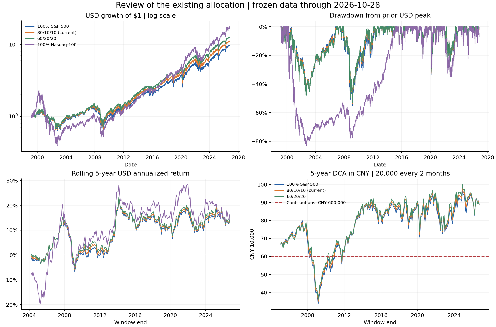

---
aliases:
  - 80-10-10配置量化复核
tags:
  - 理财
  - 资产配置
  - 量化研究
created: 2026-10-29
---

# 现有投资建议的数学复核

研究日期：**2026-10-29，北京时间**。美股日线截止 **2026-10-28 收盘**；官方历史汇率截止 **2026-10-23**；五年滚动计算只用截至 **2026-09** 的完整月份。本次是对既有建议的独立研究，供下一步修订计划使用。

## 问题与判断

既有股票目标是 **80% 标普、10% QQQM、10% BRK.B**，首笔 HKD5,000，之后每两个月约 RMB20,000，长期持有、先规划五年。本轮用户确认：**可以承受 40%—50% 的阶段性亏损，且不影响生活**。当前实际持仓、家庭资产负债、储备规模仍未知，计划入金不能当成已实际投资。

**结论：标普作为核心、两个小比例补充的结构可以保留为股票方案候选；历史数据支持有限改善，不支持把 80/10/10 称为最优比例。真正需要调整的是人民币口径的总风险预算。**这个股票组合历史上仍跌过约 54%，并未把风险降到 40%—50% 以内；人民币升值还可能放大本币亏损。如果 50% 已接近承受上限，以这笔投资预算 **80% 股票＋20% 人民币现金或短存**作为起始参考，比直接把全部预算投股票更符合所给范围。该参考仍须与已有储备合并计算。

BRK.B 的独立估值仍未完成，本次回测没有填补这项缺口，其 10% 股票目标应保留“研究通过后”的条件。报告没有据此触发买卖或修改原执行计划。

## 方法：比较既有方案，不用历史赢家反推权重

使用 Yahoo Finance 日频复权收盘，近似计入分红再投资；**基金自身费用已反映在基金价格中，个人税、换汇价差、汇款费和交易成本未计入**。实际税后结果取决于身份、账户及费用，不能直接套用表中回报。

| 样本 | 使用资产 | 用途 |
| --- | --- | --- |
| 1999-03-10—2026-10-28 | SPY、QQQ、BRK.B | 覆盖互联网泡沫、金融危机及疫情等阶段；前两者是指数暴露代理 |
| 2020-10-13—2026-10-28 | VOO、QQQM、BRK.B | 用实际可选产品交叉检查；起点晚于 2020 年春季暴跌 |
| 2000-01—2026-09 完整月份 | SPY、QQQ、BRK.B＋美联储 H.10 USD/CNY | 按人民币现金流重建五年定投 |

不把 QQQ 的历史冒充 QQQM 的实盘历史。SPY 与 SPYM/VOO 的费用、跟踪差不同，QQQ 与 QQQM 也有费用和结构差异，长期代理回测不是实际产品的精确复制。SPYM 官网说明它在 2020 年前曾跟踪其他基准，因此没有把它成立以来的全部收益直接当作标普收益。[SPYM 发行商及基准变更说明](https://www.ssga.com/us/en/intermediary/etfs/state-street-spdr-portfolio-sp-500-etf-spym)、[QQQ 发行商](https://www.invesco.com/qqq-etf/en/about.html)。

多资产组合按目标权重建立，此后持仓随价格漂移，**每年 6 月、12 月最后一个交易日收盘后再平衡**。这是可复现的统一比较规则；原计划是半年检查、偏离 5 个百分点后优先用新增资金调整，两者并不完全相同。另比较不再平衡与每月再平衡，检查结论是否依赖这一选择。

核心数学量：

\[
\mathrm{CAGR}=\left(\frac{V_T}{V_0}\right)^{1/T}-1,\qquad
\sigma_{\rm annual}=\sqrt{252}\,\mathrm{std}(r_{p,d})
\]

\[
\mathrm{MDD}=\min_t\left(\frac{V_t}{\max_{s\leq t}V_s}-1\right),\qquad
\sigma_p^2=w^\top\Sigma w
\]

\(V_t\) 是不含外部入金的组合净值，\(T\) 按实际日数换算年数；\(\Sigma\) 为日收益样本协方差乘 252。波动率是历史样本统计量，不是未来亏损上限。定投账户的本金增加不能算作收益，也不能直接拿账户余额计算上述净值回撤。

## 结果一：改善收益，但没有显著改变危机中的亏损级别

**长样本：1999-03-10—2026-10-28，美元名义回报。**比例顺序均为标普／纳指／伯克希尔。

| 股票组合 | 历史年化收益 | 年化波动 | 最大回撤 |
| --- | ---: | ---: | ---: |
| 100% 标普 | 8.56% | 19.18% | −55.19% |
| **80/10/10，既有方案** | **9.10%** | **18.89%** | **−53.66%** |
| 90/10/0 | 8.88% | 19.57% | −54.78% |
| 90/0/10 | 8.75% | 18.52% | −54.06% |
| 60/20/20 | 9.61% | 18.85% | −53.09% |
| 100% 纳指 100 | 10.77% | 26.87% | −82.96% |
| 100% BRK.B | 9.07% | 21.84% | −53.86% |

既有方案相对纯标普的历史年化增加 **0.54 个百分点**，最大回撤改善 **1.53 个百分点**。它的最深回撤发生于 **2007-10-12—2009-03-09**；跌 53.66% 后，需要上涨约 **115.8%** 才能回到原高点。

60/20/20 在这份样本中确实更好，不能反过来宣称它必然增加了历史波动；但仅凭这一结果，不足以提高未来主动仓位。伯克希尔是事后选定的存续公司，未来经营和资本配置不会复制过去，20% 单公司仓位的理由还需要独立建立。

分阶段看，80/10/10 的美元年化为：**2000—2009 年 −0.55%、2010—2019 年 13.98%、2020 年初至本次截止 15.77%**。同一组合可经历十年低回报，也可经历强增长阶段，不能把全样本的 9.10% 当作未来每年兑现的利率。

实际产品短样本中，80/10/10 年化 **15.95%**、最大回撤 **−24.37%**；纯 VOO 年化 **15.61%**、最大回撤 **−24.52%**。**短样本缺失早期危机，不能用其约 24% 的回撤预算未来风险。**

## 结果二：QQQM 增加成长暴露，伯克希尔提供部分分散

实际产品共同样本中，日收益相关系数：

| 组合关系 | 相关系数 |
| --- | ---: |
| VOO 与 QQQM | **0.938** |
| VOO 与 BRK.B | 0.583 |
| QQQM 与 BRK.B | 0.386 |

QQQM 与标普高度同向，不能把它当作独立的防守资产。伯克希尔相关性较低，但在长期样本中自身最大回撤也超过 50%。

固定目标权重下，第 \(i\) 项的样本方差贡献份额为：

\[
\mathrm{RC}_i=\frac{w_i(\Sigma w)_i}{w^\top\Sigma w}
\]

实际产品共同样本下，80/10/10 的三项方差贡献约为 **80.55%／12.80%／6.65%**。这是在固定目标权重和历史协方差下的估算，不是对漂移持仓逐日风险的精确分解，也不能衡量所有尾部风险。

为检查收益差异的不确定性，对两个组合的**配对月度对数收益**做循环移动区块重采样，每种区块长度重复 6,000 次，保留区块内的共同变化；使用截至 2026-09 的完整月份。12 个月区块下，80/10/10 相对纯标普的年化收益差 95% 百分位区间：

- 长期代理样本：约 **+0.05 至 +1.01 个百分点**；6／24 个月区块下区间也为正。
- 实际产品短样本：约 **−0.80 至 +1.23 个百分点**；6／24 个月区块下也包含零。

长样本内的改善相对稳定，但重采样条件于既有资产选择和历史路径，不能计入公司存续选择、未来制度变化等不确定性，**不能解释为未来跑赢的概率或有效的择优证明**。本次没有通过最大化历史收益来选择新权重。

既有方案不再平衡／半年再平衡／每月再平衡的长期年化分别约 **8.89%／9.10%／9.07%**，最大回撤都约 **53.7%**。这一比较支持低频检查的可执行性，未证明交易越频繁越好。

## 结果三：五年持续投入，也存在本金亏损

以用户计划建立 **261 个相互重叠的五年窗口**：每两个月期末投入 RMB20,000，30 次合计 **60 万元**，不计首笔 HKD5,000。每笔按当期汇率换美元，新增资金按目标权重购买，半年再平衡，期末按汇率折回人民币。

| 股票方案 | 期末低于本金的历史窗口 | 最差期末市值 | 历史中位数 | 最好期末市值 |
| --- | ---: | ---: | ---: | ---: |
| 100% 标普 | 33/261，12.64% | 33.80 万 | 81.17 万 | 96.92 万 |
| **80/10/10** | **28/261，10.73%** | **34.96 万** | **82.32 万** | **98.43 万** |
| 60/20/20 | 26/261，9.96% | 36.14 万 | 83.23 万 | 99.96 万 |

**这些是相关性很高的历史窗口，不能把 10.73% 当作未来亏损概率，历史最好和最差也不是未来边界。**大量近年强势窗口会提高历史中位数，不能把 82 万写成未来的基准预算。

80/10/10 最差窗口的观察起点为 **2004-02 月末**，按规则首次投入在 **2004-04 月末**，结束于 **2009-02 月末**，60 万变成约 **34.96 万**。相对累计本金少约 **41.73%**；这是终值对本金的损失，不是净值最大回撤。按等间隔现金流求得的年化资金加权收益约 **−22.12%**，也不等于直接把本金损失除以五。

一次投入并持有五年的美元滚动结果也存在亏损：既有方案最差五年年化约 **−6.11%**。因此“五年只是复盘节点”与“五年必须用钱”需要不同的风险安排。

人民币定投计算的逐期形式为：

\[
U_{i,k}^{-}=U_{i,k-1}^{+}(1+r_{i,k}),\quad
U_{i,k}^{+}=U_{i,k}^{-}+w_i\frac{C_k}{S_k},\quad
V_T^{\rm CNY}=S_T\sum_i U_{i,T}
\]

\(U\) 为各项美元市值；\(C_k\) 为当期人民币投入；\(S_k\) 为每美元对应的人民币。再平衡时，将美元总市值重新按 \(w\) 分配。汇率取美联储 H.10 纽约午间参考价，与美股收盘不同步，也不是个人银行成交价；节假日使用此前最近观察日的参考价。这是事后重建现金流，未把 H.10 的每周发布日期还原为实时交易信号。[官方历史数据](https://www.federalreserve.gov/releases/h10/hist/dat00_ch.htm)、[H.10 口径说明](https://fred.stlouisfed.org/series/DEXCHUS)。

## 当前价格与未来回报：做敏感性分析

10 月 28 日美联储决定维持联邦基金利率目标 **3.75%—4.00%**，不能把持续降息作为收益测算的已知前提。[美联储声明](https://www.federalreserve.gov/newsevents/pressreleases/monetary20261028a.htm)。

SPYM 发行商列示的 **2026-10-27 FY1 预期市盈率为 20.44 倍**，指数股息率约 **1.10%**。预期盈利本身可修订，不能仅凭这个市盈率认定低估。[发行商当期估值](https://www.ssga.com/us/en/intermediary/etfs/state-street-spdr-portfolio-sp-500-etf-spym)。

简化价格分解：若前瞻 EPS 在五年内以 \(g\) 增长，期末采用一致的前瞻市盈率口径，则

\[
r_{\rm price}=(1+g)\left(\frac{\mathrm{PE}_5}{20.44}\right)^{1/5}-1
\]

下面将价格年化加约 1.10% 股息率，作为**粗略名义总回报敏感性**，没有完整模拟分红路径、税费、回购及指数成分变更；不是估值模型给出的回报预测，也不代表整个 80/10/10 组合的预测。

| 假设 EPS 年增长 | 期末 PE 降至 16 倍 | 期末 PE 保持 20.44 倍 | 期末 PE 升至 24 倍 |
| --- | ---: | ---: | ---: |
| 4% | 约 0.13%/年 | 约 5.10%/年 | 约 8.49%/年 |
| 8% | 约 3.94%/年 | 约 9.10%/年 | 约 12.62%/年 |
| 12% | 约 7.75%/年 | 约 13.10%/年 | 约 16.75%/年 |

即使盈利增长 8%，估值从 20.44 压缩到 16 倍，粗略总回报仍可能只在约 4%/年；不能把盈利增长或近年股价涨幅直接外推为投资收益。

进一步沿用 30 次定投，假设美元总回报平滑实现、汇率从 **6.67 线性变化**到表列终点：

| 假设美元年化总回报 | 汇率终点 5.50 | 汇率终点 6.00 | 汇率终点 6.67 | 汇率终点 7.30 |
| --- | ---: | ---: | ---: | ---: |
| −10% | 43.16 万 | 44.89 万 | 47.05 万 | 48.94 万 |
| 0% | 54.58 万 | 56.98 万 | 60.00 万 | 62.65 万 |
| 5% | 61.32 万 | **64.13 万** | **67.68 万** | 70.80 万 |
| 8% | 65.73 万 | 68.82 万 | 72.71 万 | 76.15 万 |
| 12% | 72.08 万 | 75.56 万 | 79.96 万 | 83.85 万 |

**这些是无概率含义的情景，不是预测区间。**同为美元年化 5%、汇率最终 6.00，若升值主要发生在前一年、五年内线性发生、最后一年，终值分别约 **67.02 万／64.13 万／61.57 万**，因为新增资金换汇的时点不同。实际股票回报的先后顺序同样影响定投终值，不能只看长期平均回报。

## 把 40%—50% 承受力转换成仓位预算

取一个**人为设定、接近但略深于既有组合历史美元回撤**的联合压力情景：股票美元市值跌 **55%**，同时 USD/CNY 从 6.67 变为 6.00。两项相乘后：

\[
L_{\rm stock,CNY}=1-(1-55\%)\frac{6.00}{6.67}
\approx59.52\%
\]

假设其余部分持人民币现金，瞬间名义价值不变，压力期间没有再平衡或额外入金；冲击前股票权重为 \(q\)，则组合损失约为 \(q\times59.52\%\)。

| 冲击前股票比例 | 人民币现金比例 | 该情景下总损失 |
| --- | ---: | ---: |
| 100% | 0% | −59.52% |
| 90% | 10% | −53.57% |
| **80%** | **20%** | **−47.62%** |
| 70% | 30% | −41.66% |

\[
q\leq\frac{\text{可接受损失}}{\text{股票人民币压力损失}}
\]

用 50%／45%／40% 作为这个情景下的损失预算，股票比例分别约不超过 **84.0%／75.6%／67.2%**。这是压力情景预算，**无法保证真实回撤受限于给定数字**；更深下跌、汇率变化或风险资产重新加仓都会改变结果。现金还面临通胀侵蚀，此处只是为明确瞬时压力计算假设。

## 本轮建议如何落地

1. **股票内部暂不提高主动仓位。**保留标普核心；QQQM 的 10% 是成长倾向，不是避险安排。BRK.B 仍须通过独立经营和估值审查，待研究额度可留现金。100% 标普仍是可比较的简化方案，回测没有证明必须凑齐三个标的。
2. **若 50% 接近实际承受上限，先参考 80% 股票＋20% 人民币现金或短存。**股票内部采用既有目标时，总预算对应 **64% 标普、8% QQQM、8% BRK.B、20% 人民币储备**。已有可用于该风险预算的储备应合并计算；家庭应急资金和确定要用的钱仍先独立保障，不用本报告代替资产负债核对。
3. **每两个月 2 万元的参考分配：**12,800 元等值标普、1,600 元等值 QQQM、1,600 元等值研究通过后的 BRK.B、4,000 元人民币储备。BRK.B 未通过前，其 1,600 元也暂留现金。按实际净到账金额执行，不为整股凑单偏离预算；这只是新预算的研究建议。
4. **低频复核，新增资金优先补不足。**半年检查和目标偏离纪律仍可沿用。本次没有证明等待某次财报或宏观事件能提高收益，也没有建立短期择时模型。
5. **五年支出不依赖股票终值。**若后来确定第五年有刚性支出，应按金额和日期逐步落实人民币资金，不能把 67.68 万或历史中位数写成保证可用的预算。

## 图表与复现

左上：美元净值，纵轴对数；右上：美元净值回撤；左下：一次投入持有五年的美元年化；右下：每两个月 2 万元、五年共 60 万元的人民币期末市值。图中不同起点窗口相互重叠，不能视为独立样本。可另取 [PDF](assets/投资量化复核-2026-10-29/investment_review.pdf)。

复现文件位于 `notes/理财/assets/投资量化复核-2026-10-29/`：

- `download_data.py`：冻结数据与哈希清单。已有原始快照保持不变。
- `analyze.py`：组合净值、协方差、区块重采样、现金流、情景和图表；只读取本地数据，不访问交易接口。
- `manifest.json`：来源、观察日期、行数、原始文件 SHA-256。
- `results/historical_metrics.csv`、`results/rolling_5y_DCA_CNY.csv`、`results/forward_DCA_scenarios.csv`：主要完整计算结果。
- `README.md`：运行方式、数据质量和模型边界。

已核对单资产净值与复权价格比值相等、零收益零汇率变化时终值等于 60 万、5% 平滑收益递推与逐笔求和相等、资金加权年化反解一致，并用独立的持有单位数公式复核第一段标普定投。检查通过仅说明实现与所述规则一致，不验证未来收益。

## Sources

本次实际读取的 Vault 相对路径：

- `AGENTS.md`
- `notes/理财/个人股票配置与执行计划-2026-10-27.md`
- `notes/理财/美股建仓分析-2026-10-27.md`
- `notes/理财/人民币汇率破6的可能性与境内投资启示-2026-10-28.md`
- `notes/理财/INDEX.md`
- `notes/理财/assets/投资量化复核-2026-10-29/` 下本次下载的数据与生成的计算结果。

既有方案见 [[notes/理财/个人股票配置与执行计划-2026-10-27|个人股票配置与执行计划]]，汇率背景见 [[notes/理财/人民币汇率破6的可能性与境内投资启示-2026-10-28|人民币汇率研究]]。本轮风险偏好来自当前会话的明确回答，不从历史文件推测。

外部原始资料：

- [SPYM 发行商：费用、持仓、估值、基准变更](https://www.ssga.com/us/en/intermediary/etfs/state-street-spdr-portfolio-sp-500-etf-spym)。
- [SPY 发行商：标普跟踪目标及基金信息](https://www.ssga.com/us/en/intermediary/etfs/state-street-spdr-sp-500-etf-trust-spy)。
- [Invesco：QQQ 跟踪纳斯达克 100](https://www.invesco.com/qqq-etf/en/about.html)。
- [美联储 2026-10-28 决议](https://www.federalreserve.gov/newsevents/pressreleases/monetary20261028a.htm)。
- [美联储 H.10 人民币历史数据](https://www.federalreserve.gov/releases/h10/hist/dat00_ch.htm)、[FRED DEXCHUS 口径说明](https://fred.stlouisfed.org/series/DEXCHUS)。
- [Yahoo 日线数据接口示例：SPY](https://query1.finance.yahoo.com/v8/finance/chart/SPY?period1=915148800&period2=1793232000&interval=1d&events=div%2Csplits)，其余证券同结构，精确参数与快照哈希见清单。它是行情供应商来源，并非基金发行商的审计数据。

数据质量处理：未使用 Yahoo `CNY=X` 序列；其中 2011-07-18／19 出现约 −8.87%／+10.33% 的相邻异常跳动，而美联储原始记录分别为 6.4688／6.4631。人民币测算统一使用官方 H.10，并保留实际发布时间边界。没有把异步参考汇率伪称可成交汇率，也没有用未来数据补齐最后一周。
