# GPU

## GPU 的执行与性能

GPU 通过大规模并行提高吞吐量。下面先介绍 CUDA 的执行层级和内存模型，再说明性能瓶颈及对应的优化方法。

### Block、Warp 与 Thread

CUDA 中需要区分两层概念：

- **Grid、Block 和 Thread** 属于 CUDA 编程模型，其数量和组织方式由 kernel 启动配置决定；
- **Warp** 属于 GPU 执行模型，由 GPU 自动将 block 内的 thread 分组形成。

下面使用同一个 kernel 说明这些概念：

```cuda
__global__ void process(const float *input, float *output) {
    int i = blockIdx.x * blockDim.x + threadIdx.x;

    float value = input[i];

    if (value > 0) {
        value = sqrtf(value);
    } else {
        value = 0;
    }

    output[i] = value;
}
```

假设输入正好包含 1024 个元素，启动方式为：

```cuda
process<<<4, 256>>>(input, output);
```

#### Kernel 如何创建 Grid、Block 和 Thread

一次 kernel 启动会产生一个 **grid**。`process<<<4, 256>>>` 中的两个数字分别表示：

- grid 包含 4 个 block；
- 每个 block 包含 256 个 thread；
- 整个 grid 总共包含 `4 × 256 = 1024` 个 thread。

```text
Grid
├── Block 0：256 Threads
├── Block 1：256 Threads
├── Block 2：256 Threads
└── Block 3：256 Threads
```

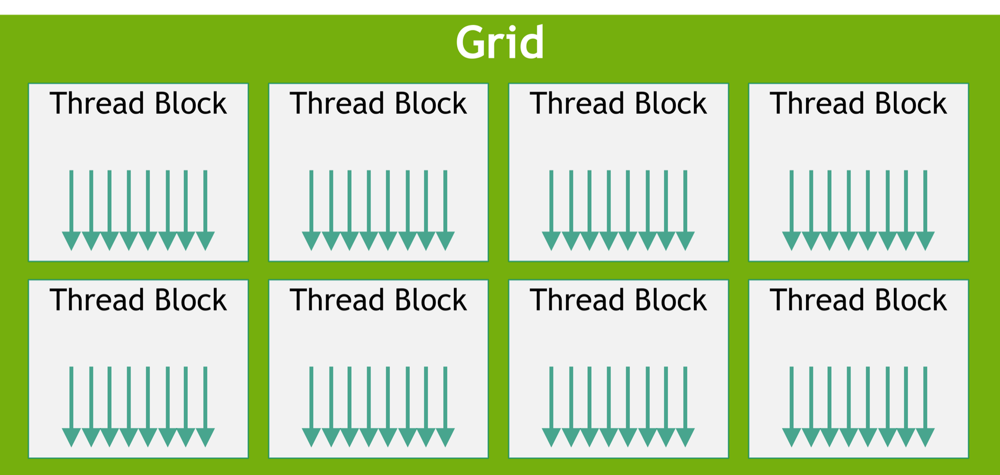

> 一个 grid 包含多个 thread block，每个 block 又包含多个 thread。图中的箭头表示 thread，数量仅用于展示层级关系，不代表实际数量。来源：[NVIDIA CUDA Programming Guide — Thread Blocks and Grids](https://docs.nvidia.com/cuda/cuda-programming-guide/01-introduction/programming-model.html#thread-blocks-and-grids)。

所有 thread 执行相同的 `process` kernel，但每个 thread 可以通过自己的索引处理不同的数据：

```cuda
int i = blockIdx.x * blockDim.x + threadIdx.x;
```

其中：

- `blockIdx.x` 是当前 block 在 grid 中的编号；
- `blockDim.x` 是每个 block 包含的 thread 数量；
- `threadIdx.x` 是当前 thread 在 block 中的编号。

例如：

```text
blockIdx.x  = 2
blockDim.x  = 256
threadIdx.x = 10

i = 2 × 256 + 10 = 522
```

这个 thread 会读取 `input[522]`，完成计算后再写入 `output[522]`。

因此，thread 是程序员划分数据和工作的最小逻辑单位。Kernel 启动配置决定创建多少个 thread，kernel 函数体决定每个 thread 执行什么操作。

#### 为什么需要 Block

Block 首先用于把一个大规模任务拆成多个相对独立的部分。在当前例子中：

```text
Block 0：处理 input[0]   ～ input[255]
Block 1：处理 input[256] ～ input[511]
Block 2：处理 input[512] ～ input[767]
Block 3：处理 input[768] ～ input[1023]
```

Grid 可以包含远多于 GPU 中 SM 数量的 block。GPU 会在运行时把 block 分配给可用的 SM，因此同一个 kernel 可以在包含不同数量 SM 的 GPU 上执行。

Block 还定义了 thread 的资源共享和同步范围。同一个 block 内的 thread：

- 会在同一个 SM 上执行；
- 可以访问该 block 的 shared memory；
- 可以通过 `__syncthreads()` 进行 block 内同步；
- 可以共同完成矩阵 tile、归约等需要多线程协作的局部计算。

不同 block 的执行顺序没有保证。普通 CUDA kernel 不能假设 Block 0 一定早于 Block 1，也不能使用 `__syncthreads()` 在不同 block 之间同步。

因此，block 同时承担两个作用：

1. 将整个 grid 的工作拆成可以独立调度的部分；
2. 定义一组 thread 共享数据和进行同步的范围。
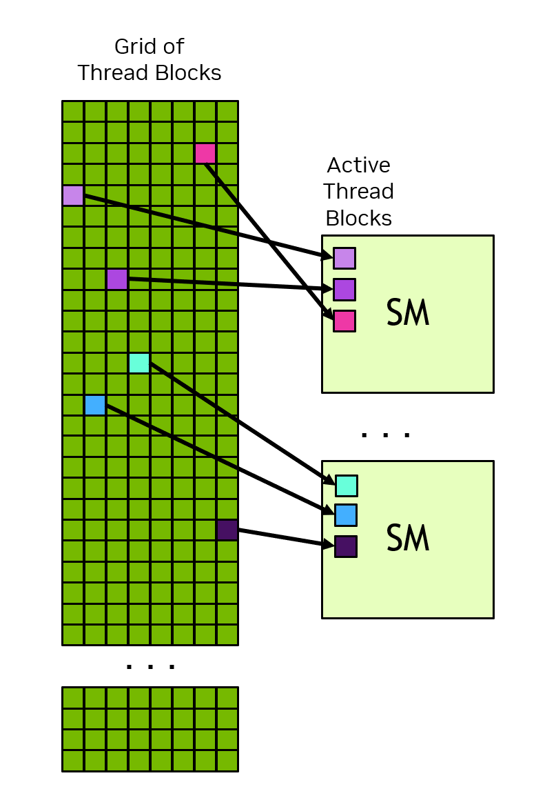

> Grid 中的 block 会被动态分配给可用的 SM。一个 SM 可以同时驻留多个 active thread block，实际数量取决于 GPU 架构以及每个 block 使用的 thread、register 和 shared memory。来源：[NVIDIA CUDA Programming Guide — Thread Blocks and Grids](https://docs.nvidia.com/cuda/cuda-programming-guide/01-introduction/programming-model.html#thread-blocks-and-grids)。

#### 为什么 Block 还要划分成 Warp

程序员通过启动配置创建 block 和 thread，但不会显式创建 warp。

一个 block 中的 thread 会按照线性编号，以固定数量自动组成 warp。Warp 的成员关系在执行期间保持不变；SM 以 warp 为单位发射指令，让不同 lane 执行相同的当前指令并处理各自的数据。

NVIDIA GPU 的一个 warp 通常包含 32 个 thread。当前例子中，每个 block 有 256 个 thread，因此会形成 8 个 warp：

```text
Block：256 Threads
├── Warp 0：Thread   0～31
├── Warp 1：Thread  32～63
├── Warp 2：Thread  64～95
├── Warp 3：Thread  96～127
├── Warp 4：Thread 128～159
├── Warp 5：Thread 160～191
├── Warp 6：Thread 192～223
└── Warp 7：Thread 224～255
```

一个 warp 包含 32 个编号为 0～31 的 **lane**。Lane 表示 warp 内执行 thread 当前指令的位置，不是独立的软件 thread，也不对应某个固定的 SP。如果 block 的 thread 数量不是 32 的整数倍，最后一个 warp 仍然会形成，但部分 lane 没有有效 thread。例如，33 个 thread 会形成两个 warp，第二个 warp 只有一个有效 lane。

Warp 是 block 和 thread 之间的指令调度单位：
- 以整个 block 为单位调度，粒度太大；
- 逐个调度 thread，则取指、译码和状态管理的成本过高。
- 以 warp 为单位时，32 个 thread 可以共享指令调度，而不同 warp 可以独立等待和推进。
- 当一个 warp 等待访存或指令结果时，warp scheduler 可以执行其他 ready warp，以隐藏等待延迟。

因此，所有 thread 执行相同的 kernel，并不表示它们在同一时刻执行相同的指令。在 `process` kernel 中，不同 warp 可能处于不同状态：

```text
Warp 0：等待 input[i] 从 global memory 返回
Warp 1：执行 value > 0 的判断
Warp 2：执行 sqrtf(value)
Warp 3：写入 output[i]
```

---


这一层级可以概括为：

| 概念 | 如何形成 | 主要作用 |
| --- | --- | --- |
| Grid | 一次 kernel 启动产生 | 表示这次 kernel 的全部并行工作 |
| Block | 由 kernel 启动配置指定 | 拆分任务，定义 shared memory 和同步范围 |
| Thread | 数量由 kernel 启动配置指定 | 通过自己的索引处理一份数据 |
| Warp | GPU 自动将连续 thread 分组形成 | 作为指令执行和调度单位 |
| Lane | Warp 内编号为 0～31 的执行位置 | 执行对应 thread 的当前指令 |

参考：[NVIDIA CUDA Programming Guide — Thread Blocks and Grids](https://docs.nvidia.com/cuda/cuda-programming-guide/01-introduction/programming-model.html#thread-blocks-and-grids)、[Warps and SIMT](https://docs.nvidia.com/cuda/cuda-programming-guide/01-introduction/programming-model.html#warps-and-simt) 与 [Stanford CS336 Spring 2025 — Lecture 5: GPUs](https://github.com/stanford-cs336/spring2025-lectures/blob/main/nonexecutable/2025%20Lecture%205%20-%20GPUs.pdf)。

### SM、Warp Scheduler 与执行单元

前一节描述了程序如何组织工作。接下来需要说明这些 block、warp 和 thread 如何映射到 GPU 硬件。

根据 NVIDIA CUDA Programming Guide，可以把 GPU 理解为由多个 **SM（Streaming Multiprocessor）** 组成。每个 SM 都有自己的 register file、shared memory / L1 cache、warp scheduler，以及执行不同类型指令的 functional unit。

每个 SM 拥有自己的寄存器资源以及 L1/shared memory；GPU 上的 SM 共享片上 L2 Cache，并通过内存控制器访问 HBM。

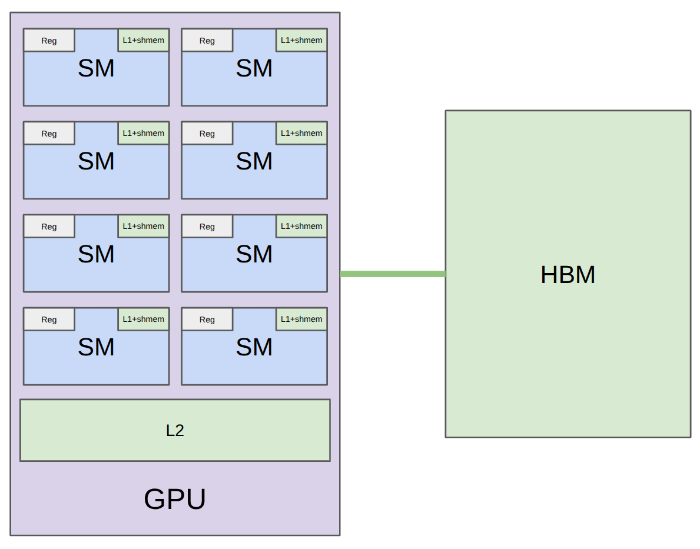

> 该图是简化结构，不代表某一款 GPU 的精确物理布局。来源：[Stanford CS336 Lectures — gpu-hardware.png](https://github.com/stanford-cs336/lectures/blob/main/images/gpu-hardware.png)。

#### Block 如何驻留在 SM

一个 block 的所有 thread 都会在同一个 SM 上执行。GPU 决定每个 block 被分配到哪个 SM，一个 SM 可以同时驻留一个或多个 block。

这里的“驻留”表示这些 block 执行所需的硬件资源已经在该 SM 上分配，包括：

- 每个 thread 需要的 register；
- 每个 block 需要的 shared memory；
- block 中所有 thread 和 warp 的执行状态。

一个 SM 的 register、shared memory、最大 thread 数量和最大 resident block 数量都是有限的。如果单个 block 使用的资源较多，一个 SM 能同时容纳的 block 和 warp 就会减少。

这些 warp 不会同时执行所有指令，而是由 SM 内的 warp scheduler 根据就绪状态选择。

#### Warp Scheduler 如何推进 Warp

SM 会同时维护多个 resident warp。每个 warp 可能处于不同状态：

```text
Warp A0：等待 global memory
Warp A1：Ready
Warp B0：等待前一条指令的结果
Warp B1：Ready
```

Warp Scheduler 会从已经就绪的 warp 中选择一个，并把它当前需要执行的指令发送给对应的执行单元。例如，Warp A0 等待显存数据时，scheduler 可以先推进 Warp A1 或 Warp B1。

这种方式称为 延迟隐藏（latency hiding）。它不会降低 global memory 本身的访问延迟，而是让 SM 在某个 warp 等待时继续执行其他 warp，从而减少执行单元的空闲时间。

Warp 切换不等同于 CPU 操作系统线程的上下文切换。Resident thread 的 register 和执行状态已经保存在 SM 上，因此 scheduler 可以在多个 ready warp 之间快速切换。

需要区分：

- block 是资源分配和 thread 协作单位；
- warp 是 SM 的主要指令调度单位；
- thread 是处理具体数据的逻辑执行实例。

#### SP 和其他执行单元如何完成指令

CS336 使用 **SP（Streaming Processor）** 描述 SM 内执行 thread 标量算术运算的单元。在 NVIDIA 的常见语境中，SP 也经常被称为 **CUDA Core**。这是便于理解执行层级的简化说法。

现代 GPU 的 SM 内包含多种 functional unit，而不是只有一种 SP：

```text
GPU
└── SM
    ├── Warp Scheduler
    ├── FP32 / INT32 执行单元（SP / CUDA Core）
    ├── Tensor Core
    ├── Load / Store Unit
    ├── Special Function Unit
    ├── Register File
    └── Shared Memory / L1 Cache
```

不同指令会被发送到匹配的执行单元：

| `process` 中的操作 | 主要涉及的硬件 |
| --- | --- |
| `input[i]` | Load / Store Unit 和内存系统 |
| `value > 0` | 比较指令和控制流处理 |
| `sqrtf(value)` | 特殊函数相关指令或多条指令组合，取决于架构和编译结果 |
| `value = 0` | 标量执行单元和 register |
| `output[i] = value` | Load / Store Unit 和内存系统 |

SP 不会从开始到结束固定绑定某个 thread，也不是一个 SP 只能执行加法、另一个 SP 只能执行乘法。以 FP32 执行单元为例，它可以在不同周期执行自己支持的多种标量浮点指令。执行单元之间的分工针对的是**指令类别**，不是具体 thread 或业务任务。

这里的 **Tensor Core** 通常指 NVIDIA GPU 中用于加速矩阵乘加等张量计算的专用单元。CS336 在比较 GPU 和 TPU 时写过 “A GPU has more SMs; TPUs has fewer TCs”，在该页中用 TC 泛指类似的大型矩阵运算单元；但课件随后也明确将 Tensor Core 作为 NVIDIA V、T 系列引入的矩阵计算硬件。

从 kernel 启动到硬件执行的完整过程如下：

```text
process<<<4, 256>>>
        ↓
产生一个 Grid
        ↓
Grid 包含 4 个 Block
        ↓
每个 Block 包含 256 个 Thread
        ↓
GPU 将每个 Block 分配到某个 SM
        ↓
每个 Block 自动形成 8 个 Warp
        ↓
Warp Scheduler 选择 Ready Warp
        ↓
指令被发送到匹配的执行单元
        ↓
各 Lane 完成对应 Thread 的当前操作
```

| 概念 | 所属层次 | 谁决定或形成 | 主要作用 |
| --- | --- | --- | --- |
| Grid | CUDA 编程模型 | Kernel 启动配置 | 表示一次 kernel 的全部工作 |
| Block | CUDA 编程模型 | Kernel 启动配置 | 拆分任务，定义资源共享和同步范围 |
| Thread | CUDA 编程模型 | Kernel 启动配置确定数量 | 处理具体数据 |
| Warp | GPU 执行模型 | GPU 自动划分 | 指令执行和调度单位 |
| Lane | GPU 执行模型 | Warp 的执行结构 | 表示 warp 内的执行位置 |
| SM | GPU 硬件 | GPU 将 block 调度到 SM | 提供资源并调度 warp |
| SP / Functional Unit | GPU 硬件 | SM 内部硬件结构 | 完成对应类别的具体指令 |

使用 Triton 编程时，开发者描述的是并行的 program instance。在 NVIDIA GPU 上，它通常会映射为类似 CUDA thread block 的执行任务，再由 GPU 调度到 SM。Triton 开发者不直接指定某个 SM，但 program instance 的 warp 数量、register 和 shared memory 使用量会影响 SM 能同时驻留多少任务。具体编程模型和示例见：[Triton Kernel：从 CS336 Lecture 6 理解 GPU Kernel 编程](triton-kernel.md)。

### GPU Memory Model

CUDA Memory Model 主要描述不同内存空间的**作用域、生命周期和访问权限**，不等同于 GPU 的完整物理缓存结构。

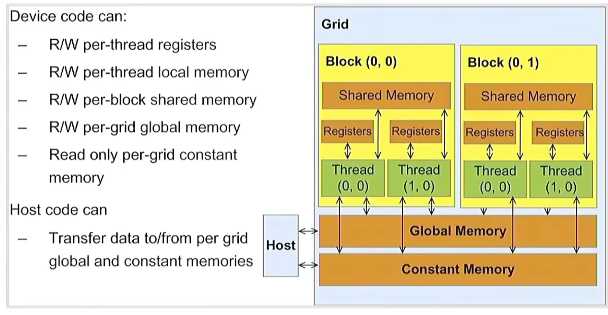

> 图中展示 thread 私有的 register / local memory、block 共享的 shared memory，以及设备范围的 global / constant memory。来源：[NVIDIA CUDA C++ Best Practices Guide — Device Memory Spaces](https://docs.nvidia.com/cuda/cuda-c-best-practices-guide/index.html#device-memory-spaces)。

Device code 可以读写 register、local memory、shared memory 和 global memory，并读取 constant memory。Host code 可以分配 global memory、在 host 与 device 之间传输数据，并向 constant memory 写入 kernel 使用的数据。

#### Register

每个活跃 thread 都有自己的寄存器状态。Resident thread 的 register 已分配在 SM 上，因此切换 warp 时通常不需要像 CPU 操作系统线程那样保存和恢复上下文。

Register 位于片上，速度快但总量有限。单个 thread 使用过多 register 会产生 **register pressure**，减少一个 SM 能同时驻留的 thread、warp 或 block，从而降低 occupancy。

参考：[Registers](https://docs.nvidia.com/cuda/cuda-c-best-practices-guide/index.html#registers)。

#### Local Memory

Local memory 属于单个 thread，但通常位于片外 device memory，访问成本接近 global memory，并通过相应缓存访问。

让编译器使用 local memory的情况：寄存器不足导致 register spilling、较大的自动数组或结构体、难以静态索引的数组。使用量过高通常意味着更多高延迟访存，可以通过 `nvcc --ptxas-options=-v` 查看。

参考：[Local Memory](https://docs.nvidia.com/cuda/cuda-c-best-practices-guide/index.html#local-memory)。

#### Shared Memory

Shared memory 位于 SM 片上，作用域和生命周期属于 block。同一 block 的 thread 可以通过它交换、重排和复用数据，并使用 `__syncthreads()` 同步；不同 block 不能直接共享同一块 shared memory。

它常用于 tiling、减少重复 global memory 访问和保存中间结果。Shared memory 被划分为多个 bank；同一 warp 的多个地址落入同一 bank 时可能产生 **bank conflict** 并被串行化，读取同一地址则可以广播。

参考：[Shared Memory](https://docs.nvidia.com/cuda/cuda-c-best-practices-guide/index.html#shared-memory)。

#### Global Memory

Global memory 通常对应 GPU 的 HBM 或 GDDR 显存，所有 thread 都可访问，host 也可以通过 CUDA API 分配、复制或映射。它不只存在于某一次 grid：生命周期通常由 host 控制，例如从 `cudaMalloc()` 到 `cudaFree()`。HBM 和 GDDR 都基于 DRAM，详见本章末的补充说明。

性能主要取决于访问模式。Warp 中相邻 thread 访问相邻地址时，请求可以合并为较少的内存事务，即 **coalesced access**；离散访问需要更多事务并浪费带宽。

参考：[Coalesced Access to Global Memory](https://docs.nvidia.com/cuda/cuda-c-best-practices-guide/index.html#coalesced-access-to-global-memory)。

#### Constant Memory

Constant memory 对 device code 只读，由 host 在 kernel 启动前写入，并带有专用缓存。同一 warp 的 thread 读取相同地址时可以广播；读取多个不同地址时通常会被串行化，成本随不同地址数量增加。

参考：[Constant Memory](https://docs.nvidia.com/cuda/cuda-c-best-practices-guide/index.html#constant-memory)。

#### L1 与 L2 Cache

内存空间示意图强调作用域，没有完整展示缓存路径，可以简化理解为：

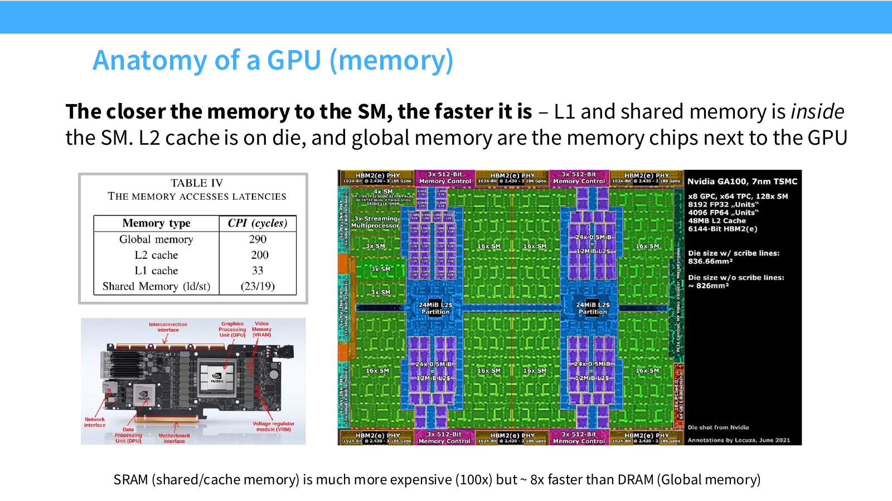

> L1 Cache 和 shared memory 位于 SM 内，L2 Cache 位于 GPU die 上，global memory 对应 GPU 外部的显存芯片。图中的延迟和成本数字来自课件引用的特定硬件示例，只用于说明层级差异，不能作为所有 GPU 的固定参数。来源：[Stanford CS336 Spring 2025 — Lecture 5: GPUs，第 10 页](https://github.com/stanford-cs336/spring2025-lectures/blob/main/nonexecutable/2025%20Lecture%205%20-%20GPUs.pdf)。

```text
Thread
├── Register
├── Local Memory ───────────────┐
├── Shared Memory（SM 片上）    │
└── Global / Constant Memory ───┼→ L1 / 专用缓存 → L2 → HBM / GDDR
                                └───────────────────────────────
```

L1 Cache 通常以 SM 为范围，L2 Cache 由整个 GPU 的 SM 共享。具体缓存策略随 compute capability 和 GPU 架构变化，不能把示意图理解成所有 GPU 都完全相同。

#### 内存空间对照

| 内存类型 | 访问权限 | 作用域 | 生命周期 | 典型物理位置 | 关键问题 |
| --- | --- | --- | --- | --- | --- |
| Register | R/W | 单个 thread | Thread | SM 片上 | register pressure、occupancy |
| Local Memory | R/W | 单个 thread | Thread | 片外 device memory | spilling、高延迟 |
| Shared Memory | R/W | block 内 thread | Block | SM 片上 | 容量、bank conflict、同步 |
| Global Memory | R/W | 所有 thread 与 host | Host allocation | HBM / GDDR | 合并访问、带宽、延迟 |
| Constant Memory | Device 只读、Host 可写 | 所有 thread 与 host | Host allocation | 片外内存及专用缓存 | warp 是否读取相同地址 |
| L1 Cache | 硬件管理 | 通常单个 SM | 硬件管理 | SM 片上 | 架构相关的缓存策略 |
| L2 Cache | 硬件管理 | 整个 GPU | 硬件管理 | GPU 芯片上 | 所有 SM 共享、显存流量 |

总体规律是：越接近 SM 的存储通常越快但容量越小；越接近 HBM / GDDR，容量越大但延迟越高。实际性能还取决于缓存命中、coalesced access、bank conflict、occupancy 和并发 warp 数量。

#### 补充：DRAM 与 HBM / GDDR

DRAM（Dynamic Random-Access Memory）使用电容保存数据，需要周期性刷新。GPU 常用的 GDDR（Graphics Double Data Rate）和 HBM（High Bandwidth Memory）都属于 DRAM：GDDR 常见于消费级 GPU，HBM 通过堆叠芯片和宽接口提供更高带宽，常见于 AI 加速器。

DRAM 通常位于 GPU 芯片外，容量大、单位 bit 成本低，但访问延迟高。在 CUDA 编程模型中，HBM / GDDR 通常承载 global memory；L1、L2 等缓存用于减少对外部 DRAM 的直接访问。参考：[CS336 Lecture 5](https://github.com/stanford-cs336/spring2025-lectures/blob/main/nonexecutable/2025%20Lecture%205%20-%20GPUs.pdf) 与 [NVIDIA CUDA C++ Best Practices Guide — Device Memory Spaces](https://docs.nvidia.com/cuda/cuda-c-best-practices-guide/index.html#device-memory-spaces)。

### 理解 GPU 性能

这一章分为三部分：先建立 FLOPS、算术强度和内存访问等前置知识，再分析 GPU 为什么变慢，最后给出 CS336 与 CUDA Guide 中对应的优化方向。

#### 第一部分：前置知识

**FLOP 与 FLOPS。** FLOP（Floating-Point Operation）表示一次浮点运算；FLOPS（Floating-Point Operations Per Second）表示每秒浮点运算次数，用于衡量计算吞吐量。通常加法或乘法各记 1 FLOP，FMA 包含一次乘法和一次加法，记 2 FLOPs；TFLOPS 和 PFLOPS 分别表示每秒万亿和千万亿次浮点运算。峰值 FLOPS 不等于程序速度：计算单元等待数据时，理论算力无法充分利用。

**Compute scaling is faster than memory scaling。** 这句话概括了现代硬件趋势：矩阵计算吞吐量的增长快于 DRAM 和多设备互联带宽的增长。数据供给跟不上计算能力时，执行单元会等待内存，这就是 **memory wall**。

```text
DRAM / HBM 带宽增长较慢
        ↓
数据供给不足
        ↓
SM / Tensor Core 等待数据
```

**Compute-bound 与 Memory-bound。**

- **Compute-bound**：执行时间主要受计算吞吐量限制，提高有效 FLOPS 可能带来明显收益；
- **Memory-bound**：执行时间主要受数据搬运限制，增加计算单元也难以提速；
- **Bandwidth-bound**：常见的 memory-bound 情况，瓶颈位于 DRAM 或互联带宽。

矩阵乘法会对输入数据执行大量乘加，通常具有较高计算密度；ReLU、向量加法等 elementwise operation 每个元素只做少量计算，却需要读写整个张量，因此更容易受显存带宽限制。

**Roofline Model。** Roofline 用算术强度判断 workload 更接近计算瓶颈还是内存瓶颈：

```text
实际性能 ≤ min(
    GPU 峰值 FLOPS,
    内存带宽 × Arithmetic Intensity
)

Arithmetic Intensity = FLOPs / 搬运字节数
```

算术强度低时，性能位于斜线区域并受内存带宽限制；算术强度高到超过转折点后，性能受峰值计算吞吐量限制。CS336 部分示例使用 `bytes/FLOP` 表示数据搬运成本，它与 Roofline 常用的 `FLOPs/byte` 互为倒数。

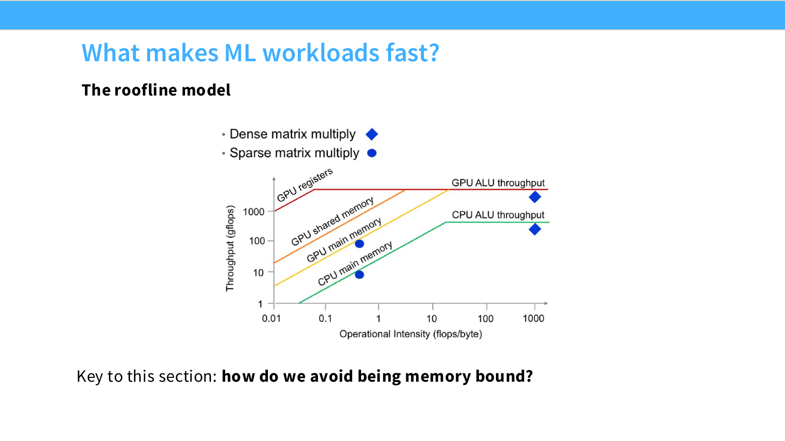

> 转折点由“峰值 FLOPS ÷ 内存带宽”决定。来源：[Stanford CS336 Spring 2025 — Lecture 5: GPUs](https://github.com/stanford-cs336/spring2025-lectures/blob/main/nonexecutable/2025%20Lecture%205%20-%20GPUs.pdf)。

#### 第二部分：GPU 为什么会变慢

CPU 主要优化少量线程的单任务延迟，使用分支预测、乱序执行和多级缓存等复杂控制逻辑；GPU 主要优化大量线程的总吞吐量，把更多硬件资源用于并行执行单元。

换句话来讲，GPU 只有在存在足够并行工作，并且数据和指令能持续送到执行单元时，才能接近峰值性能。


> CPU 通过 PCIe 等互联与 GPU 通信；GPU 内部包含多个 SM 和独立的 global memory。来源：[Stanford CS336 Lectures — cpu-gpu.png](https://github.com/stanford-cs336/lectures/blob/main/images/cpu-gpu.png)。

NVIDIA CUDA C++ Best Practices Guide 将性能优化归纳为三个方向。GPU 没有达到预期性能时，可以依次检查：

1. **Parallel execution 是否充分。** GPU 需要同时执行足够多的独立任务。算法应提供足够的 block 和 thread，并选择合适的 kernel execution configuration，例如 grid size 和 block size，让更多 SM 获得工作。互不依赖的任务还可以放入不同 stream，使它们并发执行，并在硬件支持时让数据传输与计算重叠。
2. **Memory usage（内存使用）是否高效。** Host 与 device 之间的数据传输，以及频繁访问 global memory，都会增加等待时间。Guide 建议减少不必要的数据传输，让需要重复使用的数据尽量保留在 device 或 shared memory，并让同一 warp 的访存尽可能连续和合并。在重新计算成本较低时，也可以使用 recomputation 代替保存、传输和重新读取中间结果。
3. **Instruction usage（指令使用）是否高效。** 不同指令的吞吐量不同，应避免不必要的低吞吐指令；在结果允许时，可以使用低精度或更高吞吐的指令。SIMT 模型下还要注意 control flow：同一 warp 的 thread 进入不同分支时会发生 warp divergence，不同路径需要分别执行，从而降低有效指令吞吐量。

来源：[NVIDIA CUDA C++ Best Practices Guide — Overall Performance Optimization Strategies](https://docs.nvidia.com/cuda/cuda-c-best-practices-guide/index.html#overall-performance-optimization-strategies)。其中访存合并和分支发散的具体行为分别见 [Coalesced Access to Global Memory](https://docs.nvidia.com/cuda/cuda-c-best-practices-guide/index.html#coalesced-access-to-global-memory) 与 [Branching and Divergence](https://docs.nvidia.com/cuda/cuda-c-best-practices-guide/index.html#branching-and-divergence)。

#### 第三部分：优化方向

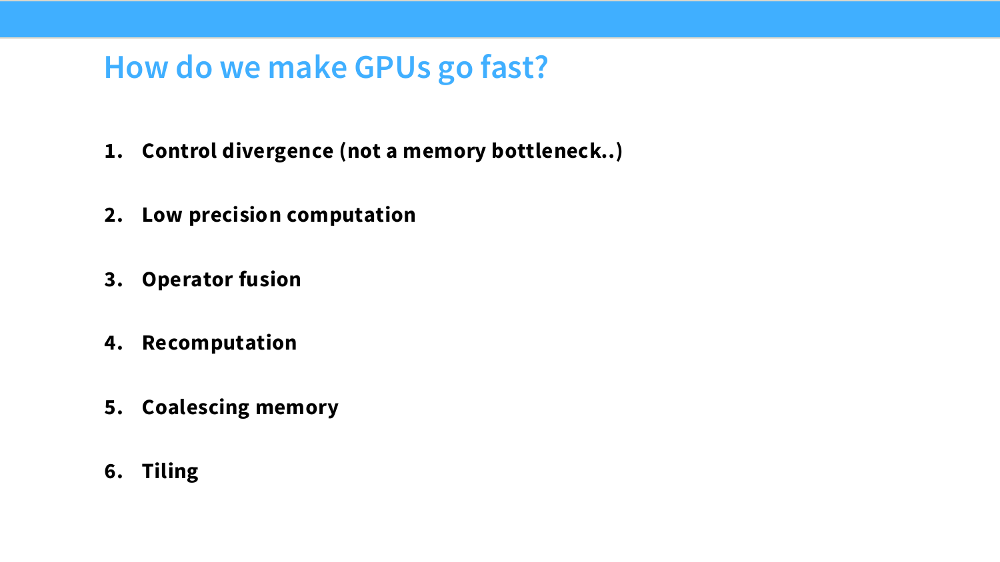

##### 1. Control Divergence：减少分支发散

Warp 使用 SIMT（Single-Instruction, Multiple-Threads） 模型执行。同一 warp 的 thread 执行相同的当前指令，但处理各自的数据。如果它们根据数据进入不同分支，GPU 通常需要分别执行各条路径，并暂时屏蔽不走当前路径的 lane，这就是 warp divergence。

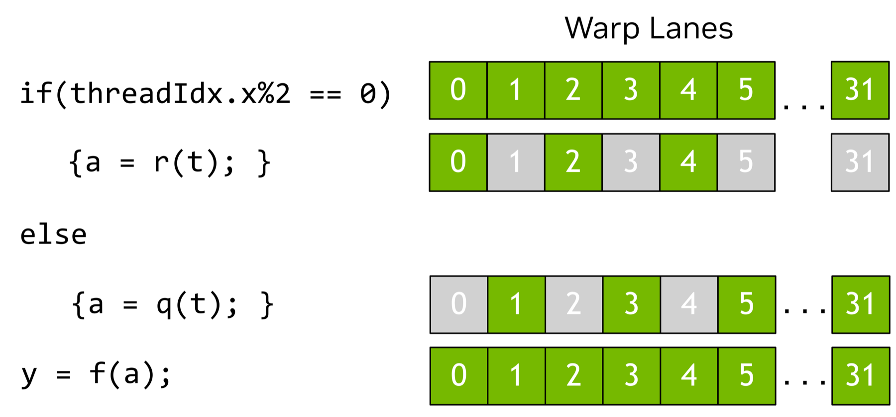

如果一个 warp 中只有部分 thread 满足 `threadIdx.x % 2 == 0`，并且编译器保留了真正的分支，执行 `if` 路径时其他 lane 会被屏蔽；执行 `else` 路径时两组 lane 再互换状态。分支仍能得到正确结果，但该 warp 需要分别执行两条路径，降低有效 instruction throughput。

绿色 lane 执行当前分支，灰色 lane 被暂时屏蔽。

---

但是有了 if 不一定会发生 warp divergence 。Predication 是一种按条件执行指令的机制，predicated instruction 是带有这种执行条件的指令。Branch predication 则是编译器使用 predicated instruction 替换短分支的优化过程。

例如，源码中的分支：

```cuda
if (condition) {
    x = a + b;
} else {
    x = a - b;
}
```

经过 branch predication 后，可以简化理解为：

```text
@condition  ADD x, a, b
@!condition SUB x, a, b
```

编译器不再生成跳转，而是依次发出 `ADD` 和 `SUB`。满足 `condition` 的 thread 执行 `ADD`，不满足的 thread 执行 `SUB`；条件不匹配时，该指令不会读取操作数或写入结果。这样可以避免 warp 进入两条独立的控制流路径。

这条指令不对该 thread 生效，但是仍然会占用调度位置。

不过，`ADD` 和 `SUB` 仍要依次发出，因此 predication 不能消除全部成本，通常只适合指令较少的短分支。是否进行这种转换由编译器根据分支内的指令数量决定。


参考：[CUDA Best Practices Guide — Branching and Divergence](https://docs.nvidia.com/cuda/cuda-c-best-practices-guide/index.html#branching-and-divergence) 与 [Branch Predication](https://docs.nvidia.com/cuda/cuda-c-best-practices-guide/index.html#branch-predication)。

##### 2. Low Precision Computation：使用低精度

FP32 每个元素占 4 bytes，FP16 占 2 bytes。使用 FP16、BF16 或 FP8 可以减少参数、activation 和中间结果在 global memory 中的存储与传输，并在运算次数不变时提高 `FLOPs/byte`。支持相应格式的 Tensor Core 还可以提供更高的矩阵运算吞吐量。

低精度会缩小数值范围或降低有效精度，可能产生溢出、下溢和舍入误差。因此训练通常使用 **mixed precision**：主要计算采用低精度，部分累加、权重副本或优化器状态保留 FP32。最终格式需要根据模型精度和目标 GPU 支持情况选择。

来源：[CS336 Lecture 5](https://github.com/stanford-cs336/spring2025-lectures/blob/main/nonexecutable/2025%20Lecture%205%20-%20GPUs.pdf) 与 [CUDA Best Practices Guide — Overall Performance Optimization Strategies](https://docs.nvidia.com/cuda/cuda-c-best-practices-guide/index.html#overall-performance-optimization-strategies)。

##### 3. Operator Fusion

**Operator Fusion 不是 CUDA Runtime 自动完成的通用优化。** CUDA 不会看到几个已经发出的 kernel launch，就自动把它们合并成一个 kernel。Fusion 通常发生在两个位置：

- 手写 CUDA 时，开发者直接把多个操作写进同一个 kernel；
- 使用 PyTorch、XLA 等系统时，TorchInductor 等上层编译器分析计算图，再生成 fused CUDA kernel。

例如下面三个 pointwise operation：

```python
a = x * 2
b = a + 1
y = relu(b)
```

它们有两种可能的执行方式。

在 PyTorch eager mode 或手写成三个 CUDA kernel 时：

```text
Kernel 1：读取 x，计算 a，写回 global memory
Kernel 2：读取 a，计算 b，写回 global memory
Kernel 3：读取 b，计算 y，写回 global memory
```

如果使用 `torch.compile` / TorchInductor，或者开发者手写 fused kernel，三个操作可以在一次 kernel 中完成：

```cuda
__global__ void fused(const float *x, float *y) {
    int i = blockIdx.x * blockDim.x + threadIdx.x;
    float value = x[i] * 2.0f;
    value = value + 1.0f;
    y[i] = fmaxf(value, 0.0f);
}
```

这个 kernel 只需要从 global memory 读取 `x[i]`，并最终写回 `y[i]`。`a[i]` 和 `b[i]` 不再作为完整中间张量存在；编译器通常可以把对应的临时值保留在 register 中。

```text
未融合：x → Kernel 1 → a → Kernel 2 → b → Kernel 3 → y
融合后：x → Fused Kernel → y
```

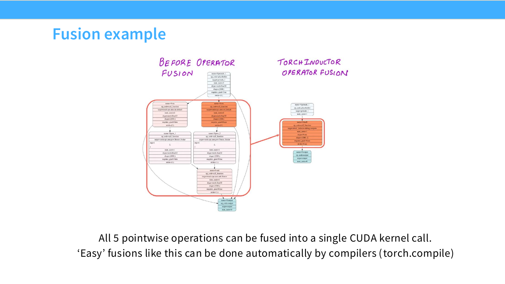

> 图左是融合前的计算图，红框中包含 5 个独立 pointwise operation；图右是 TorchInductor 根据该计算图生成的一个 fused CUDA kernel。图片展示的是上层编译器优化，不是 CUDA Runtime 自动合并 kernel。来源：[CS336 Lecture 5](https://github.com/stanford-cs336/spring2025-lectures/blob/main/nonexecutable/2025%20Lecture%205%20-%20GPUs.pdf)。

Fusion 的主要收益是减少中间张量的 global memory 读写和 kernel launch 次数，而不是减少数学运算量。它也有适用条件：操作之间必须具有编译器可以分析的依赖关系；融合后的 kernel 还可能使用更多 register 或 shared memory，降低 occupancy，严重时产生 register spilling。因此是否融合以及融合范围，需要由开发者或编译器结合实际执行情况决定。

CUDA Guide 没有把 Operator Fusion 单独列为 CUDA Runtime 功能，但 Best Practices Guide 明确建议减少 global memory 访问并提高片上存储的使用率，这解释了 Fusion 的主要性能收益。参考：[Overall Performance Optimization Strategies](https://docs.nvidia.com/cuda/cuda-c-best-practices-guide/index.html#overall-performance-optimization-strategies) 与 [Register Pressure](https://docs.nvidia.com/cuda/cuda-c-best-practices-guide/index.html#register-pressure)。

##### 4. Recomputation：用计算换内存访问

训练反向传播需要部分前向中间结果。**Recomputation** 不保存其中一部分 activation，而是在反向阶段需要时重新计算，从而减少显存占用以及写入、读取 global memory 的次数。

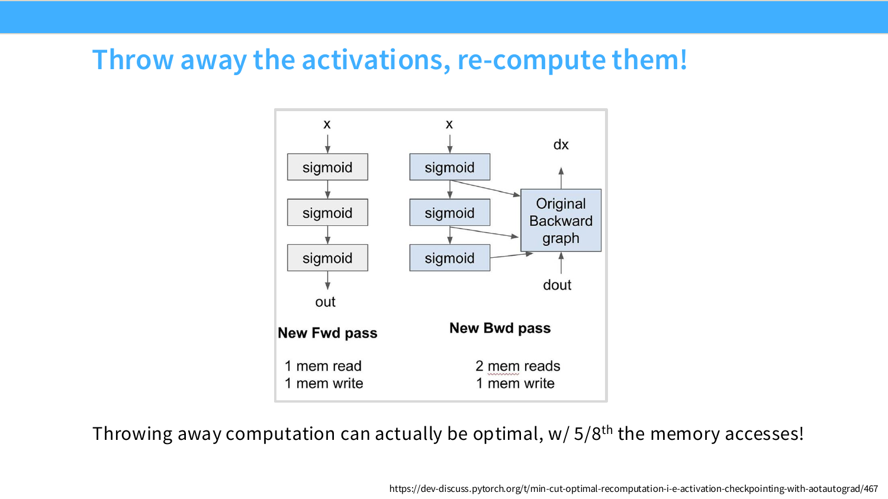

> CS336 的 sigmoid 示例把内存访问减少到原来的 `5/8`；该比例只适用于此示例。来源：[CS336 Lecture 5](https://github.com/stanford-cs336/spring2025-lectures/blob/main/nonexecutable/2025%20Lecture%205%20-%20GPUs.pdf)。

当 workload 受内存容量或带宽限制，且重新计算的成本较低时，这种方法更可能有效；如果 workload 已经 compute-bound，增加计算也可能延长执行时间。Activation checkpointing、编译器 min-cut recomputation 和部分 FlashAttention backward 都使用了这一方法。CUDA Guide 的官方总结也明确提到，在合适情况下可以通过 recomputing data 避免数据传输。

##### 5. Memory Coalescing：合并访存

Global memory 以 transaction 为单位传输数据。当同一 warp 的 thread 访问连续地址时，GPU 可以把这些请求合并成较少的 transaction；地址离散时，需要更多 transaction，即使每个 thread 实际只使用少量数据，也会降低有效带宽。

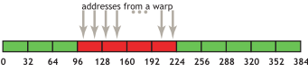

> NVIDIA 对 compute capability 6.0 及以上设备的简化说明是：warp 访问会被合并为覆盖所需地址的若干个 32-byte transaction。具体规则仍取决于目标 GPU。来源：[CUDA Best Practices Guide — Coalesced Access to Global Memory](https://docs.nvidia.com/cuda/cuda-c-best-practices-guide/index.html#coalesced-access-to-global-memory)。

连续访问还需要考虑 alignment。连续地址跨越 transaction 边界时，仍可能产生额外 transaction。因此应让相邻 thread 访问相邻元素，并让数据起始地址和 row stride 满足目标访问指令的对齐要求。

##### 6. Tiling：将数据搬到片上复用

**Tiling** 把输入数据划分为较小的 tile。一个 block 的 thread 协作把 tile 从 global memory 加载到 shared memory，再使用同一份片上数据完成多次计算。它减少重复的 DRAM 读取，并提高 arithmetic intensity。

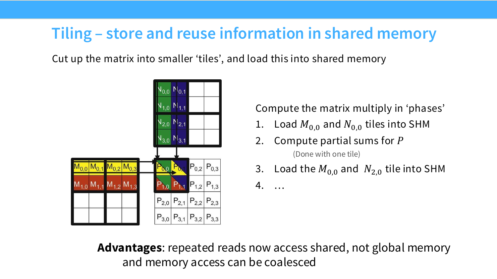

> Tile 加载可以组织为 coalesced access，后续重复读取来自 shared memory。来源：[CS336 Lecture 5](https://github.com/stanford-cs336/spring2025-lectures/blob/main/nonexecutable/2025%20Lecture%205%20-%20GPUs.pdf)。

Tile size 需要同时考虑数据复用和 SM 资源。较大的 tile 可能增加复用，但也会占用更多 shared memory 和 register，减少 resident block 和 warp，降低 occupancy。起始地址或 row stride 未对齐时，一个 tile 还可能跨越更多 memory segment。

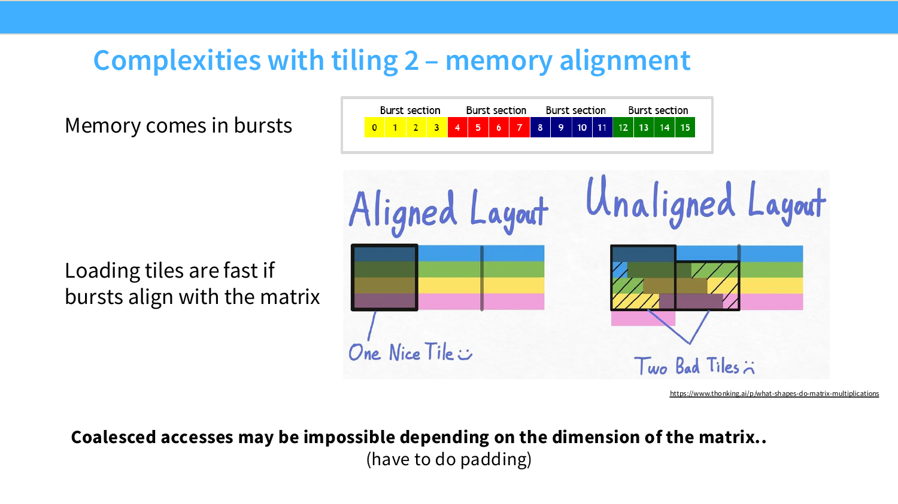

> 左侧 tile 与 burst 边界对齐，右侧未对齐，需要覆盖额外区域。具体对齐要求随数据类型、访问指令和 compute capability 变化。来源：[CS336 Lecture 5](https://github.com/stanford-cs336/spring2025-lectures/blob/main/nonexecutable/2025%20Lecture%205%20-%20GPUs.pdf)。

常见处理方法包括为矩阵行添加 padding、选择匹配 warp 和数据类型的 tile shape、满足 vectorized load 的指针对齐要求，并通过 profiler 检查 global load efficiency、shared memory 使用量和 occupancy。参考：[CUDA Best Practices Guide — Shared Memory](https://docs.nvidia.com/cuda/cuda-c-best-practices-guide/index.html#shared-memory)。

FlashAttention 综合使用了这些原则：按 tile 处理 Q、K、V，融合 softmax 等操作，并在 backward 中重新计算部分中间结果，避免完整 attention matrix 在 HBM 中反复读写。

参考：[NVIDIA CUDA C++ Best Practices Guide — Overall Performance Optimization Strategies](https://docs.nvidia.com/cuda/cuda-c-best-practices-guide/index.html#overall-performance-optimization-strategies) 与 [Stanford CS336 Spring 2025 — Lecture 5: GPUs](https://github.com/stanford-cs336/spring2025-lectures/blob/main/nonexecutable/2025%20Lecture%205%20-%20GPUs.pdf)。

## 学习资源

- [Stanford CS336 Spring 2025 — Lecture 5: GPUs](https://github.com/stanford-cs336/spring2025-lectures/blob/main/nonexecutable/2025%20Lecture%205%20-%20GPUs.pdf)
- [NVIDIA CUDA C++ Best Practices Guide](https://docs.nvidia.com/cuda/cuda-c-best-practices-guide/index.html)
- Horace He 的博客
- CUDA Mode 社群与课程
- Google TPU Book：*How to Scale Your Model*
- [NVIDIA CUDA Programming Guide — GPU Hardware Model](https://docs.nvidia.com/cuda/cuda-programming-guide/01-introduction/programming-model.html#gpu-hardware-model)
- [NVIDIA CUDA Programming Guide — Thread Blocks and Grids](https://docs.nvidia.com/cuda/cuda-programming-guide/01-introduction/programming-model.html#thread-blocks-and-grids)
- [NVIDIA CUDA Programming Guide — Warps and SIMT](https://docs.nvidia.com/cuda/cuda-programming-guide/01-introduction/programming-model.html#warps-and-simt)
- [Triton Kernel：从 CS336 Lecture 6 理解 GPU Kernel 编程](triton-kernel.md)
